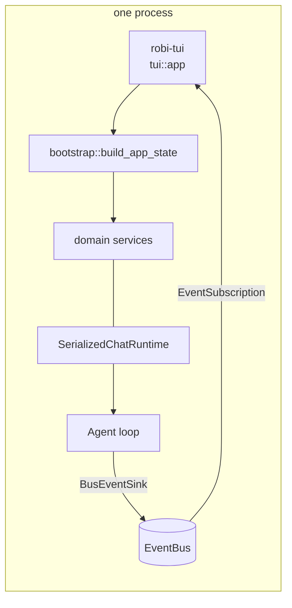

# Terminal shell

A second front end: the same agent, sessions, and tools, rendered in a terminal
instead of a webview. The `robi-api` HTTP surface stays exactly as it is; the TUI
does not call it. It links `crates/robi`, builds the same `AppState` the API
builds, and drives the same services.

This is a **surface** page, like [frontend-layout.md](frontend-layout.md), not a
milestone. It adds no capability to the loop and changes nothing in `robi-core`.
It exists because the domain layer already separates a service from a controller,
so a second front end is a rendering problem and not a rewrite.

Phases are numbered **T0–T6** rather than M-numbers, because they do not gate
any M-milestone and no M-milestone gates them.

**Scope is the chat surface only.** Review and docs are not planned here. Both
are already off in the GUI — `reviewScreen` and `docsViewer` in
`src/app/surfaces.ts`, shipped as S2 and S5 in [streamlining.md](../../streamlining.md)
— so a terminal copy would resurrect a surface the product has decided against.
`git diff` and the user's own editor are the review path; the docs screen is not
replaced at all. The backend routes stay served, as they do for the web shell.

## What this page does not cover

| Topic | Where it belongs |
|---|---|
| The turn lifecycle, approvals, tool execution order | [agent-loop.md](../core/agent-loop.md) |
| The CloudEvents envelope, the bus, and the SSE route | [events-sse.md](events-sse.md) |
| The per-session actor and `ChatRuntime` | [chat-runtime.md](chat-runtime.md) |
| Store, schema, migrations | [persistence.md](../persistence/persistence.md) |
| What a tool card shows, and when approval pauses | [chat-ui.md](chat-ui.md) — the TUI reaches parity with it, and does not restate it |
| Theme tokens | [visual-style.md](visual-style.md). `tui/theme.rs` is its terminal peer |
| Crate layout and the process model | `docs/src/design/core/architecture.md`, still unwritten |

## Problem

The agent is reachable only through a Tauri window. That costs a webview, a
window manager, and a display for work that is mostly text: a transcript, a diff,
a list of sessions. A terminal front end reaches the same sessions from a shell,
over SSH, and inside an editor pane.

The naive implementations are both wrong:

- **A TUI that speaks HTTP.** It re-introduces the whole wire layer between two
  processes on one machine, replaces `robi_core::message::Message` with the
  `ChatMessage` DTO, and stops working when the API is not running.
- **A TUI that re-implements the domain.** A copy of the session lifecycle in a
  second binary, drifting from the first.

The reason neither is necessary: `bootstrap::build_app_state` is HTTP-free.
`bootstrap::router` is the optional half, and only `robi-api` and `src-tauri`
call it.

## Decision

**A module in `crates/robi`, a binary in the same package, behind a cargo
feature. In-process. Elm-shaped. One event subscription. Refetch, never append.**



`AppState` is the whole contract. Its fields — `workspace_service`,
`chat_session_service`, `chat_message_service`, `settings_service`, `event_bus`,
`file_changes`, `mcp`, `originals`, `image_source` — are the same handles
the Axum handlers take. A controller is `State<AppState>` plus `Path` plus `Json`;
the TUI is an `Arc<AppState>` plus a keymap.

One of those it never reads: `docs_edits` (no docs surface; see *Deliberately
not planned*). It stays in `AppState` because `build_app_state` is shared and
the HTTP routes still serve it.

### Where it lives

A module, not a crate.

```text
crates/robi/
  src/tui/
    mod.rs           # run(): terminal lifecycle, the feature gate
    app.rs           # App, Msg, update()
    action.rs        # Action: the effect update() asks for
    effects.rs       # Action -> service call, on the runtime
    keys.rs          # (Mode, KeyEvent) -> Msg
    command.rs       # the built-in `/` commands, `/open` today
    lifecycle.rs     # init/restore and the panic hook
    theme.rs         # Style constants; the peer of visual-style.md
    persist.rs       # ~/.robi/tui.json
    state/           # transcript, sessions, workspaces, composer,
                     # approval, prompt, confirm, status, detail
    view/            # header, transcript, detail, composer, prompt,
                     # strip, sessions, workspaces
  src/bin/robi-tui.rs
```

`Cargo.toml` gains a feature and a binary:

```toml
[features]
tui = ["dep:ratatui"]

[dependencies]
ratatui = { workspace = true, optional = true }

[[bin]]
name = "robi-tui"
path = "src/bin/robi-tui.rs"
required-features = ["tui"]
```

`ratatui` and `crossterm` are declared once in `[workspace.dependencies]`, per
the existing rule that versions cannot drift. Take `crossterm` from
`ratatui::crossterm`, not as a second direct dependency: ratatui 0.30 pins its
own and a second version in the tree fails to typecheck on `KeyEvent`.

### Why not a crate

The rule in `AGENTS.md` is to add a module and split only for one of four
reasons. Only the second applies — a heavy, optional dependency — and a cargo
feature isolates it just as well without moving code:

- `robi-api` and `src-tauri` do not compile ratatui, because they do not enable
  `tui`.
- `cargo tree -p robi-core` is unchanged. That is the audit that matters.
- No item becomes `pub` only so a second crate can reach it. `tui` is `pub` so
  the binary can call `tui::run`, which is a real entry point.

Promote to `crates/robi-tui` when one of these is true, and not before: the M8
headless `robi-cli` needs the same module (the split `AGENTS.md` already
anticipates, "a new binary with no code moved"); the TUI's tests need to run
without the web stack; or a measured build cost appears. The promotion is a move
plus a manifest, because the module is already shaped like one.

Rejected instead of a new crate now: `robi-index` and `robi-lsp` were the
splits with a real dependency argument, and both are deleted with M7. A crate
for one binary that depends on `crates/robi` in both directions is the "split
that happened too early" anti-signal.

### Process model

In-process, no listener, no port. `robi-tui` shares `ROBI_DATABASE_URL` with
`robi-api` and `src-tauri`, so all three see the same sessions.

### The workspace argument

```
robi-tui [PATH]
```

`PATH` is the workspace the process opens, and it is **the** answer to which
sessions the reader starts with: the remembered workspace from `tui.json` is not
a fallback. Without an argument the path is the working directory, so
`cd ~/code/pocket && robi-tui` and `robi-tui ~/code/pocket` are the same session
list. The argument is canonicalised before it is compared, because the store keeps
a canonical root and one directory has many spellings.

A path with no workspace row behind it is a **prompt**, not a silent fallback to
some other workspace: `No workspace at this path.` with the path under it, and two
answers — `y` creates the workspace there (`open_workspace`, the same call the
`POST /workspaces` route makes), `n` opens the switcher so an existing workspace
can be chosen. Opening anything else on the reader's behalf would show them a
session list that is not the one they asked about.

**The switcher opens over the question, not instead of it.** `n` pushes the
workspaces overlay on the mode stack above `workspace-missing`, so the question
stays the page: the panel draws over it, dimmed, without its `y`/`n` line because
the panel owns the keyboard. `Esc` closes the panel and returns to the question;
choosing a row — or creating one from the panel's create screen — pops both. The
first cut left the question first and opened the overlay in the chat, so
`Esc`-ing the overlay landed the reader in a chat frame with no workspace, no
session, and no way to answer.

One path argument, not a flag set: a second argument is a mistake worth naming on
stderr before the alternate screen, because a terminal that ignores an argument
opens the wrong chat. It is checked before the terminal is taken raw.

`SerializedChatRuntime` is per-process and in memory: `running_session_ids` is
not persisted, and an actor belongs to the process that started it. Two front
ends on one database therefore mean two runtimes, which can drive two turns on
one session.

Ownership across processes is a per-session lease, not a database lock: the TUI
takes `Open` on the session it displays and `Turn` through the runtime, so a
second process may read that session and may not submit to it. The lease, the
`redb` handle invariant it depends on, and what parallel processes still share
are in [parallel-front-ends.md](parallel-front-ends.md). Until that module
lands, one front end at a time is the rule; see *Failure modes*.

### The loop

`self.view(&App)` is a pure function of state. `update()` is a pure function
`(State, Msg) -> (State, Vec<Action>)`. Effects run on the runtime and report
back as a `Msg`. The four sources feed one `select!`:

```rust
loop {
    tokio::select! {
        Some(msg) = input.recv()          => app.update(msg),
        Some(env) = events.recv()         => app.update(Msg::Agent(env)),
        _ = tick.tick()                   => app.update(Msg::Tick),
        Some(done) = results.recv()       => app.update(Msg::Done(done)),
    }
    for action in app.take_actions() { effects::run(&state, action, &results); }
    terminal.draw(|frame| app.view(frame))?;
    if app.should_quit() { break; }
}
```

`ratatui::crossterm::event::read` blocks. It cannot run on the runtime: it would
hold a worker for as long as the user takes to press a key. A dedicated
`std::thread` reads events and sends them into a `bounded(64)` mpsc. A resize
event arrives on the same channel.

### Interfaces

```rust
pub fn run(state: AppState, options: Options) -> std::io::Result<()>;

pub struct App { /* AppState, view state, mode stack, actions */ }

pub enum Msg {
    Key(KeyEvent),
    Agent(EventEnvelope),      // what the bus carries
    Tick,                      // 250 ms: spinners, elapsed, catch-up
    Done(ActionOutcome),       // one effect finished
    Resize,
}

pub enum Action {
    Submit { session: SessionId, text: String, files: Vec<FileAttachment> },
    StartSession { workspace: WorkspaceId, text: String, files: Vec<FileAttachment> },
    Decide { session: SessionId, call: ToolCallId, decision: Decision },
    Stop(SessionId),
    Compact(SessionId),
    Reload(SessionId),               // refetch the transcript
    LoadMessage { session: SessionId, message: MessageId },
    Rename { session: SessionId, title: String },
    Delete(SessionId),
    Create,
    LoadSettings { generation: u64 },
    SaveSetting { key: &'static str, value: Option<String> },  // from the surface's table
    LoadMcpConfig { workspace: WorkspaceId },
    OpenFile { path: String, line: Option<u32> },
}

impl App {
    pub fn update(&mut self, msg: Msg);
    pub fn take_actions(&mut self) -> Vec<Action>;
    pub fn view(&self, frame: &mut Frame);
    pub fn should_quit(&self) -> bool;
}
```

Every `Action` names a service call. `effects::run` is the only module that
touches `AppState`, and it is the only place a `.await` exists:

| `Action` | Call |
|---|---|
| `Submit` | `chat_message_service.submit_instruction` |
| `Decide` | `chat_message_service.decide_tool_call` |
| `Stop` / `Compact` | `chat_message_service.stop` / `.compact` |
| `Reload` | `chat_message_service.list_messages` |
| `LoadMessage` | `chat_message_service.get_message` |
| `RenameSession` / `DeleteSession` / `StartSession` | `chat_session_service.*`; `StartSession` creates the row and submits the first message in one effect, and a delete stops the turn first, as the route does |
| `LoadWorkspaces` / `CreateWorkspace` / `DeleteWorkspace` | `workspace_service.*`; a delete closes that workspace's MCP connections |
| `LoadSessions` | `list_chat_sessions` plus `running_session_ids` |
| `LoadMcp` / `FocusMcp` | `mcp.status` / `mcp.focus`, the peer of `GET`/`POST /workspaces/{id}/mcp` |
| `Probe` | `list_workspaces` inside a three-second timeout: the strip's health mark |
| `CompletePath` | the tools' resolver, then one `read_dir`, directories only |
| `LoadSettings` | `settings_service.get_many`, with each secret reduced to `configured` |
| `SaveSetting` | `settings_service.set` / `.remove`; the secret flag is re-read from `known_setting`, never carried on the action |
| `LoadMcpConfig` | `workspace_service.get_workspace`, then `McpHub::config_files` on `blocking::call`; the file text is dropped |
| `OpenFile` | the lifted file opener: configured `file_open_command` only |

`SubmitOutcome::AwaitingApproval` is unreachable from the real runtime — nothing
constructs it outside `web_api`'s mapping, which turns it into a `Conflict` — so
the terminal keeps the arm as a defensive no-op. A paused turn is answered on the
selected card, not by a modal.

### State ownership

The transcript is not built from deltas. `message_delta` moves the phase to
**Responding** and no more; `message_added`, `message_updated`, and
`tool_call_updated` mean refetch that row. This is the rule the web shell already
follows, and in a TUI it is load-bearing rather than tidy: the bus drops a queued
`message_delta` when a subscriber falls behind (`make_room` in `domain/events`),
so a transcript rendered from deltas silently loses tokens.

Two refetches of one URL can be in flight together, so each `Action` carries the
generation it was issued at, and a `Done` whose generation is stale is dropped.
The GUI solves the same problem with an epoch in `useAgentEvents`; the mechanism
is the same and the reason is not obvious, so it is written here.

State lives in one of three places, and nothing is duplicated between them:

| Where | Holds | Survives |
|---|---|---|
| `AppState` services | every domain fact | restart |
| `App` | the mode stack, scroll offset, composer buffer, expansion flags | the process |
| `~/.robi/tui.json` | workspace, open session, expansion flags, layout | restart |

## Parity map

Every GUI surface that is on today, its TUI form, and the phase that lands it.
The two surfaces the GUI has switched off — `reviewScreen` and `docsViewer` in
`src/app/surfaces.ts` — are out of scope here as well, so a TUI flag is not
needed for them; see *Deliberately not planned*. The index status is gone with
the index itself, so nothing in the frame carries an index line.

| GUI surface | TUI form | Phase |
|---|---|---|
| `Transcript` + `AssistantMarkdown` | scrollable buffer, turn-grouped, styled spans; every message railed in the ink of the mode that produced its turn | T1, T4 |
| `Composer` textarea, drafts per session | text area, draft kept per session in `App`, in memory | T1 |
| Send / Stop button | `Enter` / `Esc` (`Ctrl-C` also stops) | T1, T2 |
| `ActivityLine`, streaming | status strip above the composer: `Thinking for 4s` and animated dots, at the end of the transcript | T1 |
| Turn footer `Worked for …` | one gray row under each closed turn, from the turn's first and last message ids | T3 |
| `ToolCallCard` and its six variants | one background band per call, no border, muted heading and `$`; the per-variant bodies, and `Enter` on the selected card opens the whole body in a scrollable detail view | T2 |
| Approval buttons on a card | **in-transcript**: `a` / `r` / `A` act on the selected card, with the reason as a one-line prompt | T2 |
| `RecentsMenu` (filter, rename, delete) | sessions overlay: filter-as-you-type, running spinner, waiting dot, `Ctrl-R` rename, `Ctrl-D` delete behind a confirm; `New session…` is the first row | T3 |
| `WorkspaceSwitcher` | workspace overlay: the eight most recent, then `Manage workspaces…` and `New workspace…` | T3 |
| `WorkspacesPage` | `manage` view: every workspace with its own filter and remove, `Ctrl-N` to create; the create screen's typed path with directory completion | T3 |
| `robi-tui` workspace argument | `robi-tui [PATH]`, the working directory by default; a path with no workspace is a prompt, not a fallback | T3 |
| `ErrorNotices`, `ApiStatus` | status strip above the composer: `! <error>`, `! health: …`, `sending…`, `stopping…` | T3 |
| MCP marks in the tray | one word at the header's right edge: `MCP Online` / `MCP Failed` (per-server detail later) | T3 |
| New chat | `Ctrl-N`: the landing page, and no session until the first message | T3 |
| `EmptyGreeting` + welcome composer | the landing page: the greeting centred in green, the composer under it | T3 |
| Mode `ChoiceMenu` | `Ctrl-T` cycles, `/mode` names one; the word and the rail colour are the state | T4 |
| `ModelEffortMenu` | `Ctrl-M`: one overlay with a model group and an effort group, `Use default` in each | T4 |
| `SkillMenu` | `@` completion over the composer, with `· manual` and scope; accepting leaves `@id ` | T4 |
| `ContextMeter` | the token count at the right edge of the composer's facts row | T4 |
| Compact | `Ctrl-L` or `/compact`, behind a confirmation; divider row on `transcript_compacted` | T4 |
| Composer command surface | `/models`, `/sessions`, `/workspaces`, `/new`, `/rename`, `/mode`, `/compact`, `/help` — each a keybinding's twin | T4 |
| Nothing (the design promised `?`) | `?` from the transcript, or `/help`: a page of every key and command | T4 |
| General settings | settings surface, section rail | T4, T5 | **Done** |
| Model provider settings | settings surface, secrets masked | T5 | **Done** |
| Permissions settings | settings surface, two toggles | T5 | **Done** |
| Sandbox settings | settings surface, six fields and two choices | T5 | **Done** |
| MCP settings | settings surface: servers, the two config paths, trust, logs | T5 | **Done** |
| Audit log | settings surface: a paged service-call table, `Enter` expands a body | T5 | **Done** |
| `Composer` attachments | path attachments; images by path | T6 |
| `MermaidDiagram` | source fence | T6 |
| `OpenedFile`, `openWorkspaceFile` | `/open <file>`, configured program only | T6 |

## Phases

### T0 — Skeleton and the pump

**Goal** — a terminal app that renders a real transcript and nothing else.

- `tui/mod.rs::run` owns the terminal: `ratatui::init`, a panic hook that
  restores before the message prints, `ratatui::restore` on every exit path.
- `bootstrap::build_app_state` for state. No `logs::init()` as-is: a debug build
  writes tracing to **stderr**, which corrupts the frame. Log to the file layer
  only, or redirect the stderr layer to `~/.robi/logs/tui.log`.
- The four-source `select!`, the input thread, `Msg`, `Action`, `effects::run`.
- `state/transcript.rs`: turn grouping, follow-the-bottom with a scroll lock that
  yields on `PageUp` and re-arms at the bottom.
- `theme.rs` from `visual-style.md`'s tokens, so the two front ends stay one
  product.
- A `TestBackend` harness: render `App::view` into a buffer and assert on a
  string. This is the TUI's test strategy from the first commit.
- Every message and every tool call is a **band**: a raised surface with a
  one-cell rail on its left edge, one cell of horizontal padding, and one row of
  padding above and below. The rail is the only vertical rule in the transcript
  — there is no drawn border, so the band contrast plus the rail is the whole
  affordance. The rail's colour is what identifies the block. The rail cell
  itself is `\u{258d}` (left three-eighths block) rather than the hairline `│`:
  one box-drawing line is nearly invisible at a normal cell size, and the rail is
  what a reader scans for. A block glyph costs the same one cell, so the wrap
  width, the band width, and the scroll arithmetic are unchanged, and the colour
  is still the whole signal — the glyph only decides how much ink it carries.

  | Block | Band | Rail |
  |---|---|---|
  | User message | `--bg-user` | `--accent` (blue) |
  | Tool call | `--code-bg` | `--ink-faint` (gray) |
  | Composer | `--bg-surface` | `--accent` (blue) |

  A user message is therefore a full-width band with the text left-aligned, not
  a right-aligned capsule. The blue is the transcript's one piece of state:
  the user's own turn. Machinery is gray. **The composer wears the blue rail
  too**, because it is the user's turn before it is sent — the same column, the
  same accent, so the two read as one thing at either end of the transcript —
  and one row of canvas separates it from the transcript above, so the last row
  of prose never reads as part of the band.
- A tool call's card reads, in order:

  ```text
   │
   │ # shell
   │
   │ $ cd /pocket && php artisan migrate --no-interaction
   │
   │ INFO  Running migrations.
   │
  ```

  The heading is `# ` then the call's `description` argument or the tool's name,
  in `--ink-muted`. A blank row separates it from the contents; the subject line
  is `$ command`, with the `$` muted too and the command in the card's ink; a
  second blank row precedes the output. **The output is not indented past `#` or
  `$`** — all three start in the same column, so the card reads as one block
  rather than a nested list.
  At most `MAX_TOOL_OUTPUT_LINES` (6) lines of the result show, the cut counted
  as `… (+N more lines)`. One blank row also separates every *block*, and that
  one comes from `build_rows` alone, so inter-block spacing is uniform no matter
  what a block does inside its own band. T2 replaces the output per variant and
  adds expansion.

**Exit** — `cargo run -p robi --features tui --bin robi-tui` shows the most recent
session of the active workspace, scrolls, and quits cleanly. One snapshot test
renders a two-message transcript.

### T1 — Send, stream, stop

**Goal** — the M2 exit criteria, in a terminal.

- Composer: `ratatui-textarea` on a `--bg-surface` band wearing the same blue
  rail as a user message, two cells of horizontal padding inside the field, and
  one blank row of canvas above the band. `Enter` sends, `Ctrl-J` inserts a
  newline (`Alt-Enter` too, where a terminal reports it as one key — T2 binds
  `Esc`, so the `Esc`, `Enter` ambiguity is why `Ctrl-J` is the documented one).
  Draft per session, **in memory**, keyed the way `composerDrafts.ts` keys it. A
  failed send restores the buffer and attachments.
- `message_delta` → phase; `message_added` / `message_updated` /
  `tool_call_updated` → `LoadMessage` for **that row**; `turn_finished` → reload,
  then idle. Deltas never write text.
- `Ctrl-C` sends `Stop` (T2 adds `Esc` as the same interrupt); a cancelled turn
  leaves a resolvable transcript, so the view reloads rather than truncating.
- Phase, elapsed, and a caret at the end of streaming text. The phase is the
  status strip above the composer — `Thinking for 4s` with the webview's
  `ThinkingDots` — not a header segment; T3 moved it there with every other
  status.
- Assistant prose rendered as markdown — headings, lists, tables, fenced code,
  links, quotes, GFM alerts — through `tui-markdown`, styled from `theme.rs`.
- Scrolling: `↑`/`↓` (when the composer is empty or the transcript has focus),
  `PageUp`/`PageDown`, `Ctrl-U`/`Ctrl-D`, `Home`/`End`, and the mouse wheel. The
  wheel is enabled next to raw mode and turned off before the alternate screen
  goes.
- The status strip's progress widget: eight cells with one moving head, at the
  right edge of the strip above the composer, shown only while a turn runs or a
  stop is in flight. T3 moved it there with the rest of the status.
- The 2-second catch-up: while a turn is busy and no frame for the open session
  has arrived, reload. Elapsed time and the quiet stretch are counted in 250 ms
  ticks, not wall clock, so `update` stays a pure function.
- A send while a turn is running **interrupts and queues**, as it does in the
  GUI. T1 refused it, on the theory that `Enter` mid-stream more often means
  "newline" in a terminal; T2 reversed that, because refusing made the terminal
  disagree with the product in a way the user had to discover. `ChatRuntime::submit`
  already replaces a pending instruction, so nothing had to be built.

**Exit** — send a message, watch it stream, stop it, quit, restart, find the
session intact. The turn ran through `SerializedChatRuntime` and the real
provider.

### T2 — Approval and tool cards

**Goal** — the loop's pause invariant, made visible and unmissable.

- **A pause takes the keyboard, off an empty composer.** When a call starts
  waiting, the card is selected and focus moves to the transcript, so the first
  `a` answers the question instead of landing in a message. It only does that when
  the composer is **empty**: a draft is the reader's work in progress, and an
  arriving pause is no reason to take the caret out of it. With a draft the card is
  still selected and its rail still says it needs an answer, and the keyboard is
  one `Tab` away. A detail view or a reason field the reader opened is never
  interrupted, and a second call in the same batch follows the same rule.
- **A waiting card wears an orange rail and moving dots.** The rail column every
  card row shares is `--attention` (`#e39a3c`, the same value as `--mode-plan`,
  under its own name) while the call is `pending`, `not_started`, **and the turn
  is idle**, and the quiet `--ink-faint` otherwise. The idle half is the peer of
  `needsDecision` in `toolCallView.ts`, and without it the rail was wrong for
  every call between the model's response and its own execution: that is exactly
  the `pending` + `not_started` state, because that is how a model's request
  arrives. A shell command that runs without asking wore the rail and the label
  of a question for the whole of that window.
  The label row reads **waiting for approval** followed by one, two, or three
  dots, advancing **once a second** — four 250 ms ticks a step, so a full cycle is
  three seconds. A quarter-second flicker reads as machinery waiting on itself; a
  slow, even beat reads as a prompt. That is what makes a pause visible when it is
  *not* the selected card: the selection only ever marks one block, and a pause can
  be anywhere in the transcript.
  A card in the running window says **running…** instead, and its heading reads
  `shell · running` rather than `shell · not started`: the turn is what the reader
  is watching, and a call that is next in line is not a call that has stalled.
- **The dots are painted, not stored.** A row whose text changed every second would
  rebuild and rewrap the transcript once a second, and the scroll offset would
  twitch. The dots play into the band's own padding instead: the view rebuilds the
  label from `WAITING_LABEL` plus a fixed **three-cell** dot field, and `band_line`
  pads the result to the content width. Fixed field, not appended dots, for one
  reason: the first dot has to stay in its column, so growing to two and three
  extends rightwards instead of shifting what is already on screen. Editing the
  padded row text in place — the first attempt — made the row `width + dots` cells
  long, and the band's fill saturated to nothing. The clock is a tick
  counter on `App`, never the wall clock, so `update` stays a pure function of the
  messages it has seen and `view` a pure function of the state.
- **The activity line's dots sit in the same fixed field.** `Thinking for 4s .`
  keeps its column as the marker advances, for the same reason as the waiting
  card's: a fixed three-cell field after the text, never appended dots. The line
  used to be a right-aligned header segment; T3 moved it to the strip above the
  composer, where the webview puts it, and the header's right edge now carries the
  one-word MCP summary instead.
- **A selected block is lighter than the rest.** Every row of it is painted on
  `--surface-hover` and filled to the frame's content width, so a message, a
  paragraph, and a card all read the same way. This replaced a `▸` on a card's
  heading, which was too quiet and left prose with no mark at all. The foreground
  is kept — a heading stays muted, a diff stays green and red — because only the
  background is saying "this is the one the keys act on".
- **The arrows select; a key acts on the selection.** With the transcript
  focused, `↑`/`↓` (and `j`/`k`) move a selection over the transcript's blocks. A
  block is a user message, an assistant prose run, or **one tool call** — so every
  card, pending or finished, is addressable. The selection is a `BlockRef`
  (`message`, optional `call`), keyed on the message id rather than a row offset,
  so it survives a rewrap, a reload, and a row arriving underneath it.
- **There is no modal.** T2 shipped one because the GUI can disable a composer and
  a terminal cannot. Selecting in the transcript replaces it: the pause is state
  (`Approval`), not a mode, and nothing covers the frame. What replaces the
  modal's *visibility* is that a pause takes the selection to the waiting card —
  without that, a pause arriving mid-transcript would be invisible.
- **The footer hint is contextual**, because the actions are: a selected pending
  card offers `a approve · r reject · A approve all · Enter open · Ctrl-C decline`,
  a finished card offers `Enter open`, and nothing selected shows the composer's
  keys. A hint that offered approval on a card that already ran would be a lie the
  user has to test.
- **`Enter` opens a card in a detail view**: the whole body, uncapped (the band
  stops at forty lines and an edit at twenty-four), its own scroll, `Esc` back
  with the selection where it was. On a prose block it does nothing — a message
  has no second view.
- **In-card expansion is dormant.** The detail view replaced it: growing the band
  in place could push the turn it belonged to off the screen. `Render.expanded`,
  the `tui.json` key, the expanded branch and the expanded shell/MCP original
  fetch stay in the code behind `#[allow(dead_code)]`, so re-enabling is deleting
  a marker. Nothing toggles them, so the set stays empty and no original is
  fetched for them.
- **A send interrupts and rejects, like the webview.** There is no busy refusal
  and there is no pause protection: `ChatRuntime::submit` replaces a queued
  instruction (`interrupt_if_running`), and `Agent::user_input` rejects a paused
  turn's waiting calls with "the user sent a new message" before appending. The
  terminal now inherits both rather than disagreeing with them, and clears its own
  pause state as soon as the send is taken.
- Card variants, matching `ToolCallCard`: edit diff, shell, MCP, retrieve,
  delegate steps, generic. An edit shows the four changed lines it is asking
  about, or the result's patch once it has run. A shell or MCP card shows six
  lines; the detail view is what shows the rest, so an opened card no longer
  fetches anything by itself — opening the view does, through
  `OriginalStore::lookup`, the same body `getToolOriginal` serves the GUI.
- **A retrieve card shows no output at all.** Its body is a page of *another*
  call's log, so the transcript is the wrong place for it: the card keeps the
  window — `# retrieve` over `> 0193a1b2 stdout`, the id and the stream — and one
  muted `… Enter opens the output`. The page is built only by
  `tool_card::full_body`, the uncapped form the detail view calls, so the two
  cannot drift apart, and the transcript pays nothing for a log it would have had
  to truncate anyway.
- `awaiting_approval` while the window is unfocused → terminal bell, and the
  title becomes **robi — approval needed** either way. No OS notification; that is
  Tauri-only. Focus reporting is optional (DECSET 1004), so a terminal that does
  not implement it simply never rings.
- **A pause is not the end of a turn.** The loop emits `awaiting_approval` and
  then `turn_finished` with outcome `paused`, because the actor really does exit.
  That frame must not close the pause: the transcript is parked, not finished.
- **A pause is entered from the transcript as well as from the frame.** Reopening
  a session paused by an earlier run — a restart, or a switch back to it — selects
  the waiting card the same way a live pause does, from the loaded transcript.
  Without that, a pause on screen had no way in from the keyboard, and the only
  remaining answer was "send a message to clear it". The list is `pending` approval
  with `not_started` execution, which is the same predicate the loop uses, so a
  call that ran without asking is never a prompt. Idle only: after a decision the
  phase is `Thinking`, so a reload still in flight cannot re-list a settled call.

**Exit** — a turn that needs approval selects its waiting card, `a` or `r` on it
decides, and the turn resumes; a refusal reaches the model as a structured
rejection. That is `Event::AwaitingApproval` →
`ChatMessageService::decide_tool_call` → `Event::ToolCallUpdated` in
[agent-loop.md](../core/agent-loop.md).

### T3 — Sessions and workspaces

**Goal** — you can get to any session without the mouse. **Done.**

- Sessions overlay on `Ctrl-S`: a filter field with the keyboard, arrows over the
  rows, `Enter` to open, `Ctrl-R` to rename, `Ctrl-D` or `Del` to delete behind a
  one-line confirmation. Each row carries one cell of state: a braille spinner
  while the actor runs, an `--accent` dot while the turn waits on approval.
  **`New session…` is the first row**, so a fresh chat is the first thing under
  the cursor when nothing is open, and `Enter` on it creates one. `Enter` on the
  session that is already open still issues a read: "open" always means "show me
  this transcript".
- Workspace overlay on `Ctrl-W`: the eight most recently **selected** workspaces
  followed by `Manage workspaces…` and `New workspace…`. The create screen is a
  typed path with directory completion on `Tab`. The GUI's folder dialog has no
  terminal equivalent, so the path is resolved with the tools' own resolver
  (`~`, relative, absolute) and handed to `open_workspace`, which still refuses a
  path that is not a directory.
- **Managing workspaces is a view** (`mode` `manage`), not a screen of the
  switcher: every workspace, filtered, with remove behind the confirmation, and
  `Ctrl-N` to create. A menu is a thing you leave in one keystroke; reading paths
  and deleting rows is a place you stay.
- **Panels erase what is under them.** A `Block` paints a background colour but
  leaves the characters, so an empty transcript's centred sentence read through
  the switcher. Every panel clears its rectangle first, and every list row is
  painted with its background applied *after* the text style, so a selected row
  is one unbroken band — including the two action rows, which the theme helpers
  were silently cancelling to canvas.
- `robi-tui [PATH]` — the process opens the workspace at `PATH`, or the working
  directory. A path with no workspace is a prompt (`y` create, `n` switcher over
  the question), not a fallback to whichever workspace an earlier run left open;
  see *The workspace argument*.
- **`Ctrl-N` opens the landing page and creates nothing.** A workspace with no
  session open shows the webview's welcome: the time-of-day greeting
  (`Good morning` / `afternoon` / `evening`, in `--mode-ask` green) centred above
  the composer. The session row is created when the first message is sent —
  `Action::StartSession` creates and submits in one step — so opening a workspace,
  reading the list, and leaving never leaves an empty chat behind. A failed first
  send keeps the row and puts the text back in the field.
- `Ctrl-R` renames the open one.
- A status strip above the composer: `! <app error>`, `! health: <reason>` from a
  `list_workspaces` probe every five seconds, and the turn's own activity. The
  HTTP health route is not called: the terminal does not speak HTTP, and a store
  that answers is the fact the route is standing in for.
- The frame keeps one blank row above the header and one below the hint
  (`view::FRAME_PAD`), and one between the composer's underside and the hint.
  Chrome that touches the terminal's edge reads as cut off rather than placed;
  the transcript pays for those rows out of `body_height`.
- One faint row of `\u{2500}` under the header, exactly the content width: the
  frame draws no other border, so a single line is enough to say the bar above is
  chrome and the page below is the conversation.
- A one-word MCP summary at the header's right edge — `MCP Online`, `MCP Failed`,
  `MCP Starting`, `MCP Offline` — because a terminal tray would cost cells and
  say less; a status surface can carry the per-server detail later.
- A gray `Worked for 2m 5s` under every closed turn, the webview's turn footer,
  computed from the turn's first and last message ids.
- `robi.session.v1.*` frames refetch the list and never the transcript;
  `robi.mcp.v1.status` refetches the marks for the active workspace.
- Choosing a workspace also focuses its MCP servers once, the peer of
  `focusOpenWorkspace` in `workspaceStore.ts`, so the marks have something to
  report without waiting for a turn.

**Exit** — create a workspace by path from inside the TUI, create and rename a
session, delete one, and see a second one marked running while a turn is in
flight.

### T4 — Modes, model, effort, skills, context

**Goal** — everything the composer carries, minus attachments. **Done.**

- **The facts row is the composer band's last row**: `Agent · GLM-5.3 ·
  OpenCode Go · High` on the left, the token meter on the right. It is the row
  `view/composer.rs` already reserved as the band's bottom padding, so the band does
  not grow and T3's layout is untouched. See *The composer band*.
- **The rail is the mode.** Agent `--accent`, ask `--mode-ask`, plan `--mode-plan`,
  on the user band and the composer — not on the assistant's reply, which is the
  model's output rather than a statement of mode. The colour follows the mode a
  message was **submitted** under, so a plan-mode message keeps its orange after
  `Ctrl-T`; see *The mode on the rail*.
- `Ctrl-T` cycles ask → plan → agent, writing `mode` on the session row or the draft
  when there is no row yet.
- `Ctrl-M` opens one picker over `pickable_models` — `tool_capable()` filtered by the
  provider-enabled settings, the same function `/api/v1/models` calls. That helper
  is lifted, not copied; see *Gaps*. **Effort comes first**: three fixed rows should
  not sit below thirty models.
- **Two sigils.** `@` completes this workspace's skills (`· manual` and scope) and
  leaves `@id `; `/` completes commands, and each one is a keybinding's twin. See
  *The two sigils* and *Composer commands*.
- A leading `@` or `/` that names nothing is **refused without being sent**, and the
  field keeps its text.
- The meter is `contextUsage.ts`'s estimate, ported; `Ctrl-L` compacts behind a
  confirmation, and the divider appears on `transcript_compacted`.
- `?` from the transcript, or `/help`: a page of every key and command, sectioned,
  with its own scroll. The key was documented since T0 and never mapped.

**Exit** — cycle the mode mid-session and watch the band and the new turn's rail
change colour while the earlier turns keep theirs; pick another model and put it
back with `Use default`; type `@` and accept a skill; send, press `Ctrl-L`, answer
`y`, and see the divider and a smaller meter; type `/nope` and get a refusal with
the text still in the field.

### T5 — Settings

**Goal** — configure the app without leaving the terminal. **Done.**

- **One surface, six sections**, in the GUI's row order: General, Model
  providers, Permissions, Sandbox, MCP, Audit log. The rail is the nav; `h`/`l`
  (or `←`/`→`) move it and `j`/`k` move the row. See *The settings surface*.
- **A field is explicit, because a terminal has no blur.** `Enter` opens an
  editor band, `Enter` applies, `Esc` reverts. A toggle flips and a choice
  advances on `Enter` at once, since there is nothing to type. An empty buffer
  clears the key — except on a secret, where the service refuses to remove one, so
  an empty buffer leaves the stored credential alone.
- **A secret is one bit.** `effects` reduces a credential read to
  `configured: bool` before the outcome exists, so the plaintext never enters
  `App`; the row draws `••••••••`, and the editor band starts empty.
- **The audit log is the TUI's own**, not a lift: the webview records HTTP with an
  `openapi-fetch` middleware, and the terminal records service calls in
  `effects::dispatch`. See *The audit log*.
- **A write is followed by a read.** `saved · Model` appears over the surface, and
  both `LoadSettings` and `LoadModels` are re-issued; a refusal reverts the row and
  shows the service's own sentence.

**Exit** — set an API key from the TUI, press `Ctrl-C` twice (`Esc` out of the
surface first, or let the second press leave the process), start a turn that uses
it. Then set `max_iterations` to `abc` and watch the row revert with the service's
own sentence under the table.

### T6 — Attachments and the graphical remainder

**Goal** — close the parity gap on the chat surface, and name what is
permanently out.

- Attachments by path: an `@` completion in the composer over `find`, plus
  `list_dir` for browsing. `MAX_ATTACHMENTS`, `MAX_TEXT_FILE_BYTES`, and
  `MAX_TEXT_TOTAL_BYTES` stay identical to the GUI's.
- Images by path: no thumbnail, a `[image name, 1.2 MB]` row. The bytes still
  travel to the model.
- Mermaid fences render as source with a marker, never as a diagram.
- **Opening a file is `/open <path>` and nothing else.** The command resolves the
  path inside the workspace and hands it to the configured `file_open_command`.
  It never falls back to `$EDITOR`, never suspends the terminal, and never opens
  anything in-process: when no command is configured it says so and stops, which
  is the same refusal `POST /workspaces/{id}/open` returns. A terminal user sees
  the file in the editor they already chose for the GUI.

**Exit** — attach a text file by path, send it, see it in the user message and in
the model's context; render an assistant message containing a mermaid fence
without panicking; `/open` a path from an edit card and land in the configured
program, and get a clear message rather than a fallback when none is set.

### Deliberately not planned

| Not built | Why |
|---|---|
| **Review surface** — diff list, file tree, approve/reject, reject-with-reason | Off in the GUI as S2, and there is no terminal equivalent worth writing. `git diff` is the review path, and the edit tools already write session baselines for it. A TUI copy would put a surface the product removed back in front of the user |
| **Docs surface** — tree, viewer, find, search, editor | Off in the GUI as S5. Not replaced. The agent still reads and edits docs through the existing tools; a human reads them in their editor |
| **In-app file peek** (`OpenedFile` dialog) | The GUI needs a second destination so a path can render inside the app. `/open` has one destination — the configured program — so there is no dialog and no `fileOpenPatterns` split to reproduce |
| In-terminal markdown editor | Roadmap non-goal: "not a code editor" |
| Clipboard image paste, drag-and-drop | No terminal protocol worth the complexity. Paths only |
| Image and diagram rendering | No portable cell-accurate graphics; the source is shown |
| OS notifications | Tauri-only. Bell and title change instead |
| UI scale, pointer resize | Terminal-owned layout |
| A second `EventSource`-style reconnect | The subscription is in-process and does not disconnect |

## Keyboard model

A mode stack, so `Esc` unwinds one level and is predictable. Exactly one mode
owns the keyboard; `chat` is the base.

| Mode | Enter from | Leave with |
|---|---|---|
| `chat` | startup; also the landing page when no session is open | `Ctrl-C` when idle, or `q` when idle |
| `workspace-missing` | the first listing, when the path has no workspace | `y` creates it; `n` or `Esc` opens the switcher *above it*, and closing that returns here |
| `sessions` | `Ctrl-S` | `Esc`; `Ctrl-W` replaces it |
| `workspaces` | `Ctrl-W` | `Esc`, which steps back a screen before closing; `Ctrl-S` replaces it |
| `manage` | the switcher's `Manage workspaces…` row | `Esc`, back to the chat; `Ctrl-S` and `Ctrl-W` replace it |
| `models` | `Ctrl-M`, or `/models` | `Enter` writes and closes; `Esc` closes |
| `help` | `?` from the transcript, or `/help` | `Esc`, back to the chat |
| `complete` (the `/` and `@` menu) | typing the sigil in the composer | `Enter`/`Tab` accept; `Esc` closes the menu alone; it closes itself when nothing matches |
| `settings` | `Ctrl-,` | `Esc` |
| `detail` | `Enter` on a card | `Esc`, back to the transcript |
| `prompt` (reject reason, rename) | `r` on a pending card, `Ctrl-R` | `Enter`, or `Esc` which keeps the text where that matters |
| `confirm` (delete a session or workspace, compact) | `Ctrl-D` / `Del` in a list, `Ctrl-L`, `/compact` | `y` accepts; `n` or `Esc` cancels back to the list |

The confirmation is its own mode rather than a flag on the list because the list's
field owns printable keys: `y` would otherwise be a character in a filter and an
answer to a question at once. One overlay at a time, also by design: `Ctrl-S` and
`Ctrl-W` replace rather than stack, so one `Esc` always closes what is on top.

**Managing workspaces is a view, not a screen of the switcher.** The switcher is a
menu — eight rows, two actions, gone in one keystroke — and a full list stacked on
it read as the same thing twice, with the menu's frame still visible around it.
`manage` owns the frame the way `detail` does: a title with its position, a filter,
the list, and its own hint row. `Enter` opens, `Ctrl-N` creates, `Ctrl-D` removes
behind the confirmation, `Esc` returns to the chat.

There is no `approval` mode. A pause is state, answered on whichever card is
selected, so it does not need the keyboard to itself — the design's own
"a terminal has no disabled composer" problem is solved by the selection instead
of by covering the frame.

Global bindings, checked before the mode's own map:

| Key | Does |
|---|---|
| `Ctrl-C` | Decline a paused batch. Otherwise: cancel a confirmation, stop the running turn, close an overlay. Idle: quit |
| `Esc` | Unwind one level: the reason prompt, then the detail view, then the selection (handing the keyboard back to the composer), then stop the turn. Never quits |
| `q` | Quit, idle only **and transcript focus only** |
| `Ctrl-N` | New chat: the landing page, with no session created until the first message. A new workspace from inside the workspace overlay |
| `Ctrl-R` | Rename: the open session from `chat`, the selected one from the sessions overlay |
| `Ctrl-S` / `Ctrl-W` / `Ctrl-M` | Sessions / workspaces / model + effort |
| `Ctrl-,` | Settings |
| `Ctrl-L` | Compact |
| `Tab` / `Shift-Tab` | Move focus between the transcript and the composer |
| `↑` / `↓`, `j` / `k` | Move the selection block to block. The selected block is painted on `--surface-hover`, every row of it; a card waiting on a decision — idle turn, `pending`, `not_started` — has an `--attention` rail and animated dots after **waiting for approval** |
| Mouse wheel | Scroll the transcript (three rows a notch) |
| `PageUp` / `PageDown` | Scroll by a screen, and release the follow lock |
| `Ctrl-U` / `Ctrl-D` | Half a screen |
| `Home` / `End` | The first row / the last, which re-arms the follow lock |
| `Ctrl-T` | Cycle the mode: ask → plan → agent |
| `Ctrl-M` | The model and effort picker |
| `Ctrl-L` | Compact, behind a confirmation |
| `?` | The help page — transcript focus only, because `?` typed in the field is a character |
| `/` | Commands, and `@` skills, as completion over the field |

**Focus is part of the keymap, not a check inside a handler.** From T1 the
composer is on screen for the whole life of the process, so `q` cannot mean
"quit" while it may be a character someone is typing. The map is
`(Mode, Focus, Key) -> Command`, and the composer holds focus by default
because typing is what a chat is for. The composer's own bindings:

| Key | Does |
|---|---|
| `Enter` | Send |
| `Ctrl-J` (and `Alt-Enter`) | Newline, without sending |
| `Tab` / `Shift-Tab` | Give the keyboard to the transcript, and back |
| `Esc` | Stop the running turn |

`Ctrl-J` is named first for a reason: some terminals deliver `Alt-Enter` as
`Esc`, `Enter`, and with `Esc` bound as the interrupt that sequence would stop
the turn and then send the draft. `Alt-Enter` stays bound where a terminal
reports it as one key.

With the transcript focused, the keys act on the selected block:

| Key | Does |
|---|---|
| `↑` / `↓`, `j` / `k` | Select the previous / next block |
| `Enter` | Open the selected card in the detail view. Nothing on a paragraph |
| `a` / `r` / `A` | On a selected pending card: approve, reject with a reason, approve all |
| `Esc` | Clear the selection, and put the keyboard back in the composer |

The arrows select rather than scroll, and that is a real cost: one-row scrolling
is gone, and what is left is the wheel, `PageUp`/`PageDown`, `Ctrl-U`/`Ctrl-D`
and `Home`/`End`. `↑` on an **empty** composer hands the keyboard to the
transcript and selects the last block, so the gesture still works from the field
people start in.

An overlay's field owns printable keys, exactly as the composer does, so its
actions are control keys and `j`/`k` are text:

| Mode | Keys |
|---|---|
| `sessions` | typing filters; `↑`/`↓` and `PageUp`/`PageDown` select, starting on the open session with `New session…` one `Up` above it; `Enter` opens, or goes to the landing page on the action row; `Ctrl-N` does the same; `Ctrl-R` renames; `Ctrl-D` or `Del` deletes; `Esc` closes |
| `workspaces` (recent) | `↑`/`↓` select; `Enter` opens the row, or the screen the action row names; `Ctrl-N` opens the create screen; `Esc` closes |
| `workspaces` (new) | typing is the path; `Tab` accepts the highlighted directory; `↑`/`↓` pick a candidate; `Enter` opens the path as typed; `Esc` goes back |
| `manage` | typing filters; `↑`/`↓` select; `Enter` opens; `Ctrl-N` creates; `Ctrl-D` or `Del` removes; `Esc` closes |
| `workspace-missing` | `y` creates the path's workspace; `n` or `Esc` opens the switcher |
| `confirm` | `y` accepts; `n` or `Esc` cancels |
| `Esc` | Drop the selection |

**The arrows scroll, and the field keeps them while it holds text.** `↑`/`↓` map
to a one-row scroll from either focus, and `app::update` hands the key back to
the text area when the composer is non-empty — a multi-line draft is navigated
with arrows, and taking the caret away would make the field unusable. An empty
field has no caret to move, so there the arrows scroll the transcript, which is
the gesture people try first. `←`/`→` always belong to the caret.

The wheel goes through the same `scroll_by` call as the keys, so the follow lock
behaves identically however the reader scrolled. Mouse reporting is enabled by
`tui::lifecycle` next to raw mode and disabled before the alternate screen goes;
only wheel events are read, so text selection still works the usual way.

The trade is `PageUp`/`PageDown`: with the composer focused they reach the text
area's own scrolling, not the transcript. `Tab` moves focus to the transcript
first.

There is no `editor` mode and no key that opens a file. The screen belongs to the
TUI for its whole life: an external program is started and left to its own
window, so there is nothing to suspend for. Opening a file is `/open`, a
composer command, which is why it does not appear in this table.

### The landing page

A workspace with no session open — `Ctrl-N`, a fresh workspace, or the moment after
the last session is deleted — is the terminal's peer of the webview's welcome: one
centred group, the greeting and the composer together, with the header above and
the hint below.

```
  robi · workspace · New chat

                     Good morning

  │
  │   Message robi…
  │
  Enter send · Esc stop · Ctrl-J newline · Tab focus · ↑↓ select
```

- The greeting is `greeting.ts`'s three words, in `--mode-ask` green. The clock is
  **read once at startup** and carried on `App`, so `update` and `view` stay pure
  functions of state and a frame test is not a clock test.
- The header names the chat `New chat`, which is what `sessionDisplayTitle` returns
  for a chat with no row. `no session` stays for the frame with no workspace at all.
- **No session exists yet.** `Ctrl-N` used to create the row immediately, which
  meant a workspace opened, skimmed, and left collected an untitled session every
  time. Now `Action::StartSession` creates the row *and* submits the first message
  in one effect, and the outcome carries both: the session is selected and the
  transcript shown as soon as it exists. A create that succeeds and a send that is
  refused still leaves the row — the text goes back into the field and one `Enter`
  retries it.
- The composer keeps its per-session draft, so text typed on the landing page is
  parked under the draft key the GUI's `composerDrafts.ts` uses for a chat with no
  row yet.

### The composer band

The webview puts the mode, model and effort controls inside the composer, and the
terminal does the same: the band's last row carries them, on the band's own surface,
with the rail unbroken beside.

```text
  ┃ Message robi…
  ┃
  ┃ Agent · GLM-5.3 · OpenCode Go · High            214k / 1.0M · 21%
  ┃
```

**The facts row is boxed in by a blank row on each side.** The facts say what the
next send will carry; the text is what is being typed, so a gap above stops the mode
line reading as part of the message. The gap below keeps it off the band's bottom
edge, so it is a caption on the band rather than the field's last line. The band is
four rows taller than the text — a padding row, the text, a blank row, the facts row,
a blank row — and `App::body_height` follows `Composer::height`.

**Every span on the row carries the band's background.** The theme's text helpers are
built for the canvas, so a `theme::faint()` separator here paints `--bg-canvas` in the
middle of a `--surface` band, which reads as a dark dot. The background is patched
last, the same rule `rows::row` follows and for the same reason: a colour helper must
not be able to punch a hole in a band.

- **Clipping order**: the meter goes first, then the provider, then the effort, then
  the model. The mode word is never cut — it is the one fact the row exists to state
  and the one `Ctrl-T` changes.
- The provider name is derived from the id's prefix (`ProviderKind::display_name`),
  never stored: one less field to fall out of step with the model.
- **Before the first settings read** the row names the mode and nothing else. A
  guessed model id would be the band lying about what the next send carries.
- The model's name is the catalog's, with the `OCG - ` prefix where the webview's
  `modelDisplayName` adds one, so the two front ends label a model the same way.

### The mode on the rail

| Mode | Token | Ink |
|---|---|---|
| Agent | `--accent` | `#55a2fb` |
| Ask | `--mode-ask` | `#6fbf7a` |
| Plan | `--mode-plan` | `#e39a3c` |

**Two surfaces wear it: the composer's rail and a user message's band.** A mode is
what a *person* asked for, so it colours what they typed and what they are about to
type, and it stops there. A reply is the model's output, not a statement of mode.

**Assistant prose gained a rail in T4**, and that is the phase's one layout change: it
wraps one rail and one pad narrower and starts in the same column as a user message.
Its rail is `--ink-faint` — the quiet tone a tool card's rail wears — in every mode.

**Per message, not per session.** The band says which mode *that* message was typed
under, so a session cycled from plan into agent keeps a readable history. Nothing else
remembers that: the session row holds only the mode in force now. So the mode is
stamped on the **user message** itself (`Message::mode`, an opaque label
`robi-core`'s loop writes and never reads back). A message with no stamp — everything
written before the label existed — follows the session's current mode, so an old
transcript is one coherent colour rather than a bare one.

**Tool cards keep their own rail.** A card is machinery inside the turn, not the
turn's voice. Its waiting rail is `--attention`, which is now **cyan** (`#4ec9d6`)
rather than `--mode-plan`'s orange: with the mode's ink on the band and the composer,
a card asking a question in a plan-mode turn would otherwise share the one colour the
turn already wears, and the question would be the least visible thing in the frame. The palette documented
`--attention` as a second name for that value "so 'this needs you' can diverge"; T4
is when it does. The animated `waiting for approval` dots stay `--ink-muted`: the cyan
is one cell and the word does the rest.

### One overlay style

Every panel over the frame — the sessions list, the workspaces switcher, the manage
view, the model picker, the `/` and `@` menu, and a confirmation — is drawn by
`rows::panel` and `rows::row`. That is not tidiness: it is what stops one surface
having a background the next one lacks.

- **`rows::panel`** erases the rect (`Clear`, then a canvas `Block`), draws one
  `Block::bordered()` with `--ink-faint` sides and a strong title, and hands back the
  inner rect. A panel that forgot the clear let the transcript's empty state read
  through it; a panel that built its own background painted a darker rectangle than
  the one beside it. One function, one answer.
- **`rows::row`** paints each row's background *last*, over the span's own style, and
  pads to the panel's width. A theme helper carries `--bg-canvas`; composed in the
  other order it replaces a selection with the canvas, which is the bug that made the
  first cut of these panels look wrong on screen.
- **A heading is a row too.** A group label in the picker is painted on the same band
  as any other row, so the label does not end in a ragged darker patch.
- **The completion menu** is the one panel that places itself instead of centring: it
  belongs at the caret, one keystroke above the field. It uses the same border and
  fill, so the difference is its position alone.

**A confirmation is a panel**, in `view/confirm.rs`. A question that takes the keyboard
should look like it takes the keyboard, and the row it used to occupy came out of the
transcript — so asking about a compaction moved the transcript under the reader's eyes.
It takes no layout row: `App::prompt_rows` counts the one-line prompt only.

### The two sigils

| Prefix | Kind | Source | On submit |
|---|---|---|---|
| `/` | built-in command | `tui/command.rs`, a fixed table | the terminal acts, and the field clears |
| `@` | skill mention | `list_skills` for this workspace | sent as text, unchanged |

- **`/` lists commands and nothing else**, and each one is a keybinding's twin — see
  *Composer commands*. A `/` token that names a skill is refused with the sigil to
  use instead: `"/create-skill is a skill — type @create-skill"`. Two prefixes only
  stay distinct if each one holds its side.
- **`@` lists this workspace's user-invocable skills**, marked `· manual` when the
  model may not invoke them and with their scope. Accepting rewrites the token in place
  and adds a space; the message is then sent as typed, and the runtime loads the skill
  from the mention.
- **A leading token that names nothing is refused**, and the text stays exactly as it
  was typed. `/nope` is never sent to the model as prose, because the terminal acting
  as though a command ran is worse than saying it does not exist.
- **Only the first token of the first line decides.** `either/or` mid-message, a path,
  and a mention the domain cannot resolve are prose; `agent::skills::loads_for_text`
  already ignores an unknown mention, and refusing a message for what it says in the
  middle would be the terminal reading over the user's shoulder.
- A refusal is a `Notice::error` in the footer — an answer to a keystroke — while a
  failure the app *observed* stays on the strip.
- **The domain reads both sigils.** `agent::skills::mention_ids` matches `[ @/ ]` after
  whitespace, so the webview keeps `/` and the terminal adds `@`, with one loader
  behind both.

The menu is `Mode::Complete` while it is open, because `keys::command` is a pure
function of `(Mode, Focus, KeyEvent)` and cannot see whether a menu is up: `↑`/`↓`
move, `Enter`/`Tab` accept, `Esc` closes the menu alone (so it never becomes the
interrupt, and a running turn is not stopped by dismissing a menu), and every other
printable key goes to the field, after which the query is recomputed and the menu
closes itself when nothing matches. A picked command takes one more `Enter` to run.

### The status strip

One row between the transcript and the composer, and it is the only place a
status is shown: T3 moved `sending…`, `stopping…`, and the activity line here
from under the band, because a reader looks in one place or the terminal makes
them hunt. A blank row sits between it and the band's top edge
(`view::STRIP_GAP`), so the activity line reads as a caption over the field
rather than as its first row; the row is not kept when the strip is idle, and
`App::body_height` adds it only while there is something to say. One thing is said at a time, in this order — the first true one wins:

| Row says | When |
|---|---|
| `! <message>` in `--danger` | a `robi.app.v1.error` frame, or a read that failed |
| `! health: <reason>` in `--danger` | the five-second store probe did not answer |
| `stopping…` | a stop is in flight |
| `sending…` | the submit itself has not come back yet |
| `Thinking for 4s` / `Responding for 4s` + dots | a turn is running |
| nothing — the row is not drawn | idle, nothing failed |

The activity line is the webview's `ActivityLine`: its words (`Thinking for 4s`),
its dots, and its place at the end of the transcript — which in a terminal is the
row directly above the composer. The dots sit in a fixed three-cell field, so the
text before them never shifts. An error outlives a turn and outranks it, so the
error is what stays on the row.

**A notice is not a status.** The footer under the band keeps the hint and the
answer to the last keystroke — `nothing to send`, `a title is required`,
`stopped`, `one call decided — the next one is waiting` — because those answer
something the reader just did and belong next to what they did it in. A failure
the app *observed* — a failed read, a refused decision, a turn that ended
`Failed`, a rename the service refused — is not an answer to a keystroke: it goes
on this strip and stays there until a read succeeds.

### The progress widget

At the right edge of the same strip, a row of eight `▪` cells: the track in
`--ink-faint`, one head in `--ink` — the same leading-edge rule `visual-style.md`
gives the desktop shell's running spinner. The head advances one cell every two
ticks, so a pass takes four seconds.

It is an **indeterminate** marquee, not a bar: a model turn reports no
percentage, and a widget that filled would claim to know how much is left. It
shows while a turn runs or a stop is in flight, and disappears when idle. The
status is clipped to make room for it, never the other way round.

### The turn footer

A closed turn ends with one gray row, `Worked for 2m 5s`, in `--ink-muted` — the
webview's `turnDuration.ts` label, from the same two facts: the turn's first
message id and its last. Both are UUIDv7s, so the timestamp leads the bytes and
the gap is the turn's duration without the store keeping one.

A turn is open while the phase is busy or a call is still waiting on a decision,
and an open turn has no footer; it gets one when it closes. A single-message turn
has no gap to report, and a compaction divider is not a turn's work, so neither
gets one. The row is not a block: the arrow keys step over it. One blank row
separates it from the turn — the same gap the transcript keeps between blocks —
so it reads as the turn's footnote rather than its last sentence.

### Assistant markdown

Assistant prose is rendered as markdown, not as its source characters. The
terminal's peer of `AssistantMarkdown.tsx` is `tui/state/markdown.rs`, which
feeds the text to [`tui-markdown`](https://crates.io/crates/tui-markdown) — a
`pulldown-cmark` front end that returns a ratatui `Text` — and then wraps it into
the transcript's own rows.

- **The palette is a `StyleSheet`, not a post-pass.** The renderer asks for a
  `Style` per construct and every answer is a token from `tui/theme.rs`, so the
  desktop and the terminal cannot drift. Headings drop their `#` marker and carry
  weight instead; level 1 also underlines. Code, links, quotes, list markers,
  table boxes and GFM alerts each get a token.
- **Rows stay row-exact.** A `Row` carries styled byte ranges, so wrapping a
  marked-up paragraph is the same `split_cells` the plain path uses, and the
  scroll offset is still one row per visual line.
- **A table is cut, not wrapped.** The renderer draws its box to its own width;
  wrapping would tear the borders apart, so an over-wide table is truncated with
  an ellipsis, which keeps the columns aligned.
- **Syntax highlighting is off.** The `highlight-code` feature pulls in
  `syntect`, which is a large build cost for one view; fenced code renders in
  `--code-ink` on `--code-bg` with its language tag intact. Turning it on later is
  one manifest line and one `Options` call.
- Images render as their alt text, and a mermaid fence renders as its source —
  T6's rule, unchanged.

A selected card is answered in place: `a` approve, `r` reject with a reason, `A`
approve every call still waiting, `Ctrl-C` decline them all, and `Enter` to read
the whole body. Where the reason field is open every printable key is text, so
`Enter` refuses the selected card with what was typed and `Esc` closes the field
and keeps the text. A card that already ran takes only `Enter`: an approval key on
it is answered with a notice rather than a decision.

## Composer commands

`/` and `@` are the two prefixes, and each one is honest about what it does: see
*The two sigils*. A command never reaches the model; a skill mention always does.

| Command | Argument | Key | Does |
|---|---|---|---|
| `/models` | none | `Ctrl-M` | the model and effort picker |
| `/sessions` | none | `Ctrl-S` | the sessions overlay |
| `/workspaces` | none | `Ctrl-W` | the workspace switcher |
| `/new` | none | `Ctrl-N` | the landing page |
| `/rename` | optional title | `Ctrl-R` | the rename prompt, or the title outright |
| `/mode` | optional `ask`\|`plan`\|`agent` | `Ctrl-T` | cycle, or set that mode |
| `/compact` | none | `Ctrl-L` | the confirmation, then the compact |
| `/help` | none | `?` | the help page |

**Every command is a keybinding's twin.** They are not a second interface with
powers of their own; they are the discoverable spelling of keys a reader may not
know yet, and `state/help.rs` prints the pair. That is also why `/settings` waits
for T5: a command that opened nothing would be a menu row that lies.

`Arg` is `None`, `Optional` or `Required` in the table, so T6's `/open <path>` is
one entry and no new parser. A command given an argument it does not take is
refused by name rather than ignored.

### The help page

`/help`, or `?` from the transcript, opens a dedicated view — the shape `manage` and
`detail` use, because a reader who opened it went somewhere on purpose. Sections, in
the order a reader meets them: **Sending**, **Moving**, **Approvals**, **Overlays and
views**, **Composing**, **Commands**, **Leaving**.

**The list is data, and it fails the build rather than drifting.** `state/help.rs`
holds `SECTIONS` of `Entry { keys, what, command }`, and `section_of(Command)` is an
exhaustive `match` over `Command`: a new keybinding is a new `Command` variant, so the
crate does not compile until the binding is classified. Two tests close the rest — no
key is listed twice in one section, and every entry is filed in a section
`section_of` gives it. A command genuinely in two places says so: `Ctrl-C` stops a
turn, declines a paused batch and leaves from idle, and `Alt-Enter`/`Ctrl-J` are two
spellings of one `Newline`.

**The Commands section is generated** from `command::BUILT_INS`, so a new command
appears on the page the moment it exists. `/help` is also the one command whose key
was documented and missing: the global bindings table has promised `?` since T0, and
T4 finally maps it.

The guard's honest scope: it catches an unclassified or misfiled *command*, not a
stale *key string*. `keys` is prose, so rebinding `Ctrl-T` and leaving the row alone
would pass every test. Documenting every binding is enforced; keeping every string
true is a review duty.

### The settings surface

`Ctrl-,`, or `/settings`: a dedicated view like `manage` and `help`, because six
sections and thirty-six rows do not fit a panel over a chat and a reader who is
changing a credential stays a while.

**The rail is the GUI's nav.** General, Model providers, Permissions, Sandbox,
MCP, Audit log — in the order `src/features/settings/` lists them, so the two
front ends configure the same things in the same order. Below 60 columns the rail
is not drawn and the section rides on the title row (`settings · Sandbox`); `h`/`l`
still move it, so no key changes with the width. At `MIN_WIDTH` (40) an eighteen
column rail would leave the pane nothing to show.

**Four kinds, and each answers a question the terminal cannot ask.**

| Kind | Keys | `Enter` sends |
|---|---|---|
| `Text` | models, numbers, URLs, the three path lists, the container's image and runtime | the buffer, or `remove(key)` when it is empty |
| `Secret` | the four credentials | the buffer, and **nothing** when it is empty |
| `Toggle` | the five `on`/`off` keys plus `sandbox_project_files` | the flipped word |
| `Choice` | the four effort keys (optional), `sandbox_mechanism`, `sandbox_network` (fixed) | the next value, wrapping |

`Choice` exists because a stored value is not always a word a reader recognises —
`sandbox_network` is `on` and means `Sandboxed` — and because it makes a mistake
unrepresentable: `reasoning_effort` is stored unvalidated and `parse_effort` then
fails the *turn*. Its optional flavour starts by leaving `inherit` and wraps back
to it last, which is where the delete lives. `Toggle` does the same job for the six
keys the service would otherwise answer with a `400`.

**An empty value deletes, and the default returns.** `SettingsService::set`
refuses an empty string, so "clear this" is `remove(key)`; the read that follows
writes the key's default back through the store. For the container's five fields
that is `robi/agent:0.1.0`, `runsc`, `4096`, `2`, `512`. The GUI cannot do this:
its `onBlur` cannot tell "cleared" from "unchanged", so it reverts. A terminal has
an explicit `Enter`, which can.

**Sandbox is one section, not four.** `SandboxSettings.tsx` has four headings; a
rail already says which page you are on, and four dividers would cost rows a
24-row terminal does not have. Its ranges are **not** copied here — 256–65536 MiB,
64–8192 processes, and `sandbox_cpus`'s ceiling is `available_parallelism()` on the
machine the terminal is running on. A copy would drift and would be wrong on the
host that matters, so the fields are `Text` and the service's own sentence is what
a refused write shows.

**A secret is one bit.** The read returns its value over HTTP unless the controller
omits it; the terminal omits it one step earlier, in `effects`, so `App` never
holds a credential and no `Debug` of one can appear in a log. The row draws eight
bullets, the band starts empty, and re-sending a value is the only way to change
one.

**A write is followed by a read.** `SettingSaved` shows `saved · <label>`, then
re-issues `LoadSettings` and `LoadModels`: the surface, the facts row, and the
picker all read one store, so there is no second copy to drift. A `SettingFailed`
puts the service's message in the surface's own footer row — the status strip is
behind this view — and the re-read is what reverts the row.

**The MCP section is read-only.** One row per server (title, status, tool count,
from the status already loaded for the header), the two config paths, `not trusted`
on the project file when its hash does not match, and where each server's log
lands. The file *text* is not read into the app: the terminal never becomes an
editor, and a config file is one `cat` away.

**Two surfaces are deliberately absent.** *Display* is a webview UI scale with no
terminal meaning; `file_open_patterns` and `file_open_command` configure `/open`,
which is T6. A row whose feature has not shipped is a row that lies.

### The audit log

The webview's audit log is client state: `src/state/requestLog.ts`, fed by the
`auditRequests.ts` middleware over `openapi-fetch`, 250 entries, memory only. The
terminal makes no HTTP at all, so its peer boundary is `effects::dispatch` — one
row per service call, with the call's name, whether it failed, its duration, and
the outcome's own one-line summary as the body.

**The names are exhaustive.** `Action::label` and `ActionOutcome::summary` are
`match`es with no `_` arm, so a new effect states what it is called and what it is
worth saying before it can ship.

**Three calls are skipped**, for the reason the webview skips `/api/v1/health`:
`Probe` is a heartbeat, `CompletePath` runs once per keystroke, and `SaveView`
happens while the process is leaving. A table of those would be noise around the
calls a reader opened the page to see.

**The table has no cursor of its own.** The surface already has one row cursor and
one page size; a second cursor inside one section would be a mode within a mode.
`Enter` expands the row under the cursor, and an expansion is keyed by the row's
sequence number, so a call arriving at the front moves the expansion down with the
row it belongs to rather than onto its neighbour.

## Gaps to lift out of `web_api`

Four pieces of logic a controller owned and the TUI also needs. Each one is
**lifted into `domain` (or `agent`), never copied**: two front ends reading one
implementation is the point of the module boundary. Three landed in T4 with their
callers switched over.

| Logic | Today | Needed by | Action |
|---|---|---|---|
| Attachment ingestion — `build_files`, `classify_path`, `decode_base64`, `decode_text`, `matches_media_type` | `web_api/chat_message.rs` | T6 | Lift to `domain/chat_message` before T6 |
| Provider-enabled model filter — `provider_on` + `tool_capable` | `web_api/models.rs` | T4 | **Done**, as `adapters::model_source::pickable_models`; the route calls it |
| User-invocable skill list — `scan` + the filter | `web_api/workspace.rs` | T4 | **Done**, as `agent::skills::user_invocable`; the handler also moved its scan onto `spawn_blocking` |
| Model and effort resolution — override → mode key → fallback → default | `adapters/model_source.rs::provider_settings` | T4 | **Done**, as `effective_choice`; the builder and the facts row both read it |
| File opener — `spawn_opener`, template rendering, the 10-second wait | `web_api/workspace.rs` | T6 (`/open`) | Lift to `agent/workspace`; both callers keep the same refusal when the command is unset |

The audit log is the one row T5 did **not** lift: the webview's lives in the
client, over HTTP, and the terminal makes no HTTP. It is a port at a different
boundary — see *The audit log* — and there is no shared implementation to want,
because the thing being recorded is different.

The docs merge (`merge3`, `version_hash`, `docs_edits`, the `409` path) and the
review reader stay where they are: with no docs or review surface, the TUI never
calls them, and two front ends do not need one implementation of something only
one of them uses.

Eradicated on sight: `#[utoipa::path]`, status codes, `Json` wrappers,
`parse_session_id`, CORS, the multipart body limit, the SSE keep-alive.

`ingest_multipart` is the interesting one. It is not HTTP logic — it is "turn a
name and bytes into an `ImageAttachment` or a `FileAttachment` within the size
caps". It belongs in `domain/chat_message`, and the controller keeps only the
multipart parse.

## Persisted UI state

`~/.robi/tui.json`, written atomically on quit and on a change to the open
workspace or session. Not the settings store: settings are product
configuration, this is view state, and a scroll offset does not belong in a
settings screen.

Keys mirror the GUI's client state so the two can be compared: active workspace,
open session, tool-card expansion, and the workspace recents (the GUI keeps
`robi.recentWorkspaceIds` in local storage for the same reason — the switcher
lists the eight most recently *selected*, and the service only knows creation
order). Recents are unbounded, like the GUI's list; an id whose workspace has gone
is skipped when the list is read. Version 3 added them; an older file loads with
an empty list. Expansion is **one key per call id**, not
the GUI's `id`, `id:diff`, `id:answer`: a terminal card is one band, so there is
nothing for the extra keys to address. Scroll position and the last mode are not
written — a rewrap invalidates a row offset, and a mode is where the reader is
rather than a fact about the session. **Composer drafts are not here:**
they are held in memory per session, keyed the way `composerDrafts.ts` keys them,
because typed text can be a secret and the GUI does not persist it either. Never
a secret otherwise. Nothing in the file is required to start: a missing or
malformed file starts at the defaults, because a bad scroll offset must not stop
the app from opening.

Dropped because the surface is gone or terminal-owned: per-document scroll,
collapsed directories, docs-tray width, UI scale.

## Rejected alternatives

1. **A TUI that calls the HTTP API.** Rejected. It needs `robi-api` running to
   be useful, moves every message through JSON and the `ChatMessage` DTO, and
   loses `robi_core::message::Message` — a strictly better type with the approval
   and execution status enums intact. Nothing about a same-machine second front
   end justifies a socket.
2. **A TUI as a Tauri-managed sidecar.** Rejected for T0–T6. Same cost as 1, plus
   process lifecycle. Process placement stays **D3** and this page does not
   reopen it.
3. **A new crate now.** Rejected, above. A feature gate isolates the dependency
   without moving code, and the promotion path is intact when the M8 binary
   arrives.
4. **Component architecture, with a trait per widget holding its own state.**
   Rejected. Immediate-mode rendering wants a pure `view`; interior mutability
   per component is how a transcript ends up with two sources of truth. TEA is
   also what the roadmap calls "the Bubble Tea update loop" when it says to leave
   it behind — that entry is about the desktop shell, where a webview needs a
   reactive store. In a terminal, immediate mode plus a pure `update` is the
   idiomatic shape, and it is closer to `gopi`'s behavior than the rewrites.
5. **Rendering the transcript from `message_delta`.** Rejected. The bus drops a
   queued delta under backpressure by design, so the transcript would lose
   tokens. Deltas move the phase; stored rows refetch.
6. **An in-terminal editor for the docs screen.** Rejected twice over. There is
   no docs screen here, and a terminal cannot match cursor, selection, and undo
   without becoming an editor, which the roadmap names as a non-goal. The one
   handoff is `/open`, which starts the user's own program and keeps the screen.
7. **A TUI-only settings file.** Rejected. Settings are already
   `SettingsService` over `~/.robi/config.toml` and `secrets.toml`;
   a second store would fork the meaning of "default model".
8. **`tui-realm` or a retained-mode framework.** Rejected. It solves a problem
   this app does not have (reusable widgets with lifecycle) and puts a small
   corpus between a maintainer and a fix.

## Failure modes

- **Panic while the terminal is raw.** Half-drawn frame, echo off, shell prompt
  invisible. `ratatui::init` installs its own panic hook; `tui::lifecycle` wraps
  it so the process log line is written first. `restore` runs on the error path
  and on `SIGTERM`.
- **Debug tracing on stderr.** `logs::init()` adds a stderr layer under
  `debug_assertions`, which overwrites the frame. The TUI initializes the file
  layer only.
- **Two front ends on one database.** Two `SerializedChatRuntime`s can drive two
  turns on one session and interleave the transcript. The per-session lease in
  [parallel-front-ends.md](parallel-front-ends.md) is the answer: `Turn` refuses a
  second submit and names the holder in a `Conflict`. It also keeps the per-session
  `redb` handle exclusive, which is the failure that would otherwise come first —
  an unreadable transcript, not an interleaved one.
- **A slow service call.** It runs in `effects::run` on the runtime and cannot
  block the pump. Filesystem and SQLite work is already inside
  `agent::blocking::call`; the TUI adds no new blocking path.
- **A drop of a burst of frames.** Deliberate. The catch-up reload recovers what
  the render missed, and the phase does not advance past an unstored row.
- **A stale `Done`.** Two reloads of one session land out of order. Every action
  carries a generation; a lower one is discarded. The GUI's epoch rule.
- **An approval for a session that is not on screen.** Bell, and a notice naming
  it. The turn is paused either way, so it cannot be missed indefinitely; T3's
  session list is where it is answered.
- **A decision that lands while the actor is running.** The runtime refuses it
  with a `Conflict`, so only one decision is ever in flight: `A` and `Ctrl-C` while
  paused queue the rest, and only an `awaiting_approval` frame releases the next.
  A refusal keeps the call listed and shows the message.
- **A pause restored from the database.** The actor belonged to the process that
  started it, so a pause found by a later process is decided by a new one: the
  decision settles the call in the store and resumes the turn here. That is the
  same exposure a submit already has (two front ends, two runtimes), and the
  per-session lease in [parallel-front-ends.md](parallel-front-ends.md) is what
  removes it. Until then the selection says nothing about which process is
  driving.
- **`turn_finished` closing a live pause.** The worst failure in this phase,
  because it degrades into the previous one: the pause opens on
  `awaiting_approval` and a paused `turn_finished` tears it down a frame later, so
  a live pause is reported as a stale one. `turn_paused` reads the outcome before
  closing anything, and one test feeds the real pause sequence — built from
  `Event::AwaitingApproval` and `Event::TurnFinished { Paused }`, not from
  hand-written JSON — and asserts the pause is still up afterwards.
- **A pause with nothing selected.** A pause takes the selection to the waiting
  card, so the keys are on the thing that needs an answer. If the row has not
  loaded yet the selection waits for the reload, and the bell and the title have
  already said something is waiting.
- **A send during a pause or a running turn.** Both are *allowed*, and both do what
  the webview does: the pending calls are rejected and a running turn is
  interrupted with its instruction replaced. That is `ChatRuntime::submit`'s
  behaviour, inherited rather than re-implemented. The one thing the terminal adds
  is clearing its own pause state as soon as the send is taken.
- **The selection and the follow lock.** A turn streaming while the reader has
  selected an older block must not yank the view to the bottom. `reveal` runs on
  selection only; growth still follows the end while nothing is selected.
- **The open session is deleted.** The next session in the list is opened, and an
  empty list lands on the greeting rather than on a dead composer: the landing page
  is what "no session" looks like, and its composer creates the next row when a
  message is sent. A `robi.session.v1.deleted` frame takes the same path.
- **A list refresh that keeps the open session.** A rename in another window
  refetches the rows and **not** the transcript: a refresh is not a selection
  change, or the reader's scroll position would be thrown away by someone else's
  edit.
- **A failed probe while the store is wedged.** The mark says so after three
  seconds; the query keeps its connection until it returns, so the timeout bounds
  the report and not the query. The frame stays live throughout.
- **A workspace removed out from under a running session.** Its rows cascade away
  and the actor keeps running against them: the HTTP handler has the same hole,
  and closing it is a domain change, not a surface one.
- **A path completion on a huge directory.** One `read_dir` per keystroke, cut to
  eight candidates. The read is on `spawn_blocking`, so it cannot stall the pump.
- **A stale completion or list answer.** Each carries the generation it was
  issued at; a lower one is dropped. Two keystrokes can be in flight together.
- **A remembered session that is still listed.** `tui.json` names the open
  session, so the first session listing is not a "selection change" and used to
  skip the read: the frame stayed empty and `Enter` on that row seemed to do
  nothing until another session had been opened and come back from. The first
  listing now always opens a session **and reads it**, and `Enter` on the open
  session issues a read of its own.
- **An abandoned new chat.** `Ctrl-N` creates nothing, so a reader who opens a
  workspace, opens a new chat, and leaves without typing has left no row behind.
  The session appears with the first message, in the same effect that sends it.
- **A first send that fails.** The row exists by then, so it is kept: the session
  opens with its empty transcript, the text is back in the field, and the failure
  is on the status strip.
- **A path with no workspace.** The startup prompt, not a fallback. Starting the
  terminal in a directory nobody opened before is the ordinary case: opening some
  other workspace would show a session list the reader did not ask about, and
  silently creating one would leave a row they did not want. `y` and `n` are the
  two answers, and the prompt returns on the next start because the path is still
  the path.
- **Declining the prompt and then closing the switcher.** The question is still
  the page underneath, so `Esc` comes back to it rather than to a chat frame with
  nothing open. Only a chosen workspace — or a created one — answers it; `Ctrl-C`
  still leaves.
- **A panel over an empty transcript.** The empty state is centred exactly where
  a panel lands, so a `Block` that only tints its background left the sentence
  legible behind the list. The panel clears its rectangle first; the same call is
  the reason a list row's highlight is a band and not just font colour.
- **Terminal too small.** Below 40×12 render one centered message instead of a
  broken layout.
- **No TTY** (`robi-tui` in a pipe or CI). Refuse to start with a line on stderr,
  rather than drawing escape codes into a file.
- **Quit with a turn running.** Confirm; on confirm, `Stop` then exit, so the
  transcript is left resolvable. Never drop the process mid-turn.
- **`/open` with no configured program, or a program that hangs.** An unset
  `file_open_command` is one message under the composer, never a fallback to
  another program. A configured program is waited on for at most 10 seconds and
  then left running, so a hanging editor cannot freeze the frame; the TUI never
  suspends its own terminal for it.

## Testing

- `update()` is a pure function, so it is tested without a terminal, without a
  database, and without a network — the same discipline as `robi-core`.
- **A `TestBackend` frame test is for a notable bug, not for coverage.** The UI
  is not snapshot-tested per view: a golden frame fails on every cosmetic change
  and says nothing about behaviour, and the interesting logic — grouping,
  wrapping, the follow lock, the card's geometry, the keymap — lives in pure
  functions that are cheaper to test and fail more precisely. A frame test earns
  its place when a bug was visible only on screen:
  - an empty workspace list claimed there was no workspace when the process had
    opened a different database;
  - a tool card needed to be a band, not a bordered box;
  - user and tool bands needed rails in different colours, from the buffer, not
    from a glyph;
  - the frame needed one gutter, which also caught the footer padding twice;
  - an assistant heading and table painted their own `##` and `|` characters
    instead of rendering as a document.
  Frames assert on substrings and on cell colours, never on a golden file, so a
  token change that does not move the layout does not fail.
- Keymap: `(Mode, Focus, Key)` is a table, and **one** test walks it — `q` quits
  only with transcript focus, `Enter` sends where `Ctrl-J` and `Alt-Enter` insert
  a newline, no key means two things in one mode, and `Esc` from each mode
  returns to `chat`. Not one test per binding.
- The lists: one test each for the filter (case-insensitive on the title the row
  shows), the marks (`awaiting` over `running` over idle), the recent order (a
  stale id skipped, a duplicate not listed twice), `split_path` on `~`, an
  absolute path, a trailing separator and a bare name, and the selection clamp.
- The sessions rows: row zero is the action and names no session; the gaps around
  it bound the selection; a session that vanishes takes its row with it; an empty
  list still has the action row.
- The landing page: `Ctrl-N` creates nothing and shows the greeting focused on the
  composer; `Enter` issues exactly one `StartSession` carrying the typed text and
  keeps it until the actor takes it; the outcome opens the session, clears the
  field and goes busy; a refused send keeps the row, restores the text and puts the
  error on the strip; a fresh workspace with no sessions and the delete-the-last
  case both land here; the greeting's three bands each draw their own word, from a
  fixed greeting rather than the wall clock; the greeting is `MODE_ASK` and sits
  above the composer, centred.
- The startup path: a typed path with no workspace shows the prompt (`y` issues one
  `CreateWorkspace` for that exact path, `n` opens the switcher and creates
  nothing); a path that *is* a workspace becomes active and leads the recents; a
  refresh after startup does not re-prompt. `n` then `Esc` returns to the question
  with its key line, `n` opens it again, and choosing a row or creating one from
  the panel answers the question for good. A remembered session is read on the
  first listing, `Enter` on the open session still reads it, and a later refresh
  still does not.
- Panels and bands: the switcher's `Manage workspaces…` and `New workspace…` rows
  are highlighted from their first cell to the panel's inner edge (asserted on cell
  backgrounds, not glyphs); the panel leaves no transcript text behind it; the
  manage view draws its own title, list and hint with no composer; the sessions
  panel puts `New session…` above the sessions and highlights it the same way.
- The overlays: a session frame issues exactly one `LoadSessions` and **no**
  `Reload`; a refresh that keeps the open
  session selects nothing and a refresh that loses it opens the next; `Ctrl-D`
  then `n` issues nothing and keeps the selection, then `y` issues one delete; a
  rename prompt is pre-filled and sends one `RenameSession`, and an empty title
  stays in the field with a reason; the create screen issues one `CreateWorkspace`
  with the typed path and keeps it on a refusal; a completion answer for text the
  field no longer holds is dropped by its generation.
- The strip: a failure sets `! <message>` in `DANGER`, a successful reload clears
  it while a successful probe does not, the probe fires once per twenty ticks and
  never while one is in flight, `sending…`/`stopping…` outrank the activity line,
  and an error outranks both. A frame test asserts the strip is two rows above
  the composer band with a blank row between, that an idle app has no strip row at
  all and no gap for it, and that the prompt takes a row off the transcript. A
  blank row above the header and one under the hint are asserted too.
- The header: one word on the right, absent with no servers, and `MCP Failed`
  when any server has failed; frame tests assert the label and the cell colour. A
  frame test asserts the row under it is one unbroken rule that starts at the
  gutter and ends at the header's right edge.
- A retrieve card: the page text is absent from the frame, the hint is there, and
  the detail view opened from the card holds both paged lines. The card builder's
  own test pins the same two facts against `card` and `full_body`.
- The turn footer: `Worked for 12m 42s` from two ids 12m 42s apart, none while a
  turn is open, one per closed turn when the last is still going, none for a
  single-message turn or a compaction divider, and a rebuild only when the last
  turn opens or closes — a `Thinking` → `Responding` delta leaves the rows
  untouched. A test pins the one blank row between a closed turn and its footer,
  and another pins the blank row between the last message and the strip's
  activity line.
- The composer and the pump, one test each: a send records one `Submit` and keeps
  its text until the actor takes it; the two refusals (blank, no session) each say
  why inside that same test; `Esc` stops a running turn and `Ctrl-C` stops or
  quits; and a real `EventBus` publishing `turn_started` → `message_delta` →
  `message_added` → `turn_finished` ends idle with exactly one `LoadMessage` for
  the stored row and one `Reload` at the end.
- Reopening a paused session: a transcript that loads with a `pending` +
  `not_started` call selects that call's card, and `a` then issues one `Decide`; a
  call that ran without asking selects nothing; a session switch drops the
  previous session's pause.
- Selection: the arrows walk the prose and then each card; a selection survives an
  upsert of its own row and is dropped when its block goes; `Enter` opens the
  detail view on a card and does nothing on a paragraph. Frames assert the
  *background* of a cell, not a glyph: a selected band, paragraph, and card are all
  `BG_SELECTED`, the fill reaches the end of the row, and the unselected rows keep
  their own tone. A waiting card's rail cell is `ATTENTION`, and a settled one goes
  back to `INK_FAINT`. The dots cycle `1, 2, 3` over six ticks, and the row count
  and scroll offset are asserted unchanged across them — the marker must not move
  the layout. Clearing a selection with `Esc` returns focus to the composer: the
  keys that acted on the block mean nothing once it is gone, and typing is what a
  chat is for.
- A pause takes the keyboard off an **empty** composer and leaves it alone when
  there is a draft: the card is selected either way, and only an empty field hands
  the focus over.
- The approval keys: `a` in the composer is a character and `a` on the transcript
  approves the selected card; an approval key off target says so rather than
  deciding; one decision in flight at a time; `A` queues the rest and the next
  `awaiting_approval` releases exactly one; `Ctrl-C` declines the batch and does
  not `Stop`; and a call from a later iteration is never swept into the queue.
- `Esc` and `Ctrl-C`: `Esc` unwinds the prompt, then the detail view, then the
  selection, then stops the turn, and never quits; `Ctrl-C` keeps stop-or-quit and
  gains decline-the-batch while paused.
- A send while a turn runs, and a send while a turn is paused, are both taken and
  recorded as one `Submit`: the runtime decides what they mean.
- A tool call's two states: a `pending` + `not_started` call in a **running** turn
  is `running…` with no attention rail, no approval list and no overlay; the same
  call in an **idle** turn is `waiting for approval` with the rail, and the two are
  asserted on the same fixture so a predicate that loses the phase fails both.
- The detail view renders the whole body — a two-hundred-line shell result is 203
  lines, past the band's forty-line cap — and `Esc` returns with the selection
  where it was.
- The `/` command surface: `/open` on a path inside the workspace issues one
  `OpenFile`; a path outside it, an absolute path, and a blank argument each
  produce a composer error and no action. A stub opener records what it was
  asked to start, so the unset-command case asserts the error with **no** call
  made — the fallback this design rules out is a test failure, not a code review.
- A skill whose id collides with a built-in is listed but not selectable, and
  typing it still resolves to the built-in.
- Persistence: `tui.json` round-trips; a malformed file starts at defaults; a
  secret-looking key is never written.
- The debug-build stderr regression: a unit test asserts the TUI's log
  initializer installs no stderr layer.
- `cargo test -p robi --features tui` joins `make test`, and clippy runs
  `--all-features` so the feature-gated module is still linted.
- The overlay panels and the status row are checked by frames for position and
  colour, not by a golden file: the MCP summary sits at the header's right edge,
  a `!` is `DANGER`, `MCP Online` is `SUCCESS`, and a `Worked for` row is
  `INK_MUTED`.

- T4, the two sigils: prose sends; a leading `@id` sends unchanged; `/nope`,
  `@nope`, a lone sigil, `/create-skill` and an argument where none is taken each
  refuse with their own sentence; a sigil mid-line and a command on a second line
  are prose. A refusal leaves the field exactly as it was and sets a `DANGER`
  footer notice.
- T4, the two menus: the trigger (line start, after a space, inside a word, a
  second line, a bare sigil), the rows a query matches, `· manual` and scope, and
  the replacement length on a multibyte line — with a test that the rewrite
  *replaces* the token, because `delete_str` runs forward from the cursor.
- T4, the rail: `mode_ink`'s three values are the tokens'; a stamped user band keeps
  the mode's ink after the session has moved on, an unstamped one follows the session,
  and **the reply under it is `--ink-faint` in every mode** — the reply is the model's
  output, so a mode colour there was the transcript claiming the assistant was in ask
  or plan mode. A **waiting card in a plan-mode turn is cyan and not `MODE_PLAN`** —
  the case the old shared value made invisible.
- T4, the keys: `Ctrl-T` cycles and issues one `SetSessionMode`, and on the landing
  page changes the draft and issues nothing; `Ctrl-M` opens the picker on the row in
  force; `Ctrl-L` is refused while a turn runs and opens the confirmation when idle,
  where `n` sends nothing and `y` is one `Compact`.
- T4, the help page: every entry is filed where `section_of` puts it, no key is
  listed twice in a section, every `BuiltIn` appears in the generated Commands
  section, `/help` names `?`, and the scroll stops at both ends. `/help` opens with
  no session at all; `?` from the composer is a character and from the transcript
  opens the page; `PageDown` inside it moves the page and leaves the transcript's
  offset alone.
- T4, the band: the facts row is the band's last row with a blank row above it — both
  asserted on cell contents, the rail glyph trimmed before the gap is judged empty —
  and a cell test pins the separator's background to `--surface`, because a
  `--bg-canvas` dot in a band is invisible to a glyph assertion. The row drops the
  meter, then the provider, then the effort as the band narrows, never the mode.
- T4, one overlay style: the picker and the completion menu both draw a bordered
  panel with a title, a panel row's cell background is the panel's own, and a
  confirmation reports `prompt_rows() == 0` — it is a panel, so the transcript keeps
  its rows. The picker's groups put effort first, and the test walks to the first
  model by *kind* rather than by counting rows, so a reorder fails only where it is
  wrong.
- T5, the table: four tests hold it against the store — every key is one
  `known_setting` returns, a `Secret` field is exactly a secret key, every `Choice`
  option is a value the service accepts, and no key appears twice. A fifth pins the
  six section titles to `SettingsLayout.tsx`'s pages.
- T5, the surface: `Ctrl-,` and `/settings` land on General with the rail's six
  titles; the Sandbox page shows the defaults the first read wrote (`OS`,
  `robi/agent:0.1.0`, `4096`, `Sandboxed`, `off`); a 50-column frame folds the rail
  and names the section in the title. A stored credential draws bullets and
  `plain(key)` is `None`, which is the reduction asserted rather than assumed.
- T5, the writes: the second `Enter` sends exactly one `SaveSetting` with the
  buffer appended to the stored value; an empty buffer on a secret sends **nothing**
  and on a plain key sends `None`; a toggle sends the other word and the row follows
  the keystroke before the store answers; a `Choice` advances `on` → `off`; a
  `SettingFailed` puts the service's sentence in the footer and issues one
  `LoadSettings`; a `SettingSaved` names the field and re-reads models **and**
  settings. `Esc` closes the band, and the second `Esc` leaves.
- T5, the keys: `j`/`k` move the row, `PageDown` moves a page, `q` does nothing,
  and the audit table's `Enter` expands the selected row, draws its body, and folds
  it again. `Ctrl-C` closes the settings, help, and detail views instead of
  quitting, which it had done from all three.

## Implementation order

1. Workspace dependency, feature, `[[bin]]`, `tui/mod.rs::run`, terminal
   lifecycle, and a `TestBackend` harness that renders one `Paragraph`. Proves the
   plumbing before any state exists.
2. `Msg` / `Action` / `effects::run` and the input thread.
3. `state/transcript.rs` and `view/transcript.rs` reading `list_messages`. This is
   T0.
4. Composer, `Submit`, the event pump, phases and catch-up. **T1, done.**
5. The card variants, then approvals on the selected card and the detail view.
   **T2, done.** The modal shipped first and was replaced: covering the frame was
   the wrong answer to "a terminal has no disabled composer", and selecting a card
   answers it without taking the keyboard away.
6. Sessions and workspaces overlays, then the status surface. **T3, done.** The
   confirmation and the visible prompt came with it: the reject reason had keys
   but no view from T2, and one shared one-row prompt fixes both. The status
   surface is a strip above the composer rather than a bar below it, plus the
   header's MCP word and the per-turn `Worked for` footer. The phase's last pass
   took the startup path (`robi-tui [PATH]` and the missing-workspace prompt),
   lifted managing workspaces out of the switcher into its own view, put
   `New session…` first in the sessions overlay, and fixed two things only the
   screen showed: a highlighted action row that was not, and an empty state
   reading through a panel.
7. Lift the model-filter helper and the model/effort resolution; the mode label
   and the mode-coloured rail; modes, the picker, the two sigils, the confirmation,
   and the help page. **T4, done.** The phase shipped the facts row inside the
   composer band rather than above it, added a rail to assistant prose (the one
   layout change), stamped the mode on each turn's user message so history keeps
   its colour, took `--attention` to cyan now that a plan-mode turn is orange
   throughout, and implemented `?` — the one key the global bindings table had
   promised since T0 and nothing had mapped.
8. Settings surface. **T5, done.** Six sections in the GUI's order, four field
   kinds, and the audit table ported from the webview's client-side request log onto
   `effects::dispatch`, since the terminal makes no HTTP. The phase also corrected
   the parity map, which had never listed the GUI's Sandbox page, and gave
   `Ctrl-C` the branch the keyboard table had always promised: it closes the
   settings, help, and detail views rather than quitting from them.
9. Lift the file opener and the attachment ingestion together; `/open`; path
   attachments; mermaid fallback. T6.
