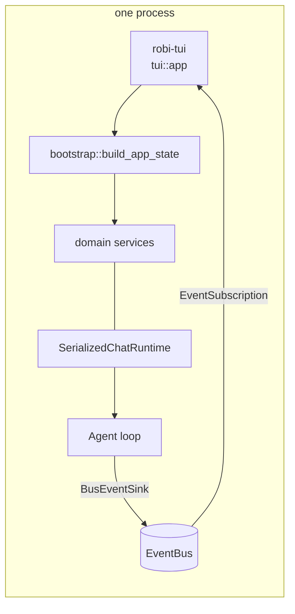

# Terminal shell

A second front end: the same agent, sessions, and tools, rendered in a terminal
instead of a webview. The `robi-api` HTTP surface stays exactly as it is; the TUI
does not call it. It links `crates/robi`, builds the same `AppState` the API
builds, and drives the same services.

This is a **surface** page, like [frontend-layout.md](frontend-layout.md), not a
milestone. It adds no capability to the loop and changes nothing in `robi-core`.
It exists because the domain layer already separates a service from a controller,
so a second front end is a rendering problem and not a rewrite.

Phases are numbered **T0–T6** rather than M-numbers, because they do not gate
any M-milestone and no M-milestone gates them.

**Scope is the chat surface only.** Review and docs are not planned here. Both
are already off in the GUI — `reviewScreen` and `docsViewer` in
`src/app/surfaces.ts`, shipped as S2 and S5 in [streamlining.md](../../streamlining.md)
— so a terminal copy would resurrect a surface the product has decided against.
`git diff` and the user's own editor are the review path; the docs screen is not
replaced at all. The backend routes stay served, as they do for the web shell.

## What this page does not cover

| Topic | Where it belongs |
|---|---|
| The turn lifecycle, approvals, tool execution order | [agent-loop.md](../core/agent-loop.md) |
| The CloudEvents envelope, the bus, and the SSE route | [events-sse.md](events-sse.md) |
| The per-session actor and `ChatRuntime` | [chat-runtime.md](chat-runtime.md) |
| Store, schema, migrations | [persistence.md](../persistence/persistence.md) |
| What a tool card shows, and when approval pauses | [chat-ui.md](chat-ui.md) — the TUI reaches parity with it, and does not restate it |
| Theme tokens | [visual-style.md](visual-style.md). `tui/theme.rs` is its terminal peer |
| Crate layout and the process model | `docs/src/design/core/architecture.md`, still unwritten |

## Problem

The agent is reachable only through a Tauri window. That costs a webview, a
window manager, and a display for work that is mostly text: a transcript, a diff,
a list of sessions. A terminal front end reaches the same sessions from a shell,
over SSH, and inside an editor pane.

The naive implementations are both wrong:

- **A TUI that speaks HTTP.** It re-introduces the whole wire layer between two
  processes on one machine, replaces `robi_core::message::Message` with the
  `ChatMessage` DTO, and stops working when the API is not running.
- **A TUI that re-implements the domain.** A copy of the session lifecycle in a
  second binary, drifting from the first.

The reason neither is necessary: `bootstrap::build_app_state` is HTTP-free.
`bootstrap::router` is the optional half, and only `robi-api` and `src-tauri`
call it.

## Decision

**A module in `crates/robi`, a binary in the same package, behind a cargo
feature. In-process. Elm-shaped. One event subscription. Refetch, never append.**



`AppState` is the whole contract. Its fields — `workspace_service`,
`chat_session_service`, `chat_message_service`, `settings_service`, `event_bus`,
`file_changes`, `index`, `mcp`, `originals`, `image_source` — are the same handles
the Axum handlers take. A controller is `State<AppState>` plus `Path` plus `Json`;
the TUI is an `Arc<AppState>` plus a keymap.

Two of those it never reads: `index` (the GUI hides the index line, so the TUI
does not render one) and `docs_edits` (no docs surface; see *Deliberately not
planned*). They stay in `AppState` because `build_app_state` is shared and the
HTTP routes still serve them.

### Where it lives

A module, not a crate.

```text
crates/robi/
  src/tui/
    mod.rs           # run(): terminal lifecycle, the feature gate
    app.rs           # App, Msg, update()
    action.rs        # Action: the effect update() asks for
    effects.rs       # Action -> service call, on the runtime
    keys.rs          # (Mode, KeyEvent) -> Msg
    command.rs       # the built-in `/` commands, `/open` today
    lifecycle.rs     # init/restore and the panic hook
    theme.rs         # Style constants; the peer of visual-style.md
    persist.rs       # ~/.robi/tui.json
    state/           # transcript, sessions, workspaces, composer,
                     # approvals, settings, notices
    view/            # header, transcript, tool_call, composer, plan,
                     # sessions, workspaces, settings, modal
  src/bin/robi-tui.rs
```

`Cargo.toml` gains a feature and a binary:

```toml
[features]
tui = ["dep:ratatui"]

[dependencies]
ratatui = { workspace = true, optional = true }

[[bin]]
name = "robi-tui"
path = "src/bin/robi-tui.rs"
required-features = ["tui"]
```

`ratatui` and `crossterm` are declared once in `[workspace.dependencies]`, per
the existing rule that versions cannot drift. Take `crossterm` from
`ratatui::crossterm`, not as a second direct dependency: ratatui 0.30 pins its
own and a second version in the tree fails to typecheck on `KeyEvent`.

### Why not a crate

The rule in `AGENTS.md` is to add a module and split only for one of four
reasons. Only the second applies — a heavy, optional dependency — and a cargo
feature isolates it just as well without moving code:

- `robi-api` and `src-tauri` do not compile ratatui, because they do not enable
  `tui`.
- `cargo tree -p robi-core` is unchanged. That is the audit that matters.
- No item becomes `pub` only so a second crate can reach it. `tui` is `pub` so
  the binary can call `tui::run`, which is a real entry point.

Promote to `crates/robi-tui` when one of these is true, and not before: the M8
headless `robi-cli` needs the same module (the split `AGENTS.md` already
anticipates, "a new binary with no code moved"); the TUI's tests need to run
without the web stack; or a measured build cost appears. The promotion is a move
plus a manifest, because the module is already shaped like one.

Rejected instead of a new crate now: `robi-index` and `robi-lsp` are the splits
with a real dependency argument, and a crate for one binary that depends on
`crates/robi` in both directions is the "split that happened too early"
anti-signal.

### Process model

In-process, no listener, no port. `robi-tui` shares `ROBI_DATABASE_URL` with
`robi-api` and `src-tauri`, so all three see the same sessions.

`SerializedChatRuntime` is per-process and in memory: `running_session_ids` is
not persisted, and an actor belongs to the process that started it. Two front
ends on one database therefore mean two runtimes, which can drive two turns on
one session.

Ownership across processes is a per-session lease, not a database lock: the TUI
takes `Open` on the session it displays and `Turn` through the runtime, so a
second process may read that session and may not submit to it. The lease, the
`redb` handle invariant it depends on, and what parallel processes still share
are in [parallel-front-ends.md](parallel-front-ends.md). Until that module
lands, one front end at a time is the rule; see *Failure modes*.

### The loop

`self.view(&App)` is a pure function of state. `update()` is a pure function
`(State, Msg) -> (State, Vec<Action>)`. Effects run on the runtime and report
back as a `Msg`. The four sources feed one `select!`:

```rust
loop {
    tokio::select! {
        Some(msg) = input.recv()          => app.update(msg),
        Some(env) = events.recv()         => app.update(Msg::Agent(env)),
        _ = tick.tick()                   => app.update(Msg::Tick),
        Some(done) = results.recv()       => app.update(Msg::Done(done)),
    }
    for action in app.take_actions() { effects::run(&state, action, &results); }
    terminal.draw(|frame| app.view(frame))?;
    if app.should_quit() { break; }
}
```

`ratatui::crossterm::event::read` blocks. It cannot run on the runtime: it would
hold a worker for as long as the user takes to press a key. A dedicated
`std::thread` reads events and sends them into a `bounded(64)` mpsc. A resize
event arrives on the same channel.

### Interfaces

```rust
pub fn run(state: AppState, options: Options) -> std::io::Result<()>;

pub struct App { /* AppState, view state, mode stack, actions */ }

pub enum Msg {
    Key(KeyEvent),
    Agent(EventEnvelope),      // what the bus carries
    Tick,                      // 250 ms: spinners, elapsed, catch-up
    Done(ActionOutcome),       // one effect finished
    Resize,
}

pub enum Action {
    Submit { session: SessionId, text: String, files: Vec<FileAttachment> },
    Decide { session: SessionId, call: ToolCallId, decision: Decision },
    Stop(SessionId),
    Compact(SessionId),
    Reload(SessionId),               // refetch the transcript
    LoadMessage { session: SessionId, message: MessageId },
    Rename { session: SessionId, title: String },
    Delete(SessionId),
    Create,
    SaveSetting { key: &'static str, value: Option<String> },
    OpenFile { path: String, line: Option<u32> },
}

impl App {
    pub fn update(&mut self, msg: Msg);
    pub fn take_actions(&mut self) -> Vec<Action>;
    pub fn view(&self, frame: &mut Frame);
    pub fn should_quit(&self) -> bool;
}
```

Every `Action` names a service call. `effects::run` is the only module that
touches `AppState`, and it is the only place a `.await` exists:

| `Action` | Call |
|---|---|
| `Submit` | `chat_message_service.submit_instruction` |
| `Decide` | `chat_message_service.decide_tool_call` |
| `Stop` / `Compact` | `chat_message_service.stop` / `.compact` |
| `Reload` | `chat_message_service.list_messages` |
| `LoadMessage` | `chat_message_service.get_message` |
| `Rename` / `Delete` / `Create` | `chat_session_service.*` |
| `SaveSetting` | `settings_service.*` |
| `OpenFile` | the lifted file opener: configured `file_open_command` only |

`SubmitOutcome::AwaitingApproval` is an outcome, not an error. The composer stays
locked and the approval modal opens.

### State ownership

The transcript is not built from deltas. `message_delta` moves the phase to
**Responding** and no more; `message_added`, `message_updated`, and
`tool_call_updated` mean refetch that row. This is the rule the web shell already
follows, and in a TUI it is load-bearing rather than tidy: the bus drops a queued
`message_delta` when a subscriber falls behind (`make_room` in `domain/events`),
so a transcript rendered from deltas silently loses tokens.

Two refetches of one URL can be in flight together, so each `Action` carries the
generation it was issued at, and a `Done` whose generation is stale is dropped.
The GUI solves the same problem with an epoch in `useAgentEvents`; the mechanism
is the same and the reason is not obvious, so it is written here.

State lives in one of three places, and nothing is duplicated between them:

| Where | Holds | Survives |
|---|---|---|
| `AppState` services | every domain fact | restart |
| `App` | the mode stack, scroll offset, composer buffer, expansion flags | the process |
| `~/.robi/tui.json` | workspace, open session, expansion flags, layout | restart |

## Parity map

Every GUI surface that is on today, its TUI form, and the phase that lands it.
The two surfaces the GUI has switched off — `reviewScreen` and `docsViewer` in
`src/app/surfaces.ts` — are out of scope here as well, so a TUI flag is not
needed for them; see *Deliberately not planned*. `indexStatus` is out for the
same reason, and the status bar carries no index line.

| GUI surface | TUI form | Phase |
|---|---|---|
| `Transcript` + `AssistantMarkdown` | scrollable buffer, turn-grouped, styled spans | T1 |
| `Composer` textarea, drafts per session | text area, draft kept per session in `App` | T1 |
| Send / Stop button | `Enter` / `Ctrl-C` | T1 |
| `ActivityLine`, streaming | header line: Thinking / Responding, elapsed | T1 |
| `ToolCallCard` and its six variants | one card block per call, collapsible | T2 |
| Approval buttons on a card | **modal**, one turn at a time | T2 |
| `PlanCard` + `PlanPage` | plan surface, `Esc` returns | T2 |
| `TodoList`, `FinishedTodos` | list under the transcript | T2 |
| `RecentsMenu` (filter, rename, delete) | sessions overlay | T3 |
| `WorkspaceSwitcher`, `WorkspacesPage` | workspace overlay, path entry | T3 |
| `ErrorNotices`, `ApiStatus`, MCP marks | status bar, one line, `!` separated | T3 |
| New chat | `Ctrl-N` | T3 |
| Mode `ChoiceMenu` | mode cycle in the header | T4 |
| `ModelEffortMenu` | model picker overlay | T4 |
| `SkillMenu` (`/` at the caret) | `/` completion over the composer | T4 |
| `ContextMeter` | token count in the status bar, compact from a menu | T4 |
| Compact | `Ctrl-L`, divider row on `transcript_compacted` | T4 |
| General settings | settings surface, section list | T5 |
| Model provider settings | settings surface, secrets masked | T5 |
| Permissions, MCP, audit log | settings surface, audit paged | T5 |
| `Composer` attachments | path attachments; images by path | T6 |
| `MermaidDiagram` | source fence | T6 |
| `OpenedFile`, `openWorkspaceFile` | `/open <file>`, configured program only | T6 |

## Phases

### T0 — Skeleton and the pump

**Goal** — a terminal app that renders a real transcript and nothing else.

- `tui/mod.rs::run` owns the terminal: `ratatui::init`, a panic hook that
  restores before the message prints, `ratatui::restore` on every exit path.
- `bootstrap::build_app_state` for state. No `logs::init()` as-is: a debug build
  writes tracing to **stderr**, which corrupts the frame. Log to the file layer
  only, or redirect the stderr layer to `~/.robi/logs/tui.log`.
- The four-source `select!`, the input thread, `Msg`, `Action`, `effects::run`.
- `state/transcript.rs`: turn grouping, follow-the-bottom with a scroll lock that
  yields on `PageUp` and re-arms at the bottom.
- `theme.rs` from `visual-style.md`'s tokens, so the two front ends stay one
  product.
- A `TestBackend` harness: render `App::view` into a buffer and assert on a
  string. This is the TUI's test strategy from the first commit.

**Exit** — `cargo run -p robi --features tui --bin robi-tui` shows the most recent
session of the active workspace, scrolls, and quits cleanly. One snapshot test
renders a two-message transcript.

### T1 — Send, stream, stop

**Goal** — the M2 exit criteria, in a terminal.

- Composer: `ratatui-textarea`, `Enter` sends, `Alt-Enter` inserts a newline.
  Draft per session. A failed send restores the buffer and attachments.
- `message_delta` → phase; `message_added` / `message_updated` → `LoadMessage`;
  `turn_finished` → reload, then idle. Deltas never write text.
- `Ctrl-C` sends `Stop`; a cancelled turn leaves a resolvable transcript, so the
  view reloads rather than truncating.
- Phase, elapsed, and a caret at the end of streaming text.
- The 2-second catch-up: while a turn is busy and no frame for the open session
  has arrived, reload.

**Exit** — send a message, watch it stream, stop it, quit, restart, find the
session intact. The turn ran through `SerializedChatRuntime` and the real
provider.

### T2 — Approval and tool cards

**Goal** — the loop's pause invariant, made visible and unmissable.

- **A modal owns the keyboard while a turn is paused.** The GUI disables a
  composer; a terminal has no such affordance, and a user typing into a composer
  whose only answer is `AwaitingApproval` is a bug. The modal lists every pending
  call in the turn, `a` / `r` per call, `A` approve all, `r` opens the reason
  field.
- Card variants, matching `ToolCallCard`: edit diff, shell (with
  `getToolOriginal` for the uncapped output), MCP, retrieve, delegate steps,
  todos, generic. Expansion flags keyed by call id, persisted per the table above.
- Plan card and plan surface; **Build** sets agent mode then sends the plan
  instruction.
- `awaiting_approval` while the window is unfocused → terminal bell and a title
  change. No OS notification; that is Tauri-only.

**Exit** — a turn that needs approval renders a card, the modal approves it, the
turn resumes; a rejection reaches the model as a structured rejection. Covers the
three `list_pending_tool_calls` → `approve_tool_call` → `reject_tool_call`
transitions in [agent-loop.md](../core/agent-loop.md).

### T3 — Sessions and workspaces

**Goal** — you can get to any session without the mouse.

- Sessions overlay: filter-as-you-type, running spinner, awaiting mark, rename,
  delete with confirmation.
- Workspace overlay: the 8 most recent, then manage. Create from a typed path —
  the GUI's folder dialog has no terminal equivalent, so it is a path input with
  completion over `list_dir`.
- Status bar: active workspace, API health from `GET /api/v1/health` replaced by a
  direct service probe, MCP server marks, `robi.app.v1.error` notices.
- `robi.session.v1.*` frames update the list without a refetch of the transcript.

**Exit** — create a workspace by path from inside the TUI, create and rename a
session, delete one, and see a second one marked running while a turn is in
flight.

### T4 — Modes, model, effort, skills, context

**Goal** — everything the composer carries, minus attachments.

- Mode cycle (ask → plan → agent) writing to `model_config[mode]` on the session
  row, or to the draft when there is no row yet.
- Model and effort pickers over `ModelCatalog::tool_capable()` filtered by the
  provider-enabled settings — the same filter `web_api/models.rs` applies. That
  helper is lifted, not copied; see *Gaps*.
- `/` completion over two kinds of name: built-in commands (see *Composer
  commands*), then `list_skills(workspace_id)` with `· manual` and scope,
  replacing the token with `/id `.
- Context meter from `Usage` on the last assistant message; `Ctrl-L` compacts and
  a divider row appears on `transcript_compacted`.

**Exit** — switch model and mode mid-session, invoke a skill with `/`, compact and
see the divider. The next actor picks up the override.

### T5 — Settings

**Goal** — configure the app without leaving the terminal.

One settings surface with the GUI's five sections: General, Model providers,
Permissions, MCP, Audit log. Field list and order follow
`GeneralSettings` / `ModelProvidersSettings` / `PermissionsSettings` /
`McpSettings` / `AuditLogSettings`.

The GUI saves text fields **on blur**. A terminal has no blur, so each field is
explicit: `Enter` applies, `Esc` reverts, an empty value deletes the setting, and
a failed write reverts the buffer and shows the error. Secrets are re-sent only
when non-empty and are never echoed — the field renders `••••••••` once one is
stored, exactly as the GUI does.

The audit log is the one view that wants vim keys: a paged request table, `Enter`
to expand a body, `j` / `k` within a page.

**Exit** — set an API key from the TUI, press `Ctrl-C`, start a turn that uses it.

### T6 — Attachments and the graphical remainder

**Goal** — close the parity gap on the chat surface, and name what is
permanently out.

- Attachments by path: an `@` completion in the composer over `find`, plus
  `list_dir` for browsing. `MAX_ATTACHMENTS`, `MAX_TEXT_FILE_BYTES`, and
  `MAX_TEXT_TOTAL_BYTES` stay identical to the GUI's.
- Images by path: no thumbnail, a `[image name, 1.2 MB]` row. The bytes still
  travel to the model.
- Mermaid fences render as source with a marker, never as a diagram.
- **Opening a file is `/open <path>` and nothing else.** The command resolves the
  path inside the workspace and hands it to the configured `file_open_command`.
  It never falls back to `$EDITOR`, never suspends the terminal, and never opens
  anything in-process: when no command is configured it says so and stops, which
  is the same refusal `POST /workspaces/{id}/open` returns. A terminal user sees
  the file in the editor they already chose for the GUI.

**Exit** — attach a text file by path, send it, see it in the user message and in
the model's context; render an assistant message containing a mermaid fence
without panicking; `/open` a path from an edit card and land in the configured
program, and get a clear message rather than a fallback when none is set.

### Deliberately not planned

| Not built | Why |
|---|---|
| **Review surface** — diff list, file tree, approve/reject, reject-with-reason | Off in the GUI as S2, and there is no terminal equivalent worth writing. `git diff` is the review path, and the edit tools already write session baselines for it. A TUI copy would put a surface the product removed back in front of the user |
| **Docs surface** — tree, viewer, find, search, editor | Off in the GUI as S5. Not replaced. The agent still reads and edits docs through the existing tools; a human reads them in their editor |
| **In-app file peek** (`OpenedFile` dialog) | The GUI needs a second destination so a path can render inside the app. `/open` has one destination — the configured program — so there is no dialog and no `fileOpenPatterns` split to reproduce |
| In-terminal markdown editor | Roadmap non-goal: "not a code editor" |
| Clipboard image paste, drag-and-drop | No terminal protocol worth the complexity. Paths only |
| Image and diagram rendering | No portable cell-accurate graphics; the source is shown |
| OS notifications | Tauri-only. Bell and title change instead |
| UI scale, pointer resize | Terminal-owned layout |
| A second `EventSource`-style reconnect | The subscription is in-process and does not disconnect |

## Keyboard model

A mode stack, so `Esc` unwinds one level and is predictable. Exactly one mode
owns the keyboard; `chat` is the base.

| Mode | Enter from | Leave with |
|---|---|---|
| `chat` | startup | `Ctrl-C` twice, or `q` when idle |
| `sessions`, `workspaces`, `models` | `Ctrl-S`, `Ctrl-W`, `Ctrl-M` | `Esc` |
| `plan`, `settings` | a card action, `Ctrl-,` | `Esc` |
| `approval` | any paused turn, from any mode | a decision for every call |
| `prompt` (rename, delete, reject-reason) | an action | `Esc`, unless busy |

Global bindings, checked before the mode's own map:

| Key | Does |
|---|---|
| `Ctrl-C` | Stop the running turn. Idle: quit |
| `q` | Quit, idle only |
| `Ctrl-N` | New chat |
| `Ctrl-R` | Rename the open session |
| `Ctrl-S` / `Ctrl-W` / `Ctrl-M` | Sessions / workspaces / model + effort |
| `Ctrl-,` | Settings |
| `Ctrl-L` | Compact |
| `Tab` / `Shift-Tab` | Move focus between the transcript and the composer |
| `PageUp` / `PageDown` | Scroll the transcript, and release the follow lock |
| `?` | Keymap help |
| `Esc` | Unwind one mode |

There is no `editor` mode and no key that opens a file. The screen belongs to the
TUI for its whole life: an external program is started and left to its own
window, so there is nothing to suspend for. Opening a file is `/open`, a
composer command, which is why it does not appear in this table.

Arrow keys always belong to the text area. This is why scrolling is a separate
binding rather than `Up` / `Down`: a terminal chat has a text field on screen at
all times, and stealing its cursor is the mistake every naive implementation
makes.

In `approval`: `a` approve, `r` reject, `A` approve all, `j` / `k` move,
`Enter` expand the call's detail.

## Composer commands

`/` is a command prefix, the same prefix the GUI uses for skills. The TUI keeps
one namespace and two kinds of name, so a user does not have to remember which
list to look in:

| Kind | Source | Sent to the model? |
|---|---|---|
| Built-in | `tui/command.rs`, a fixed table | Never. The TUI acts, then clears the composer |
| Skill | `list_skills(workspace_id)`, as today | Yes, unchanged |

The completion menu merges both, built-ins first, and marks a skill
`· manual` as the GUI does. A built-in wins a name collision, because a skill
that quietly shadowed `/open` would break the one path to an external file, so
the menu renders such a skill as unavailable rather than hiding it.

One built-in command:

| Command | Does |
|---|---|
| `/open <path>` | Resolve `<path>` inside the workspace, then run the configured `file_open_command` with `{file_path}` and `{line}` substituted |

`/open` follows the rules of `POST /workspaces/{id}/open`, deliberately: the same
confinement, the same template rendering, the same 10-second wait before the
process is left running, and the same refusal when `file_open_command` is unset.
There is no `$EDITOR` fallback and no in-app viewer. A path outside the workspace
is an error in the composer, not a prompt.

`<path>` accepts a trailing `:<line>` — `/open crates/robi/src/tui/app.rs:210` —
so a line number from an edit card survives the round trip. Invalid input, an
absolute path, and an unset command each produce one line under the composer and
leave the buffer intact, so the user can fix the path instead of retyping it.

A focused tool card offers the same command pre-filled for its path; that is a
typing shortcut, not a second code path.

## Gaps to lift out of `web_api`

Three pieces of logic live in a controller and are needed by the TUI. Each one is
**lifted into `domain` (or `agent`), never copied**: two front ends reading one
implementation is the point of the module boundary.

| Logic | Today | Needed by | Action |
|---|---|---|---|
| Attachment ingestion — `build_files`, `classify_path`, `decode_base64`, `decode_text`, `matches_media_type` | `web_api/chat_message.rs` | T6 | Lift to `domain/chat_message` before T6 |
| Provider-enabled model filter — `provider_on` + `tool_capable` | `web_api/models.rs` | T4 | Lift one function, both callers |
| File opener — `spawn_opener`, template rendering, the 10-second wait | `web_api/workspace.rs` | T6 (`/open`) | Lift to `agent/workspace`; both callers keep the same refusal when the command is unset |

The docs merge (`merge3`, `version_hash`, `docs_edits`, the `409` path) and the
review reader stay where they are: with no docs or review surface, the TUI never
calls them, and two front ends do not need one implementation of something only
one of them uses.

Eradicated on sight: `#[utoipa::path]`, status codes, `Json` wrappers,
`parse_session_id`, CORS, the multipart body limit, the SSE keep-alive.

`ingest_multipart` is the interesting one. It is not HTTP logic — it is "turn a
name and bytes into an `ImageAttachment` or a `FileAttachment` within the size
caps". It belongs in `domain/chat_message`, and the controller keeps only the
multipart parse.

## Persisted UI state

`~/.robi/tui.json`, written atomically on quit and on a change to the open
workspace or session. Not the settings store: settings are product
configuration, this is view state, and a scroll offset does not belong in a
settings screen.

Keys mirror the GUI's client state so the two can be compared: active workspace,
open session, per-session composer draft, tool-card expansion keyed by call id
(including `:diff` and `:answer`), scroll position, and the last mode. Never a
secret. Nothing in it is required to start: a missing or malformed file starts at
the defaults, because a bad scroll offset must not stop the app from opening.

Dropped because the surface is gone or terminal-owned: per-document scroll,
collapsed directories, docs-tray width, UI scale.

## Rejected alternatives

1. **A TUI that calls the HTTP API.** Rejected. It needs `robi-api` running to
   be useful, moves every message through JSON and the `ChatMessage` DTO, and
   loses `robi_core::message::Message` — a strictly better type with the approval
   and execution status enums intact. Nothing about a same-machine second front
   end justifies a socket.
2. **A TUI as a Tauri-managed sidecar.** Rejected for T0–T6. Same cost as 1, plus
   process lifecycle. Process placement stays **D3** and this page does not
   reopen it.
3. **A new crate now.** Rejected, above. A feature gate isolates the dependency
   without moving code, and the promotion path is intact when the M8 binary
   arrives.
4. **Component architecture, with a trait per widget holding its own state.**
   Rejected. Immediate-mode rendering wants a pure `view`; interior mutability
   per component is how a transcript ends up with two sources of truth. TEA is
   also what the roadmap calls "the Bubble Tea update loop" when it says to leave
   it behind — that entry is about the desktop shell, where a webview needs a
   reactive store. In a terminal, immediate mode plus a pure `update` is the
   idiomatic shape, and it is closer to `gopi`'s behavior than the rewrites.
5. **Rendering the transcript from `message_delta`.** Rejected. The bus drops a
   queued delta under backpressure by design, so the transcript would lose
   tokens. Deltas move the phase; stored rows refetch.
6. **An in-terminal editor for the docs screen.** Rejected twice over. There is
   no docs screen here, and a terminal cannot match cursor, selection, and undo
   without becoming an editor, which the roadmap names as a non-goal. The one
   handoff is `/open`, which starts the user's own program and keeps the screen.
7. **A TUI-only settings file.** Rejected. Settings are already
   `SettingsService` over `~/.robi/config.toml` and `secrets.toml`;
   a second store would fork the meaning of "default model".
8. **`tui-realm` or a retained-mode framework.** Rejected. It solves a problem
   this app does not have (reusable widgets with lifecycle) and puts a small
   corpus between a maintainer and a fix.

## Failure modes

- **Panic while the terminal is raw.** Half-drawn frame, echo off, shell prompt
  invisible. `ratatui::init` installs its own panic hook; `tui::lifecycle` wraps
  it so the process log line is written first. `restore` runs on the error path
  and on `SIGTERM`.
- **Debug tracing on stderr.** `logs::init()` adds a stderr layer under
  `debug_assertions`, which overwrites the frame. The TUI initializes the file
  layer only.
- **Two front ends on one database.** Two `SerializedChatRuntime`s can drive two
  turns on one session and interleave the transcript. The per-session lease in
  [parallel-front-ends.md](parallel-front-ends.md) is the answer: `Turn` refuses a
  second submit and names the holder in a `Conflict`. It also keeps the per-session
  `redb` handle exclusive, which is the failure that would otherwise come first —
  an unreadable transcript, not an interleaved one.
- **A slow service call.** It runs in `effects::run` on the runtime and cannot
  block the pump. Filesystem and SQLite work is already inside
  `agent::blocking::call`; the TUI adds no new blocking path.
- **A drop of a burst of frames.** Deliberate. The catch-up reload recovers what
  the render missed, and the phase does not advance past an unstored row.
- **A stale `Done`.** Two reloads of one session land out of order. Every action
  carries a generation; a lower one is discarded. The GUI's epoch rule.
- **An approval for a session that is not on screen.** Queued, bell, status-bar
  mark. The turn is paused either way, so it cannot be missed indefinitely.
- **The open session is deleted.** Reset to a new draft and reload the list. A
  `robi.session.v1.deleted` frame does the same.
- **Terminal too small.** Below 40×12 render one centered message instead of a
  broken layout.
- **No TTY** (`robi-tui` in a pipe or CI). Refuse to start with a line on stderr,
  rather than drawing escape codes into a file.
- **Quit with a turn running.** Confirm; on confirm, `Stop` then exit, so the
  transcript is left resolvable. Never drop the process mid-turn.
- **`/open` with no configured program, or a program that hangs.** An unset
  `file_open_command` is one message under the composer, never a fallback to
  another program. A configured program is waited on for at most 10 seconds and
  then left running, so a hanging editor cannot freeze the frame; the TUI never
  suspends its own terminal for it.

## Testing

- `update()` is a pure function, so it is tested without a terminal, without a
  database, and without a network — the same discipline as `robi-core`.
- `TestBackend` snapshots, one per view: an empty transcript, a streaming turn, an
  approval modal, a collapsed and expanded edit card, the sessions overlay, a
  settings section. A snapshot asserts on rendered strings, not on a golden file,
  so a token change that does not change the layout does not fail.
- Keymap: every binding in the table is reachable from `chat`, no key maps to two
  `Msg`s in one mode, and `Esc` from each mode returns to `chat`.
- The pump: publish `EventEnvelope`s onto a real `EventBus` — `turn_started`,
  `message_delta`, `message_added`, `turn_finished` — and assert the phase
  sequence and that exactly one refetch was issued per stored row.
- The approval modal: with a fake `ChatRuntime`, a paused turn blocks a submit and
  `a` issues `Decide`. `SubmitOutcome::AwaitingApproval` keeps the composer
  locked.
- The `/` command surface: `/open` on a path inside the workspace issues one
  `OpenFile`; a path outside it, an absolute path, and a blank argument each
  produce a composer error and no action. A stub opener records what it was
  asked to start, so the unset-command case asserts the error with **no** call
  made — the fallback this design rules out is a test failure, not a code review.
- A skill whose id collides with a built-in is listed but not selectable, and
  typing it still resolves to the built-in.
- Persistence: `tui.json` round-trips; a malformed file starts at defaults; a
  secret-looking key is never written.
- The debug-build stderr regression: a unit test asserts the TUI's log
  initializer installs no stderr layer.
- `cargo test -p robi --features tui` joins `make test`, and clippy runs
  `--all-features` so the feature-gated module is still linted.

## Implementation order

1. Workspace dependency, feature, `[[bin]]`, `tui/mod.rs::run`, terminal
   lifecycle, and a `TestBackend` harness that renders one `Paragraph`. Proves the
   plumbing before any state exists.
2. `Msg` / `Action` / `effects::run` and the input thread.
3. `state/transcript.rs` and `view/transcript.rs` reading `list_messages`. This is
   T0.
4. Composer, `Submit`, the event pump, phases and catch-up. T1.
5. Approval modal, then the card variants. T2, in that order: the modal is the
   invariant, the cards are cosmetics.
6. Sessions and workspaces overlays, then the status bar. T3.
7. Lift the model-filter helper; modes, model, effort, skills, and the `/`
   command surface. T4.
8. Settings surface. T5.
9. Lift the file opener and the attachment ingestion together; `/open`; path
   attachments; mermaid fallback. T6.
