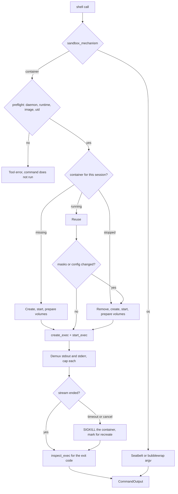

# Container sandbox

The container sandbox runs a `shell` command inside a long-lived gVisor
container that the harness manages over the Docker API. It is an alternative to
the OS sandbox, not a replacement for it: bubblewrap on Linux and Seatbelt on
macOS stay, and a setting chooses between the two mechanisms. Both mechanisms
run on both platforms. This page defines the runtime, the container lifecycle,
the path mapping, the settings that select a mechanism, and the `retrieve`
integration. It is a design for the container milestone, not a description of
shipped code.

The tool contract, its arguments, and its approval rules are in
[shell-tool.md](shell-tool.md). The output pipeline that collapses a long log is
in [shell-output.md](../compression/shell-output.md). Path rules and the file
floor are in [read-tools.md](read-tools.md).

## What this page does not cover

| Topic | Where it belongs |
|---|---|
| `ShellAccess`, `read_paths`, `write_paths`, `unsandboxed` | [shell-tool.md](shell-tool.md). This page adds a mechanism, not an argument |
| The bubblewrap and Seatbelt profiles | [shell-tool.md](shell-tool.md). Both stay and both keep working |
| What the image installs | `resources/docker/agent-base.Dockerfile`, versioned with the repository |
| Settings for other subsystems | [persistence.md](../persistence/persistence.md), which owns the store |
| Session grants and the path filter for file tools | [read-tools.md](read-tools.md) |
| Keeping more than 256 KiB of a command's output | A later change to the compressor. See [Output and retrieve](#output-and-retrieve) |
| Remote or multi-tenant execution | Later. This container runs on the user's machine and trusts that machine |

## Problem

The OS sandbox builds an argv from host paths: a Seatbelt policy string on macOS,
a `bwrap` command on Linux. It is fast, it needs no daemon, and it ships today.
It also has three costs that lead some users to want a different mechanism:

- **The host is the toolchain.** A sandboxed command sees the host's `cargo`,
  `node`, and Python because the profile binds `~/.cargo/bin`, `~/.rustup`, and
  the rest read-only. A tool installed on the host but outside those trees fails
  with a permission error, and a tool that is present leaks a host binary and its
  libraries into the command. The container puts the toolchain in the image
  instead, at the cost of a much larger download.
- **Every grant is another host mount.** A session allow, a `write_paths` entry,
  and a settings allow each become another bind. The profile describes the user's
  machine, so it differs per machine and is hard to reproduce. The container
  mounts only what the profile names, and starts from an empty host view.
- **Unprivileged user namespaces are not universal.** Some Linux distributions
  block them, so `bwrap` fails for a reason unrelated to the command. A container
  runtime uses the daemon's privileges instead.

The build caches are also per-machine. `target/` survives in the workspace, but
`~/.cargo/registry` and `~/.cache/pip` are host state that the profile does not
cover, so a fresh sandbox re-downloads crates and wheels. The container gets named
volumes for those.

None of that makes the OS sandbox wrong. It is the default because it is free,
parse-free, and already working. The container is for the user who would rather
install Docker once than keep a host toolchain that matches the agent's profile,
and who is willing to pay a slower, larger sandbox for a smaller host surface.

## Decision

The sandbox mechanism is a setting with two values:

| `sandbox_mechanism` | Linux | macOS |
|---|---|---|
| `os`, the default | `bwrap` | `sandbox-exec` with a Seatbelt policy |
| `container` | gVisor container over the Docker API | gVisor container over the Docker API, inside the daemon's Linux VM |

Both values run on both platforms. `unsandboxed: true` still runs on the host
after approval, and it is the same escape hatch under either mechanism.

The container path adds no fallback. When the configured mechanism cannot be
applied, that call is refused. The error names the setting, so the user can
switch to `os` or fix the runtime; the command is never retried on the host.

One container serves one chat session. It is created on the first sandboxed
command, reused by every later command in that session, and removed when the
session ends or when it has been idle for seven days. The workspace and the
cache volumes outlive it. [Container lifetime](#container-lifetime) records why
the container is preserved rather than created per call.

Settings resolve per workspace: a `.robi/sandbox.toml` in the workspace
overrides the global settings in `~/.robi/config.toml`, field by field. The
[next section](#settings) defines that layering.



### Settings

Container settings follow the two-file pattern that MCP config already uses:
global settings in `~/.robi/config.toml`, project settings in
`<workspace>/.robi/sandbox.toml`. A project file is typed TOML, not a flat string
key, because a user writes it by hand and checks it into the repository.

```toml
# <workspace>/.robi/sandbox.toml
mechanism = "container"
image = "robi/agent:1"
runtime = "runsc"
memory_mb = 8192
cpus = 4
pids_limit = 1024
network = "deny"
```

Every field is optional. A field that is absent inherits the next layer up, and a
field that is present replaces only itself. There is no whole-file override, so a
project that changes `memory_mb` keeps the user's `image`.

| Field | Global key | Global default | Range |
|---|---|---|---|
| `mechanism` | `sandbox_mechanism` | `os` | `os`, `container` |
| `image` | `sandbox_image` | `robi/agent:1` | `repo/name[:tag]` |
| `runtime` | `sandbox_runtime` | `runsc` | a name in the daemon's runtime map |
| `memory_mb` | `sandbox_memory_mb` | `4096` | 512 to 65536 |
| `cpus` | `sandbox_cpus` | `2` | 1 to the host CPU count |
| `pids_limit` | `sandbox_pids_limit` | `512` | 64 to 8192 |
| `services` | — | empty | `name:port` pairs; workspace file only |
| `service_network` | — | unset | an existing Docker network; workspace file only |
| `env` | — | empty | `KEY = "value"`; workspace file only |

The global keys join the existing whitelist in
`domain/settings/keys.rs`; the values are strings there, so they reuse
`SettingsService`, `parse_bounded`, and the `on`/`off`-style validator that
`provider_*` already uses. `sandbox_mechanism` and `sandbox_project_files` take
the same two-value check as `web_search_approval`.

`sandbox_network` is global only, and it is the one setting that trades the
container's network boundary for convenience. `on`, the default, keeps the
sandbox: no interface unless a call is approved for egress or the workspace
declares a service. `off` gives every sandboxed command full outbound networking.
A workspace file cannot reach it, so a repository cannot open its own network.

`services`, `service_network`, and `env` have no global key. They name a specific
project's dependencies, and a machine-wide default would be wrong for every other
workspace. They are workspace fields, and the acknowledgement below is what lets
them apply.

The workspace file is read through `agent::blocking::call` and cached against the
file's modification time, so a settings read does not touch the disk on every
`exec`.

A project file is written by whoever wrote the repository, so it is gated: until
`sandbox_project_files` is `on`, the file is shown with the values it would apply
and none of it takes effect. The gate is not ceremony — `image` names a container
the harness will pull and run, and `network = "unrestricted"` would otherwise let a
cloned repository widen its own egress. A per-file hash acknowledgement, so one
workspace can trust a file without trusting every other, is a later refinement;
the machine-wide switch is the first version.

`mechanism` is the exception: it is absent from the workspace file entirely. A
repository does not get to decide whether its own code is containerised.

Resolution happens once per call, in this order:

```text
default  <  global settings  <  workspace sandbox.toml (when sandbox_project_files is on)
```

`Sandbox` stores the resolved `Config` it was created with. `exec`
re-resolves and compares; a changed `Config` marks the container for recreation,
the same way a changed mask set does. A `memory_mb` raised mid-session therefore
applies to the next command, not to the running container.

On macOS only the mechanism differs. The settings mean the same thing; the
`runtime` value has to exist in the Linux VM that hosts the daemon.

#### The settings screen

**Settings → Sandbox** is a tab in `src/features/settings/SandboxSettings.tsx`,
registered in `SettingsLayout.tsx` (`ITEMS`) and routed at `/settings/sandbox` in
`src/app/SolidApp.tsx`. It reads and writes the eight keys through the generic
`/api/v1/settings` routes, so there is no sandbox-specific endpoint and no DTO:
`SETTING_KEYS` in `src/api/settings.ts` names them and `getSettings` loads all
eight in one request.

The tab has four sections, in the order a user meets the decision:

| Section | Control | Keys |
|---|---|---|
| Mechanism | segmented `OS` / `Container` | `sandbox_mechanism` |
| Container | image and runtime text fields, memory, CPU, and process-limit number fields | `sandbox_image`, `sandbox_runtime`, `sandbox_memory_mb`, `sandbox_cpus`, `sandbox_pids_limit` |
| Network | segmented `Sandboxed` / `Open` | `sandbox_network` |
| Project files | switch | `sandbox_project_files` |

The container fields stay editable when the mechanism is `OS`, so a user can
stage a configuration before switching. A segmented control and the switch write
on click and revert if the write fails; a text or number field writes on blur, and
an empty or unchanged value restores what is stored rather than clearing the key,
because the service refuses an empty value for all five.

The tab does not yet show which layer a value came from. A workspace file's
pending values, and the resolved value per layer, are still a follow-up.

### Container lifetime

The container is preserved for the session. It is not created per tool call, and
it is not shared across sessions.

A per-call container looks simpler and is wrong for real work. A session is a
sequence of steps that build on each other: install the dependencies, then run
the tests, then reproduce the failure with a debugger, then re-run the tests. Most
of those steps only make sense on top of the state the earlier step created.

Two costs decide it:

- **State that has no other home.** `pip install requests`, `apt-get install
  jq`, and `npm install -g` write inside the container. Nothing mounts those
  paths, so a per-call container discards them and the next call installs them
  again. The same applies to generated code outside the workspace, a warmed
  database, and a background watcher the agent started on purpose.
- **Iteration speed.** A dependency install plus a cold start is minutes. Repeating
  it on every `shell` call turns a five-step debugging session into a
  half-hour one, and it burns the model's context on output the agent already
  read.

Preserving the container makes the session reproducible in the wrong direction:
two commands that ran ten minutes apart saw different environments. That is the
tradeoff, and it is bounded — the writable layer belongs to one container, one
session, and it is destroyed when the container is.

The root filesystem is therefore writable, through the container's own overlay
layer. `readonly_rootfs: true` would make `pip install` fail with `Read-only file
system`, which is the opposite of the goal. The image stays immutable — a write
lands in the container's layer, not in the image — and the layer is discarded
with the container, so a package installed to a system path is absent in the
next session.

| State | Next exec, same session | Container recreated | New session |
|---|---|---|---|
| Workspace files | kept (bind mount) | kept | kept |
| Package caches under `~/.cargo` and `~/.cache` | kept (volumes) | kept | kept |
| Installed packages, system library changes | kept (container layer) | **lost** | **lost** |
| `/tmp` contents, running background processes | kept (tmpfs, live) | **lost** | **lost** |
| `cd`, exported variables, shell history | **lost** — every exec is a new `/bin/sh` | lost | lost |

The last row is the one that surprises people. "Container state" means the
filesystem and long-running processes, not the shell. An exec is a new process
with the constructed environment each time, so a command that does `cd
../elsewhere` affects nothing after it returns. A workflow that needs shell state
writes a script into the workspace and runs it, or starts one background process
and talks to it.

The container is recreated, and the layer with it, when three things change:

- the path mask set, because a new secret file must be hidden;
- the resolved `Config`, because memory, cpus, and the image are create-time
  properties;
- the container is gone, because the daemon restarted or the reaper removed it.

The first two are cheap to trigger by accident: adding a `.env`, or bumping
`memory_mb` in `sandbox.toml`, throws away the installed packages and costs a
reinstall. The cache volumes make that reinstall offline and fast — `pip install`
reads `~/.cache/pip` and `cargo build` reads `~/.cargo/registry` — which is why
[the caches](#caches) are separate volumes rather than part of the layer.

To get a clean environment mid-session, remove the container. The next `exec`
creates a fresh one from the image; the workspace and the cache volumes survive.

### Broker and preflight

The sandbox talks to the Docker daemon through `bollard` over
`/var/run/docker.sock`. It does not spawn `docker`, `runsc`, or any other CLI.
The daemon is reached with `Docker::connect_with_local_defaults`.

`new` fails before a command runs when any of these is false:

| Check | Call | Failure |
|---|---|---|
| The daemon answers | `docker.info()` | `SandboxError::Daemon` |
| The configured runtime is registered | the `Runtimes` map in `SystemInfo` | `SandboxError::RuntimeMissing` |
| The agent image exists | `docker.inspect_image(config.image)` | Pull it with `create_image`, then fail on a pull error |
| The workspace is a directory | `canonicalize` | `SandboxError::Workspace` |

The egress network and the named volumes are created on first use. A failure
in any check becomes `sandbox could not be applied: <reason>`, and the command
does not run.

### Container specification

| `HostConfig` field | Value | Reason |
|---|---|---|
| `runtime` | `config.runtime`, `runsc` by default | gVisor handles the container's syscalls in user space instead of passing them to the host kernel |
| `memory`, `memory_swap` | `config.memory_mb`, 4 GiB by default | A build that exceeds the limit is OOM-killed instead of taking the host down |
| `nano_cpus` | `config.cpus`, 2 by default | Bounds a runaway parallel build |
| `pids_limit` | `config.pids_limit`, 512 by default | Bounds a fork bomb |
| `cap_drop` | `["ALL"]` | A sandboxed command needs no Linux capability |
| `cap_add` | `["CHOWN"]` | The one-time setup exec hands the root-owned cache volumes to the host user, and `cap_drop: ALL` would take `CAP_CHOWN` from it too. A non-root exec gains nothing: `no-new-privileges` blocks the setuid and file-capability routes |
| `security_opt` | `["no-new-privileges:true"]` | A setuid binary in the image cannot raise privilege |
| `readonly_rootfs` | `false` | The container's own overlay layer accepts `pip install` and `apt-get`; the image is untouched, and the layer dies with the container. See [Container lifetime](#container-lifetime) |
| `network_mode` | `"none"`, or `"bridge"` when `sandbox_network` is `off` | `none` means no interface and no DNS. `bridge` is the default bridge plus the daemon's NAT, which is what "fully networked" means |
| `init` | `true` | Reaps orphans left by an exec, so the container does not accumulate zombies |
| `tmpfs` | `/tmp`, `nosuid,size=1g` | A private temp directory that is not a host bind |
| `log_config` | driver `none` | The stream is the record; the daemon keeps no second copy |
| `restart_policy` | `no` | A killed container is recreated deliberately, not restarted under the same state |
| `user` | `<uid>:<gid>` | See [User mapping](#user-mapping) |

The four settings-backed fields are the ones a project may tune. Everything else
is fixed: a `sandbox.toml` cannot add a capability, mount the host, or reach the
network outside the egress approval. In particular it cannot add `CHOWN` to a
setting: the capability set is code, not configuration.

A writable root filesystem is not a way out of the sandbox:
`no-new-privileges`, UID mapping, and the read-only mounts are unchanged. It only
lets a command change the environment that later commands in the same session
see.

The container command is `sleep infinity`. The container exists to hold the
mounts, the namespaces, and the home volume; every command arrives through
`exec`.

### User mapping

Run the container as the invoking user, not as root:

```rust
let uid = nix::unistd::getuid().as_raw();
let gid = nix::unistd::getgid().as_raw();
let user = format!("{uid}:{gid}");
```

Set `ContainerCreateBody.user` and each `CreateExecOptions.user` to that string.
A bind-mounted workspace is owned by the host user, so a file the command
creates is owned by that user and the user can delete it without `sudo`. Under
`runsc`, the container's UID maps to the same numeric UID on the host for a bind
mount; gVisor isolates the kernel, not the file owner.

Named volumes are the exception. Docker creates a new volume owned by
`root:root`, and a container running as the host UID cannot write it. After
creating the container, run one preparation exec as `0:0`:

```sh
chown -R <uid>:<gid> /home/agent
```

The workspace is deliberately outside that `chown`: it is the user's directory
and the preparation step must not change its ownership.

On macOS the daemon shares its files into the VM instead of bind-mounting them,
and the shared filesystem presents them as owned by the macOS user. The `chown`
above still applies to the volumes, which are native filesystems inside the VM.

### Mounts

A container starts from the image's filesystem. The host is not visible unless
it is mounted, so a deny outside every mount needs no rule: the path is absent.
This is the main simplification over `bwrap`, which starts from the host
filesystem and hides most of it.

| Profile field | Container path | Mode |
|---|---|---|
| `workspace` | `/workspace` | `rw` for `WriteAccess::ReadWrite`, `ro` for `ReadOnly` |
| `workspace/.git` | `/workspace/.git` | `ro`. A nested mount over the workspace; Docker applies the longer destination last |
| `temp_dir` | not mounted; `/tmp` is a tmpfs | `rw`, private to the container |
| `extra_writes`, `wide_writes`, `protected_write_*`, session write grants | `/workspace/<relative>` inside the workspace, the same absolute path outside | `rw`. A nested mount over a read-only workspace, used by Plan mode's `.robi/plans` |
| `wide_reads`, `protected_read_*`, session read grants | `/workspace/<relative>` inside the workspace, the same absolute path outside | `ro` |
| `toolchain_reads` | not mounted | The image supplies the toolchain |
| `deny_reads`, `deny_writes` inside a mounted tree | masked | See below |
| Everything else on the host | absent | No mount, no path |

Absolute paths outside the workspace are mounted at the same path so a command
that names one still resolves. Inside the workspace the path changes: the host
repository is `/workspace`, not its host path.

`cwd` is rebased the same way, so the tool's existing `cwd` argument keeps
working: `cwd: "crates/robi"` runs in `/workspace/crates/robi`. A command that
names no `cwd` runs at the mount root, which is why a session never needs
`cd /workspace` — the prompt states that once and forbids the `cd`, and the tool
result reports `cwd` so the model can see where it ran rather than guess.

The two rules differ by mechanism. The `<cwd>` prompt block carries the *host*
path, which the container does not have, so the container prompt omits it and the
built-in rules state `/workspace` instead. Under Seatbelt and bubblewrap the host
path is correct and the block stays.

`toolchain_reads` is intentionally dropped. Mounting `~/.cargo/bin` into a
different image gives a binary that links against host libraries the image does
not have, and it reintroduces the host-toolchain problem. If a project needs a
tool, it belongs in the image or in the project's own dependencies.

The floor and the `.git` write deny are the one place a deny needs a mount. The
host walks the workspace with the same `floor_files` function `bwrap` uses, and
emits one read-only `/dev/null` bind per match:

```text
source: /dev/null  target: /workspace/.env    read_only: true
```

A directory deny uses an empty read-only tmpfs at the target instead. The walk
skips `target`, `node_modules`, `dist`, and `vendor`, as it does today.

Two limits apply:

- **Count.** More than 2,000 masks makes container creation slow and is almost
  always a mistake. Above the limit the command is refused with `workspace
  needs N path masks, above the 2000 limit`; the user can delete the files, add
  an explicit allow, or switch the workspace to `mechanism = "os"`.
- **Time.** The mask set is captured when the container is created. `exec`
  recomputes it with a cheap walk and compares the result. If a `.env` appeared
  since the last call, the container is recreated before the command runs, so a
  file created mid-session is not readable through a stale mount.

On macOS a mask still works, because the workspace is inside a shared root by
definition. An allow outside every shared root cannot be mounted, so it is
refused rather than dropped; see [macOS](#macos).

A deny that falls outside every mounted tree is already unreachable and is
skipped.

### Caches

Three concerns drive the volume layout: the container runs as the host UID, the
caches must survive the container, and a reinstall after a recreation must not hit
the network. The paths in the original sketch
(`/usr/local/cargo/registry`, `/root/.cache`) assume a root container and do not
work with user mapping. Use a writable home volume instead:

| Volume | Container path | Environment |
|---|---|---|
| `agent_home` | `/home/agent` | `HOME` |
| `agent_cargo_registry` | `/home/agent/.cargo/registry` | `CARGO_HOME=/home/agent/.cargo` |
| `agent_cargo_git` | `/home/agent/.cargo/git` | `CARGO_HOME=/home/agent/.cargo` |
| `agent_pip_cache` | `/home/agent/.cache/pip` | `PIP_CACHE_DIR` |
| `agent_uv_cache` | `/home/agent/.cache/uv` | `UV_CACHE_DIR` |
| `agent_npm_cache` | `/home/agent/.npm` | `npm_config_cache` |

Declare every volume with `nocopy`, because the image has no content at those
paths. The nested volumes sit on top of the home volume; Docker orders mounts by
destination length, so the more specific path wins.

The caches and the container layer cover different things, and the split is the
point. A cache holds *inputs* — downloaded crates and wheels — so it survives
every recreation. The layer holds the *result* of an install, so it survives only
until the container is recreated. Together they mean a reinstall is fast and
offline, even though it is not free.

The first `cargo build` in a new session fills the registry volume. Later
sessions reuse it. `target/` is not a volume: it belongs to the workspace, so
two sessions on the same repository share it exactly as they share the files.

`pip install --user` is the case worth calling out. It writes to
`/home/agent/.local/lib`, which is inside the home volume rather than the
container layer, so it survives a recreation and a new session. A package
installed that way is available to every later session until the volume is
removed. That is convenient and it is also a hidden dependency: a fresh machine
does not have it. Prefer a project-local venv in the workspace, which is visible
and reproducible from the repository.

The volumes are global, not per session. Two sessions may read the same registry
concurrently; Cargo's registry cache is safe for that. Remove a volume only when
the user asks, with `docker volume rm`.

### Network

`network_mode: none` is fixed at creation, and the `shell` argument is per call.
The two are reconciled with a dedicated bridge network:

1. Create the container with `none`. It has loopback and nothing else.
2. For an approved `network: "unrestricted"` call, `connect_network` the
   container to `robi-egress`, run the exec, then `disconnect_network`.
3. Disconnect in a guard, so a timeout or a dropped future still removes the
   interface before the next call.

The shell tool is `Exclusive`, so no other exec overlaps the window in which the
interface exists. DNS resolution works only inside that window.

A workspace that declares `services` is the exception: its container is created
attached to the service network instead of `none`, because the connection has to
exist for the whole session, not for one approved call. See [Reaching a dev
database](#reaching-a-dev-database).

`robi-egress` is a user-defined bridge, created on first use. It is not the
default `bridge`, so the disconnect is unconditional and does not depend on the
daemon's default-network behaviour.

`sandbox_network = "off"` is the exception, and it is machine-wide. The container
is created on the default bridge, which reaches the outside through the daemon's
NAT, so every sandboxed command has egress. A per-call `network:
"unrestricted"` then asks for nothing and gets no card, because the interface is
already there.

### Reaching a dev database

A workspace usually needs a service that is already running: a Postgres in
compose, a Redis, a local API. The agent runs the test inside the sandbox, and the
test connects to that service. Three things break before it works.

**The sandbox has no network.** `network_mode: none` is the default, so the
connection fails with `Network is unreachable`, not a timeout.

**`localhost` means the sandbox.** A test that hardcodes
`postgres://localhost:5432` connects to the sandbox's own loopback. The service
is not there, and the error is `Connection refused`. No network setup changes
this; the address has to come from the environment.

**A port published to `127.0.0.1` is not reachable from any container.** This is
the one that wastes an afternoon:

| Host publish | Container reaches it | Why |
|---|---|---|
| `-p 5432:5432` | yes, at the gateway address | binds `0.0.0.0`, so the bridge interface accepts |
| `-p 127.0.0.1:5432:5432` | no | the packet arrives on the bridge interface, and the socket only listens on loopback |
| `ports: ["127.0.0.1:5432:5432"]` in compose | no | same |

The decision is a `services` list in `sandbox.toml`, and every entry needs the
Docker network it lives on:

```toml
services = ["postgres:5432"]
service_network = "myproj_default"
```

`services` is an allowlist, not a blanket. The sandbox joins one network that
holds those endpoints: it cannot resolve or reach anything the list does not
name. This is not `unrestricted`, and a workspace that sets no `services` keeps
`network_mode: none`.

#### A containerized service

When `service_network` names a Docker network, the sandbox joins it for the life
of the session. Docker's embedded DNS then resolves `postgres` on that network, and
no host port is involved at all — which is why this is the preferred shape. It
removes the `127.0.0.1` binding problem entirely and the port collision on 5432
between two projects.

The blast radius is the network, not the port: joining `myproj_default` lets the
sandboxed command reach every container on it, not only `postgres:5432`. Put the
database on its own network if that matters.

#### A host process, or a loopback-bound port

There is no relay, and that is a deliberate MVP boundary.

A service published with `-p 127.0.0.1:5432:5432` listens only on the host's
loopback. Reaching it from a bridge container needs a process inside the host's
network namespace — a `socat` container with `network_mode: host`, which was two
extra moving parts and a standing host-network grant for a case the approval card
already covers. So this case escalates instead:

| The service is | You can | Cost |
|---|---|---|
| On a Docker network | `service_network = "<network>"` and `services` | The blast radius of that network |
| Published on all interfaces (`-p 5432:5432`) | `network: "unrestricted"` on the call, approved | Egress for that one command |
| Bound to `127.0.0.1` | `unsandboxed: true`, approved | The command runs on the host |

The second row is the usual fix and needs no new machinery: `config.network_mode`
is `bridge` only when `services` is non-empty, and an approved call is otherwise
attached to `robi-egress` for its own duration. The sandbox then reaches the
service at the bridge gateway address.

Declaring `services` without a `service_network` is refused rather than silently
starting a container that cannot connect: the error names the escalation. That is
the whole point of dropping the relay — a workspace either has a path to its
service or it is told why it does not, instead of discovering `Connection refused`
inside a test run.

#### The address the test sees

The sandbox sets one environment variable per service, so a test reads the
address instead of hardcoding it:

| Service | Variable | Value |
|---|---|---|
| `postgres:5432` | `DATABASE_URL` | `postgres://postgres:5432` |
| `postgres:5432` | `POSTGRES_HOST`, `POSTGRES_PORT` | `postgres`, `5432` |

Set these in `sandbox.toml` as literals when the test needs something the harness
cannot guess:

```toml
[env]
DATABASE_URL = "postgres://app@postgres:5432/app"
REDIS_URL = "redis://redis:6379"
```

`[env]` goes through the same secret filter as the rest of the environment, so a
`DATABASE_URL` containing a password is not written to a log.

Two things on the service side have to be true, and neither is the sandbox's to
fix: Postgres must listen on an interface the connection arrives on
(`listen_addresses`), and `pg_hba.conf` must accept the source subnet. A stock
`postgres` image with `POSTGRES_HOST_AUTH_METHOD=trust` and a published port
satisfies both; a hand-written `pg_hba.conf` that only allows `127.0.0.1/32` does
not, and the error is `no pg_hba.conf entry for host "172.x.x.x"`.

#### What this deliberately does not allow

A test may not start the database itself. `testcontainers`, a `docker compose up`
in a setup hook, and anything else that talks to the Docker socket need the socket
mounted into the sandbox, and that is root on the host behind a path — the
standard container escape, rejected below. The project provides the service; the
sandbox connects to it.

### Environment

The container does not inherit the host environment. `command_env` stays the
builder for `bwrap` and Seatbelt; the container path uses `container_env`, which
constructs a smaller list:

| Name | Value |
|---|---|
| `HOME` | `/home/agent` |
| `USER`, `LOGNAME` | `agent` |
| `PATH` | `/home/agent/.local/bin:/usr/local/cargo/bin:/usr/local/bin:/usr/bin:/bin` |
| `CARGO_HOME` | `/home/agent/.cargo` |
| `RUSTUP_HOME` | `/usr/local/rustup`, from the image |
| `TMPDIR` | `/tmp` |
| `XDG_CACHE_HOME` | `/home/agent/.cache` |
| `GIT_CONFIG_GLOBAL`, `GIT_CONFIG_SYSTEM` | `/dev/null` |
| `LANG` | the parent's value when it is a locale token, otherwise `C.UTF-8` |

The secret filter still applies. Any name containing `KEY`, `TOKEN`, `SECRET`,
`PASSWORD`, or `CREDENTIAL`, and any `DYLD_*`, `LD_PRELOAD`, or
`LD_LIBRARY_PATH`, is not copied. The host `PATH` is not copied: a directory in
the workspace cannot place its own `ls` first.

The image is the `PATH` contract. Add a toolchain to
`resources/docker/agent-base.Dockerfile`, not to the profile.

### Execution

`exec` creates one exec per command with `attach_stdout` and `attach_stderr`,
`tty: false`, the rebased `working_dir`, and the container user and environment.
The container is also created with `/workspace` as its own workdir, so an exec that
somehow arrives without one still starts there.
`start_exec` returns `StartExecResults::Attached { output, .. }`, where `output`
is one multiplexed stream. `LogOutput::StdOut` and `LogOutput::Console` go to the
stdout buffer, `LogOutput::StdErr` to the stderr buffer, and `LogOutput::StdIn`
is ignored. One stream, two buffers: no second task is needed to read stderr,
and the relative order of bytes inside each stream is preserved.

Each buffer is capped at `OUTPUT_LIMIT / 2` (128 KiB), matching
`launch::run_command`. A frame that crosses the cap is truncated at the cap and
sets `truncated`. Bytes after the cap are read and discarded, so the socket
drains and the exec cannot block on a full pipe.

`start_exec` does not carry the exit code. After the stream ends, `inspect_exec`
returns `exit_code`, which becomes `CommandOutput.exit_code`.

### Timeout and cancellation

An exec has no cancel API. The container is the cancellable unit:

```text
select {
  stream ends        -> normal
  cancel.cancelled() -> kill
  sleep(timeout)     -> kill
}
kill: docker.kill_container(name, SIGKILL)
      drain the remaining frames
      mark the container for recreation
```

The result has `exit_code: -1`, `killed: true`, and `command was killed`
appended to stderr, the same shape `launch::run_command` returns today. The next
`exec` sees the dirty flag and recreates the container. Workspace files and the
cache volumes persist; installed packages, running processes, and the tmpfs do
not.

Killing the container rather than one process is deliberate. `runsc` runs the
container's processes in one sandbox; signalling a single exec's PID from the
host is not reliable across runtimes, while killing the container is defined by
the Docker API. The cost is that a timed-out build loses its warm process tree
and the container layer, so packages installed earlier in the session have to be
installed again. The cache volumes make that reinstall offline, and [Container
lifetime](#container-lifetime) lists exactly what survives.

The workspace is shared, so a killed command may leave a partial file. That is
the same outcome as `SIGKILL` on a host process, and it is why the timeout is a
safeguard rather than a normal path.

### Output and retrieve

The tool result does not change. `exec` returns the existing `CommandOutput`,
`shell.rs` serialises the same five fields, and the compressor and `retrieve`
need no sandbox-specific branch.

| Stage | Owner | Result |
|---|---|---|
| Stream and cap | `container::exec` | At most 128 KiB per stream, `truncated: true` past the cap |
| Tool result | `tools/shell.rs` | `{exit_code, stdout, stderr, truncated, sandboxed}` |
| Collapse and store | `ShellCompressor` | Above 4 KiB, and when it saves 1 KiB, the original is stored and stdout or stderr becomes a `ROBI_LOG` header (`id`, `sha256`, `exit`) plus collapsed lines |
| Page | `retrieve` | `stream`, `offset`, `limit`, or `raw` over the stored original |

The sandbox does not mint the `retrieve` id. It has no `SessionId` and no
`OriginalStore`, and the compressor sees the tool result after the loop has
attached the call id. Keeping that seam where it is means the container path and
the `bwrap` path share one truncation implementation.

The stored original is the capped text, not the full 1 GiB a noisy command
printed. That is existing behaviour and it stays. A session that needs every
byte of a build log should redirect it to a file in the workspace, which is a
plain file the read tools can page. Full-fidelity capture is a follow-up, listed
below.

### Reaping

Every container carries labels:

```text
robi.sandbox=container
robi.session=<session id>
robi.workspace=<canonical workspace path>
```

On session end, `shutdown` calls `remove_container` with `force: true`. On
startup, the harness lists containers with `label=robi.sandbox=container` and
removes any whose `robi.session` is no longer in the session store, or whose
last-used annotation is older than seven days. A container left by a crash is
therefore cleaned up without user action.

## Module layout

The code lives under `crates/robi/src/agent/sandbox/`. `bollard` is an ordinary
dependency: the container sandbox is selected at run time by `sandbox_mechanism`,
not by a Cargo feature. One switch, not two, and no way for a build to accept the
setting and quietly do something else with it.

| File | Role |
|---|---|
| `sandbox/masks.rs` | The workspace floor. Every mechanism emits this one list, so `bwrap`, Seatbelt, and the container cannot drift apart |
| `sandbox/container/config.rs` | The settings layers: `Config`, `Mechanism`, `resolve`, `parse_service`, and the per-command environment |
| `sandbox/container/host.rs` | The `HostConfig`, its mounts, the UID/GID, and the base environment. Pure construction, so it is testable without a daemon |
| `sandbox/container/mod.rs` | The lifecycle: preflight, create, exec, streaming, timeout, shutdown, and the per-session registry |

The split is by what needs a daemon. `config` and `host` are functions of the
profile and the settings, so their tests run with no Docker at all. Only `mod.rs`
talks to the socket, and the only part of it with interesting logic is
`StreamBuffer`, which is unit-tested directly.

Each module's tests cover the behaviour its doc comment claims:

- `masks` — the floor finds a secret file and skips `target/`; an explicit grant
  wins over the floor.
- `config` — the defaults are `os` with no network; a workspace file overrides only
  the fields it sets; an unacknowledged file contributes nothing; a project file
  cannot name a mechanism; out-of-range values are refused; a service entry needs
  a name and a port; a service without `service_network` is refused.
- `host` — the workspace mounts where the container expects it; a read-only profile
  mounts it read-only; a grant inside the workspace is rebased and one outside
  keeps its host path; the floor becomes a `/dev/null` bind; the cache volumes are
  present; the security posture is fixed while the settings-backed fields follow
  the config.
- `mod` — the two streams stay apart, each gets its own cap, a frame crossing the
  cap is cut, stdin frames are ignored, and invalid UTF-8 does not panic.

### Dispatching from `sandbox::launch`

`launch` takes a [`Launch`] request. The mechanism decides the branch, and the
`os` branch is byte-for-byte what shipped: `launch_argv` keeps its
`cfg!(target_os)` branches.

```rust
pub struct Launch<'a> {
    pub profile: &'a Profile,
    pub command: &'a str,
    pub cancel: CancellationToken,
    pub timeout: Duration,
    pub session: SessionId,
    pub mechanism: Mechanism,
    pub settings: Option<&'a dyn SettingsStore>,
    pub project_trusted: bool,
    pub registry: Option<&'a container::Registry>,
}

pub async fn launch(request: Launch<'_>) -> Result<CommandOutput, String> {
    let profile = request.profile;
    if !profile.sandboxed {
        return launch_host(profile, request.command, request.cancel, request.timeout).await;
    }
    match request.mechanism {
        Mechanism::Os => launch_os(profile, request.command, request.cancel, request.timeout).await,
        Mechanism::Container => launch_container(request).await,
    }
}
```

`container::Registry::global()` is the only shared state. One daemon, one process,
one map keyed by session id: a process-wide map keeps the sandbox out of every
`AgentFactory` and `ToolContext` literal, and it is what lets the container survive
the per-turn rebuild of the tool registry. `get` returns the cached sandbox without
comparing config, because `exec` compares it and recreates the container, so one
place decides whether the container goes.

`shutdown` removes the container. The workspace and the cache volumes are left
alone.

## Integration guide

The `shell` tool builds one `Launch` instead of calling `launch` with four
arguments:

```rust
let request = crate::agent::sandbox::Launch::new(
    &profile,
    command,
    run.cancel,
    timeout,
    self.ctx.session_id,
);
let request = {
    let settings = self.ctx.settings.clone();
    let mechanism = container::config::mechanism(settings.as_deref()).await;
    let project_files_on = self
        .ctx
        .setting_value(keys::SANDBOX_PROJECT_FILES)
        .await
        == keys::PROJECT_FILES_ON;
    request
        .with_settings(self.ctx.settings.as_deref(), project_files_on)
        .with_mechanism(mechanism)
        .with_registry(container::Registry::global())
};
let output = launch(request).await.map_err(ToolError::Failed)?;
```

The mechanism is read once, before the profile is built, because `os` skips the
container preflight entirely. A workspace that keeps the default pays one settings
read for this, not a daemon round trip. `resolve` repeats the read when the
container path is taken; it is cheap and it keeps the mechanism decision in one
place.

Nothing after that line changes. The result payload is still:

```json
{
  "exit_code": 0,
  "stdout": "   Compiling robi v0.1.0\n    Finished `dev` profile\n",
  "stderr": "",
  "truncated": false,
  "sandboxed": true
}
```

A long build produces the same payload with `truncated: true`; the compressor
then stores the capped text and replaces each stream with a header. The model
pages it with the existing tool:

```json
{ "id": "0190f3f2-...", "stream": "stdout", "offset": 120, "limit": 200 }
```

`retrieve` needs no container awareness. It reads the per-session redb store,
which the compressor wrote.

A denial is still detected from stderr. The container's errors name the missing
path (`/workspace/.env: Permission denied`), so the existing `blocked_hint` path
continues to work. Add one case for the container-specific messages: `exec
failed: container is not running` and `no such container` mean the container
died between calls; the next `exec` recreates it, and the model should retry
once rather than ask for `unsandboxed`.

## Operational setup

The user performs these steps once per machine. The harness does the rest.

### Linux

1. Install Docker Engine and `runsc` for the host architecture.
2. Register the runtime in `/etc/docker/daemon.json`, then restart the daemon:

   ```json
   {
     "runtimes": {
       "runsc": { "path": "/usr/local/bin/runsc" }
     }
   }
   ```

3. Verify both:

   ```sh
   $ docker info --format '{{json .Runtimes}}'
   {"runc":{"path":"runc"},"runsc":{"path":"/usr/local/bin/runsc"}}
   $ runsc --version
   runsc version release-20240916.0
   ```

4. Build the agent image, or let the first call pull `robi/agent:1`:

   ```sh
   $ docker build -t robi/agent:1 \
       -f resources/docker/agent-base.Dockerfile resources/docker
   ```

### macOS

The daemon runs on a Linux VM, and the container runs in that VM. Everything in
this design applies; three details differ.

1. **The runtime lives in the VM.** `runsc` has to be installed inside the Linux
   VM, not on macOS. Colima and Lima let you install it as you would on a Linux
   host. Docker Desktop also runs it once installed in its own VM, but a Docker
   Desktop upgrade replaces that VM, so the runtime has to be reinstalled.
2. **The workspace crosses a filesystem boundary.** The projects directory is
   shared into the VM, which is correct but slower than a native bind mount.
   Many small files pay the most, so a `cargo build` that writes thousands of
   files under `target/` is the slowest case.
3. **Only shared paths can be mounted.** A `read_paths` or `wide_reads` entry
   outside the paths the daemon shares cannot become a mount. Docker Desktop
   shares `/Users`, `/Volumes`, `/private`, and `/tmp` by default; Colima shares
   the paths it was started with. A grant outside those roots is refused with the
   path named, rather than silently dropped.

A Linux daemon is one package and one `daemon.json` entry, so the setup is
shorter there than on macOS. The mechanism itself is the same on both.

### Choosing the mechanism

Set `sandbox_mechanism` once:

```sh
$ curl -X PUT http://127.0.0.1:1431/api/v1/settings/sandbox_mechanism \
    -H 'content-type: application/json' -d '{"value":"container"}'
```

The setting is global, not per workspace: `mechanism` is absent from
`.robi/sandbox.toml`, so a repository cannot decide whether its own code is
containerised. A workspace file tunes the container — image, limits, services,
environment — for a machine that already runs one.

The harness creates `robi-egress` and the cache volumes on first use. Remove them
only when the user asks, with `docker network rm` or `docker volume rm`.

## Rejected alternatives

- **Replacing `bwrap` and Seatbelt with this.** They are the default, they need
  no daemon, and they already work. Deleting them would make a working machine
  depend on Docker for every `shell` call. The mechanism is a setting, and `os`
  stays the default.
- **A container mode that only builds on Linux.** The daemon already runs on a
  Linux VM on macOS, so the same code path serves both. Gating it to Linux would
  duplicate the mechanism choice for no gain.
- **Shelling out to `docker`.** A subprocess is another process to supervise,
  its output needs parsing, and an argument with a newline or a quote changes
  the command. `bollard` speaks the API directly.
- **A fresh container per command.** It discards the installed packages and any
  other in-container state the previous command created, so `pip install` and
  `apt-get install` have to run again on the next call. It also gives up the warm
  process tree. The per-session container keeps both and still isolates sessions
  from each other. See [Container lifetime](#container-lifetime).
- **One container shared by every session.** Two sessions would see each other's
  installed packages and background processes, and the second session's `pkill`
  would hit the first. The workspace is already shared; the environment should
  not be.
- **Root inside the container with a `chown` on exit.** Root-owned files appear
  in the workspace the moment a command creates one, and a crash skips the
  cleanup. Matching the host UID removes the class of bug.
- **Mounting `~` and denying a list.** That is the model the sandbox already
  rejects for `bwrap`: one missed credential directory is readable. The
  container mounts only what the profile names.
- **Mounting host toolchains at the same paths.** The binary would run against
  image libraries it was not linked with, and the host toolchain would leak back
  into the sandbox. The image owns the toolchain.
- **`/usr/local/cargo` and `/root/.cache` as volume targets.** They assume a
  root container. With UID mapping they are not writable; the home volume is.
- **Using the default `bridge` network for egress.** The container is created
  with `none`, and the default bridge is not a network the harness can rely on
  disconnecting cleanly. `robi-egress` is created and removed on the harness's
  terms.
- **`docker exec --privileged` for toolchains that need it.** It restores the
  capabilities the profile drops. A tool that needs privilege does not belong in
  the sandbox.
- **Mounting the Docker socket into the container.** That is root on the host
  behind a socket path, and it is the standard container escape. The sandbox
  never mounts it.
- **Kata or Firecracker instead of gVisor.** A microVM gives a stronger kernel
  boundary and needs hardware virtualisation, a guest kernel, and a second
  image pipeline. gVisor is one runtime name in `HostConfig`.
- **Retrying a refused container call on the host.** That is the bypass the
  current design already rejects. A refusal names the `os` mechanism instead.
- **`network_mode: host` for the sandbox, so it can reach `localhost`.** That is
  the whole host network namespace, and it removes the boundary this page exists
  for. An approved `network: "unrestricted"` call reaches egress without it.
- **A `socat` relay container for a loopback-bound port.** Two extra containers
  and a standing `network_mode: host` grant to solve a case the approval card
  already covers. `unsandboxed: true` is the escalation, and the user sees it.
- **A per-workspace network toggle.** The switch is global, so a repository
  cannot open its own network. It is also named for what it does (`Open`, not
  `unrestricted`) and sits beside the mechanism it affects.
- **An approval card on every command when the network is open.** There is
  nothing left to grant, so the card would only train the user to approve
  without reading. The toggle is the one place the decision is made.
- **Declaring a service by port only, with no allowlist.** That is unrestricted
  egress under another name. `services` names the endpoints the workspace needs.
- **Mounting the Docker socket so the test can start its own database.** That is
  root on the host behind a path, and it is the standard container escape. The
  project provides the service.
- **One flat settings file with no workspace layer.** A team that needs 16 GB for
  one repository would edit the global `config.toml` per project, or pass
  `unsandboxed`. The project file is the narrower tool.
- **A project file that can set `mechanism`.** The repository would decide whether
  its own code is containerised. That choice belongs to the machine's owner.

## Failure modes

- The daemon socket is missing or the user is not in the `docker` group:
  `sandbox could not be applied: the Docker daemon is not reachable`, and the
  command does not run. Setting `sandbox_mechanism` to `os` restores the host
  sandbox.
- The configured runtime is not registered: the error names it and says to
  register it or set `sandbox_mechanism` to `os`.
- The image is missing and the pull fails: the error names the image and the pull
  failure. An offline machine fails here rather than running on the host.
- The workspace is not a directory after canonicalisation: `the workspace <path>
  is not a directory`.
- The workspace has more than 2,000 floor masks: `the workspace needs N path
  masks, above the 2000 limit`.
- `sandbox.toml` does not parse, or sets a field outside its range: the sandboxed
  call is refused with `sandbox.toml did not parse` or the field's range message,
  and the command does not run. A project file that breaks the build is loud, not
  silently ignored.
- `sandbox.toml` is present but not acknowledged: it has no effect, and the
  settings screen shows the values it would apply.
- A mounted path on macOS is outside the daemon's shared roots: the error names
  the path, and the command does not run.
- `service_network` names a network that does not exist, or the daemon refuses the
  attach: the sandboxed call is refused with the network name, and the command
  does not run.
- A `services` entry is not `name:port`: the error is `services entry <entry> must
  look like name:port`.
- A test that connects to `localhost` reports `Connection refused`, or to an
  undeclared service reports `Network is unreachable`. Neither is a sandbox bug;
  name the service in `sandbox.toml` and read the address from the environment.
- `services` is declared without `service_network`: the sandboxed call is refused
  with the escalation named, and the command does not run.
- `sandbox_network = "off"` and a command cannot reach a host port anyway: the
  default bridge still cannot see the host's loopback. Publish on all interfaces
  or use `unsandboxed: true`.
- A service published to `127.0.0.1` is not reachable from the sandbox even with
  `service_network`. Publish it on all interfaces, or approve `network:
  "unrestricted"` for the call, or run that command with `unsandboxed: true`.
- The setup exec fails: `setup command exited N: <its output>`, with a hint when
  the output names a known cause. `chown: ...: Operation not permitted` means the
  container lost `CAP_CHOWN`, which is what `cap_drop: ["ALL"]` does on its own.
  `No such file or directory` means the image lacks the path.
- A volume cannot be written after a successful setup: the first command fails
  with `Permission denied` on a path under `/home/agent`. Setup skips a volume
  root whose owner already matches, so a root left root-owned by a failure stays
  that way until the container is recreated.
- A command exceeds `tool_timeout_seconds` or the call is cancelled: the
  container is killed, the result is `exit_code: -1`, `killed: true`, and stderr
  ends with `command was killed`. The next command recreates the container.
- The kernel OOM-kills the command: the container exits 137 and the result
  carries `exit_code: 137`. The container is marked dirty and recreated.
- Output passes 128 KiB on either stream: `truncated: true`, the prefix is kept,
  and the compressor stores that prefix for `retrieve`.
- The container is removed by the user between calls: the next `exec` reports
  `no such container`, recreates, and retries the lifecycle once.
- The daemon restarts while a command runs: the stream ends with an error, the
  call returns `the Docker daemon is not reachable`, and the command does not
  produce an exit code.

## Follow-ups

- **Full-fidelity logs.** The original stored for `retrieve` is capped at 256
  KiB. A `full_log` field on `CommandOutput`, written by the sandbox to the
  session directory and read by the compressor, would keep a 1 GiB build log
  without raising the tool-result ceiling.
- **A project-pinned image.** `robi/agent:1` is one image for every repository.
  A `.robi/agent.Dockerfile` in the workspace would let a project pin its
  toolchain without touching the global image.
- **Rootless Docker and Podman.** `bollard` can reach a rootless socket. The
  user-mapping step and the volume ownership change; the rest of this design is
  unchanged.
- **GPU and device access.** The profile drops all capabilities and mounts no
  devices. A project that needs a GPU needs a new, explicit grant, not a
  privileged container.
- **A resolved-value view.** The **Settings → Sandbox** tab writes the eight
  global keys, but it shows what is stored, not what will apply. A form that
  shows the value each layer contributes — the default, the global key, and the
  workspace file — and the project file's pending values before acknowledgement,
  would make the layering visible. It needs a read route that returns the
  resolved `Config`, which does not exist yet.
- **Measured overhead.** gVisor intercepts syscalls, so a `cargo build` is slower
  than the same build under `bwrap`, and on macOS it also crosses the VM boundary.
  Publish the number for a reference build so the choice between `os` and
  `container` is informed. `os` stays the default until then.
