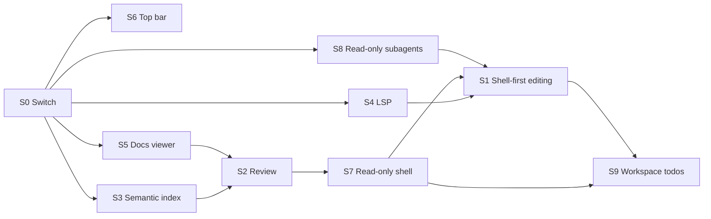

# Streamlining Roadmap

This page sketches a smaller Robi: one
general-purpose tool instead of a suite of specialised ones, fewer surfaces, and
a shell that spends its width on the conversation. **Nine workstreams have
shipped** — S1, S2, S3, S4, S5, S6, S7, S8, and S9 — so the roadmap is complete.

Nothing was deleted to get there. Each backend surface sits behind a Cargo
feature, off by default, exactly as the front end has one switch in
`src/app/surfaces.ts`: [feature-switches.md](design/core/feature-switches.md).

The premise is that a **minimalist harness** can outperform a complex one. A
small tool set with good prompts gives the model fewer ways to choose wrong, and
a shell is the one interface that already knows how to read, search, edit, and
verify a repository. The counter-premise is just as important: every tool we
remove is a guarantee we stop enforcing in code and start enforcing in prompt
copy. This roadmap exists to test the first claim without losing the second.

Read [roadmap.md](roadmap.md) first for the shipped milestones. This page
describes M11, which subtracts from them.

## What shipped

Nine workstreams removed a **surface**, and the backend ones removed their
routes and tools too. The first pass kept each backend surface behind a Cargo
feature in `crates/robi/Cargo.toml`, off by default, gating the module, its
registration, and its OpenAPI entry together. S3 and S4 are now past that stage:
the index, the language-server client, and the tree-sitter outline are deleted,
and no flag restores them. The front end keeps its own switch in
`src/app/surfaces.ts`.

| # | What the app lost |
|---|---|
| S1 | `read_file`, `list_dir`, `find`, `grep`, `write_file`, `edit_file`, and `delete_file`. The shell reads, searches, and edits; the prompt carries the forms |
| S2 | The review screen, its route, its three API routes, and the `N files edited` strip. `git diff` is the review path |
| S3 | The index status pill, the `robi.index.v1.progress` event, the `semantic_search` tool, `IndexHub`, the two `/index` routes, and `crates/robi-index` |
| S4 | The five language-server tools, the `lsp` setting, and the LSP client in `agent/lsp/` |
| S5 | The `#/docs` route, the docs screen, the editor, the chat tray, the toggle, and the four docs routes |
| S6 | The permanent left sidebar. Navigation is one bar across the top; the transcript gets the full width |
| S7 | The agent's ability to write from Ask or Plan. Ask holds a read-only shell; Plan may write only `.robi/plans` |
| S8 | A subagent's ability to write. Both child modes are read-only |
| S9 | `todos` and `write_plan`. A plan is `.robi/plans/<name>/PLAN.md` plus `TODO.md`, written and ticked with the shell |

`src/app/surfaces.ts` is the front-end switch: `docsViewer` and `reviewScreen`
are off, `topBarShell` is on. `topBarShell` is a layout flag only — it never
gates a backend call (D5). The `indexStatus` flag is gone: with the index off
there is nothing for it to show.

`crates/robi/Cargo.toml` is the backend switch. `default = []`, and four
features restore one workstream each: `read-tools`, `edit-tools`, `review`,
`docs-viewer`. S3 and S4 are not flags: their code is deleted. `make
lint-restore` and `make test-restore` compile and test the remaining restore
path, and CI runs both — a missing feature edge fails only there. See
[feature-switches.md](design/core/feature-switches.md).

Two prerequisites grew out of S1. **S7** was already required because a shell in
Plan is an editor in Plan. **S8 trimmed** became required because `explore` had
*only* read tools: removing them left it with nothing, so both child modes were
rebuilt on the read-only shell.

## Thesis

| Complex harness | Minimal harness |
|---|---|
| A tool per operation (`read_file`, `edit_file`, `write_file`, …) | One `shell` tool, plus a small set of read-only search tools |
| Tool schemas encode safety | The sandbox and approval policy encode safety |
| In-app review, docs, and index panes | The IDE, git, and a file browser do those jobs |
| A permanent navigation column | A top bar that yields width to the transcript |

The bet is that a strong model with `grep`, `cat`, `git diff`, and a shell writes
better code than a weaker model constrained by bespoke tools. If the bet is
wrong, the model burns turns on shell syntax and the harness gets slower, not
simpler. The measurement plan below is how we tell the difference.

## What changes

| # | Workstream | Outcome | State |
|---|---|---|---|
| S1 | Shell-first editing | `read_file`, `list_dir`, `find`, `grep`, `write_file`, `edit_file`, and `delete_file` are disabled. The agent reads, searches, and edits through `shell`, with prompt hints and `git diff` verification | **Shipped**. `read-tools` and `edit-tools` restore them |
| S2 | No in-app code review | Review routes and the edited-file strip leave the app. Review happens in an IDE or `git diff` | **Shipped**. `review` restores the routes; the baseline table stays |
| S3 | No semantic index | Indexing, embeddings, the `semantic_search` tool, and index UI are gone, along with `crates/robi-index`, tree-sitter, and the embedder | **Removed**. Nothing restores it |
| S4 | No LSP diagnostics | The five language-server tools, the `lsp` setting, and the LSP client are gone | **Removed**. Nothing restores it |
| S5 | No docs viewer | The `/docs` route, docs screen, docs editor, and the docs routes are removed | **Shipped**. `docs-viewer` restores them; `agent/docs/` stays |
| S6 | Top-bar shell | The permanent left sidebar is removed; navigation moves into the top bar | **Shipped** |
| S7 | Read-only shell in Ask and Plan | Ask gets a shell that cannot write; Plan may write only `.robi/plans` | **Shipped** |
| S8 | Read-only subagents | No child can write, and none can run unsandboxed | **Shipped** |
| S9 | No built-in todos | `todos` and `write_plan` go. A plan is `.robi/plans/<name>/PLAN.md` with a checkbox `TODO.md` beside it, written through the shell | **Shipped**. Nothing restores the tools |

## S1 — Shell-first editing

**Shipped as shell-only**, which is further than this section first proposed.
The original plan kept `find`, `grep`, `list_dir`, and `read_code`; the shipped
build removes them too, behind `--features read-tools`. `read_code` went further
still: it was the last user of the tree-sitter outline, so it is deleted with
S3's grammar crates, and `read_file` is the window into a source file. The shell
is the only interface to the workspace by default, and the prompt teaches the
forms.

That widened the prerequisites. `explore` had only read tools and no shell, so
removing them would have left it with nothing: both child modes were rebuilt on
the read-only shell (S8 trimmed). And the prompt now covers reading, searching,
editing, and verifying, not just the three write operations.

### What the model is told

The prompt is the whole interface now, so the hints are product copy and need
the same review as a tool schema. The first cut:

| Job | Hint |
|---|---|
| Read a file | `sed -n '1,120p' path`, `cat path`, `head`/`tail`; no pager, no `less`, no `vim` |
| Read a slice by line | `sed -n '40,80p'` or `awk 'NR>=40 && NR<=80'` |
| Full overwrite | `cat > path <<'EOF' … EOF` — quoted delimiter, so `$` and backticks survive |
| Small exact replacement | A short Python script that reads, replaces one occurrence, asserts the count, and writes |
| Delete | `rm path`, after confirming the path with `ls` |
| Verify | `git diff -- path`, `git status --short`; read the diff before claiming success |
| Avoid | `sed -i` for multi-line or regex-heavy edits, interactive editors, commands that wait on stdin |
| Search | `grep`/`rg`; prefer the tools when they are registered |

Two hints carry most of the risk:

- **`sed -i` is the wrong default.** It is portable enough to seem safe and
  subtly different between GNU and BSD, and an unanchored pattern edits more
  than intended. A Python replace that asserts exactly one match fails closed.
- **`cat <<'EOF'` is the only reliable full overwrite.** An unquoted delimiter
  expands `$VAR` and backticks inside the file being written, which corrupts
  shell scripts and templates. The prompt must show the quoted form.

The existing `shell` tool already returns `exit_code`, `stdout`, `stderr`,
`truncated`, and `sandboxed`, plus a blocked-path hint. That is the feedback
loop the agent needs. Shell output compression (M9) becomes more important here,
because a shell-first agent produces more output, not less.

### What this costs

- **Checkpoints can no longer be recorded automatically.** The edit journal in
  [checkpoints.md](design/tools/checkpoints.md) relies on `write_file` and
  `edit_file` to capture a baseline before their first write. A `shell` command
  is opaque, so the harness cannot know which paths it touched. S1 therefore
  depends on S2: either review and undo move to git, or a shell-first session
  has no per-session undo. Pretending to keep checkpoints without intercepting
  writes would be worse than removing them.
- **Ask and Plan must be pinned read-only first.** Once the shell is the editing
  interface, a mode that has a shell has an editor. S7 lands before S1 for that
  reason; without it, the mode policy silently widens.
- **Approval granularity changes.** A denied path currently becomes a prompt for
  that call. Under a shell, approval is for the command, and the command can
  touch many paths. The sandbox and the session path rules must stay the
  enforcement point; the prompt hints are convenience, not a boundary.
- **The prompt gets longer.** Deleting three schemas buys some tokens back, but
  the shell hints spend them. Measure the net change rather than assuming it is
  a saving.

### Exit criteria

A representative edit task — read a file, change one function, run the tests,
and inspect `git diff` — completes in the same number of turns as today, with no
higher rate of failed commands. If it does not, keep the edit tools.

## S2 — No in-app code review

**Shipped as a UI change.** The route and the screen are gone from the app, and
the strip with them; the API routes and `features/review/` stay. Baselines are
still written because the edit tools still write them — S2 coupled the baselines
to S1, and S1 has not shipped, so there is nothing to remove yet. The inline file
peek from a tool call card is not a review surface and stays.

Remove the review screen and the routes behind it:

- `GET /api/v1/chat_sessions/{id}/review`
- `GET /api/v1/chat_sessions/{id}/review/file`
- `POST /api/v1/chat_sessions/{id}/review`
- the `/sessions/:id/review` route and `src/features/review/`

The user reviews in an IDE or with `git diff`, which is where review already
happens for most people. The assistant can be asked to explain a diff, but it
does not own a review surface.

This is coupled to S1 and to [checkpoints.md](design/tools/checkpoints.md):

- The review screen reads `session_file_baselines`, and so does checkpoint
  undo. Removing review does not automatically remove the table, but a
  shell-first agent cannot fill it.
- Recommendation: **remove the baselines with the review screen.** Git becomes
  the undo mechanism. A session that wants an independent snapshot can ask for
  `git stash` or a branch, under the same approval as any other command.
- Keep `crates/robi/src/agent/review/` behind the disabled switch until the
  shell-first path has shipped for a release. If checkpoints return, they will
  return as a git-backed feature, not a second journal.

Also update [guides/code-review.md](guides/code-review.md): either delete the
page or turn it into "reviewing changes with git and your editor". A guide for a
removed screen is a broken link with extra steps.

### Exit criteria

No route, component, guide, or prompt mentions in-app review. `git diff` is the
documented verification path, and the S1 prompt hints say so.

## S3 — No semantic index

**Removed.** The first pass gated the workstream behind `--features
semantic-index`. The code is now deleted:

- the `semantic_search` tool (`agent/tools/semantic_search.rs`);
- `IndexHub` and its leases (`agent/index.rs`);
- `GET`/`PUT /api/v1/workspaces/{id}/index` (`web_api/code_index.rs`);
- the `robi.index.v1.progress` event and its constant;
- the semantic engine in docs search, which is now a literal scan;
- `crates/robi-index`, and with it `fastembed`, `sqlite-vec`, `rusqlite`,
  `notify`, and the tree-sitter grammars.

The index status pill and the client's frame handling went in the first pass. A
cold start issues no index work and opens no embedding model, because there is
no embedder or index task left to start.

Agents did not call `semantic_search` enough to justify an embedding runtime, a
vector store, and a background index task. `grep` and `find` are the retrieval
path, and that is a real downgrade for "where is this concept handled?"
questions. The prompt says so honestly: search by identifier and filename first,
then read the hits.

The last user of the tree-sitter outline was `read_code`, so it goes with the
grammars rather than staying as a duplicate of `read_file`. `read_file` is the
window into a source file, and the shell covers the rest.

`~/.robi/index/<workspace_id>/` is no longer written. The workspace asset
cleaner still removes a directory an older install left behind.

### Exit criteria

A cold workspace start does no indexing work and opens no embedding model, and
the index status UI is gone. `grep`/`find` cover the retrieval in the S1 task
set without a measurable drop in success.

## S4 — No LSP diagnostics

**Removed.** The first pass gated the five tools behind `--features lsp-tools`
and kept the client. With no tool driving it, the client is dead weight, so the
whole module is deleted: `agent/lsp/`, `agent/tools/lsp.rs`, and the `async-lsp`
and `futures-io` dependencies. `note_lsp` goes with it; nothing else invalidated
a server cache.

The two smaller decisions:

1. **Diagnostics only, or the whole LSP surface?** The whole surface. If the
   agents do not use diagnostics, they do not use symbol navigation either, and
   five tools sharing one hub is one subsystem, not five.
2. **What replaces verification?** The shell. `cargo check`, `tsc --noEmit`,
   `eslint`, and the project's own test command are already available through
   `shell` and are more honest than a diagnostics snapshot. The prompt hints say
   so.

`docs/src/reference/tools.md` has no language-server section, and the design
page for the client is deleted rather than bannered.

### Exit criteria

`lsp = on` is an unknown setting, no language-server tool is registered, and the
S1 task set verifies with `cargo check` rather than `diagnostics`.

## S5 — No docs viewer

**Shipped as a UI change.** The route is out of `chatRoutePaths`, `DocsScreen` and
`ChatTray` are out of `ChatChrome`, and the toggle is out of the bar. The docs
modules and the API routes stay, so a return is a flag flip plus a back link. A
`#/docs` hash kept from an older build is rewritten to the chat on startup.

Temporarily remove the viewer and editor:

- the `/docs` route and `ViewToggle`;
- `src/features/docs/` (screen, tree, toolbar, find bar, editor, autosave);
- `src/api/docs.ts` and the docs store.

The backend question is separate. The agent can read and write markdown with the
shell, so `web_api/docs.rs` is not needed by the model. Recommendation: disable
the docs routes with the UI, and keep `agent/docs/` (change reconciliation and
merge) behind the switch. When the viewer returns, it returns with its merge
path intact rather than half-remembered.

Docs search goes with the viewer, and its guide went with it. If search should
survive as a standalone surface, it needs its own entry point, which is a
different feature.

**Temporarily** means the removal is reversible and recorded: the design pages
[design/shell/docs-viewer.md](design/shell/docs-viewer.md) and
[design/shell/docs-mode.md](design/shell/docs-mode.md) stay, with the banner and
a note on what a return would need.

### Exit criteria

No `/docs` route, no docs components, and the S1 prompt tells the agent to use
the shell for markdown. The user browses docs in an external editor.

## S6 — Top-bar shell

**Shipped.** `TopBar` renders one row over the window frame's strip: the workspace
dropdown, back and forward, the session title (which is also the Recents menu),
then New chat, Settings, and an overflow holding MCP marks and the API health
row. `Sidebar` and `ChatHeader` remain in the tree as the legacy branch behind
`showSurface('topBarShell')`; delete them a release after this shipped.

Remove the permanent left sidebar and give the transcript the full window width.
Everything the sidebar held moves into the top bar:

| Today (sidebar) | Tomorrow (top bar) |
|---|---|
| Workspace switcher | Workspace dropdown at the leading edge |
| Recents session list | Recents dropdown, with the current session title as the trigger |
| New chat | Icon button |
| Workspaces | Item in the workspace dropdown, not a separate page link |
| Settings | Icon button at the trailing edge |
| Chat/Docs toggle | Gone with S5 |
| History back/forward | Icon pair beside the title |
| Index status | Gone with S3 |
| API status, MCP tray | Stay in the top bar; MCP moves into an overflow icon |

The shell already has two vertical layers to work with: `WindowFrame` (the
draggable, route-tinted window chrome) and `ChatHeader` (the session header).
S6 should produce one bar, not two stacked bars. On macOS the leading edge
must leave room for the traffic lights; the existing `WindowFrame` padding rules
are the place to handle that.

Design constraints:

- **One row at the default width.** The title truncates before any control does.
  The primary actions (workspace, recents/new chat, settings) stay visible; the
  rest collapses into one overflow menu.
- **Dropdowns are menus, not panels.** Kobalte primitives styled with the tokens
  in [visual-style.md](design/shell/visual-style.md). No new hex values.
- **Keyboard and focus still work.** Every icon-only button needs an accessible
  name and a shortcut where the sidebar had one. A hover-only menu is not a
  replacement for a visible list.
- **Recents needs search.** A dropdown is worse than a list once a user has more
  than a screenful of sessions. Ship it with a filter field or cap it and link
  to the workspaces page.
- **State lives where it did.** `ChatChrome` keeps owning route and session
  state; only the presentation moves. Do not create a second source of truth for
  the selected workspace.

### Exit criteria

At 1280 px and 900 px wide, the transcript gets the full width, every sidebar
function is reachable in two clicks or fewer, and no control is clipped. The
`Sidebar.tsx` and `Sidebar.module.css` files are gone from the render path,
along with `AppLayout`'s fixed left column.

## S7 — Read-only shell in Ask and Plan

Today the mode's tool set decides who may write, and it does so by withholding
tools: Ask gets no `shell`, Plan gets a `shell` that can write anywhere the
sandbox allows, and Agent gets the edit tools too. Under S1 the shell becomes
the editing interface, so "Plan has a shell" quietly becomes "Plan can edit".
That must not happen.

Make read-only a property of the `shell` tool instance, not a consequence of
which tools were registered:

| Mode | Today | After S7 |
|---|---|---|
| Ask | No `shell` | `shell`, read-only |
| Plan | `shell`, full write inside the sandbox | `shell`, read-only |
| Agent | `shell`, full write inside the sandbox | unchanged |

Implementation shape:

- **A flag, not a second tool.** `Shell::new(ctx)` gains a `ShellAccess::ReadOnly`
  or `ReadWrite`. One tool, one schema, two policies; a separate `read_shell`
  tool would split the prompt and the tests for no benefit.
- **Enforce in the sandbox profile, not in the arguments.** A read-only call
  puts the workspace in `Profile::deny_writes` and refuses `write_paths`
  outright. Checking the command string for `>`, `rm`, or `tee` is not
  enforcement: `python -c`, `cp`, and `git checkout` all write without a
  redirect. The OS profile is the boundary.
- **Drop the write knobs from the schema.** In read-only mode, omit `write_paths`
  and `unsandboxed` from `parameters()`, and say so in `description()`. A
  property the model can set and the tool then refuses is a wasted turn.
- **Refuse, then explain.** A blocked write returns the sandbox's blocked-path
  hint plus "this mode is read-only", so the model asks the user to switch to
  Agent rather than retrying the same command.
- **`git` is read-only or it is not.** `git status`, `diff`, `log`, `show`, and
  `grep` are fine. `git checkout`, `restore`, `stash`, `commit`, and anything
  that writes `.git` are writes. The simplest rule that holds: the read-only
  profile denies `.git` writes along with the working tree, which makes the
  whole family fail closed without a command allowlist.

**Build caches are the sharp edge.** `cargo check` writes to `target/`, `tsc`
and `eslint` write caches, and a test run writes artifacts. A blanket
deny-writes profile therefore refuses exactly the verification commands S1
tells the agent to use. Two honest options:

1. **Scope the exception.** Let a read-only call write to the known build and
   cache directories (`target/`, `node_modules/.cache/`, `.git` excluded), and
   nothing else. This needs a per-project list, so it is a setting, not a
   constant.
2. **Verify in Agent only.** Ask and Plan read and reason; they do not run the
   build. The prompt says so, and a refused `cargo check` is expected.

Prefer the first if the mode prompts promise verification, and the second if
they do not. Do not silently allow the whole workspace and call it read-only.

Ask gains a shell it did not have. That is deliberate: with S1 and S3 in place,
`grep`, `ls`, and `git diff` are how the agent answers questions, and Ask needs
them. If Ask should stay tool-free of the shell, drop that row; do not keep the
shell and leave it unconstrained.

### Exit criteria

In Ask and Plan, a command that writes fails inside the sandbox with a
read-only refusal and no file changes. `git diff` still works. The tool schema
in those modes has no `write_paths` or `unsandboxed`.

## S8 — Read-only subagents

A subagent cannot ask for approval, and the current code already fails closed:
`FailClosed` turns any `NeedsApproval` call into an `access_denied` result. That
is the right shape, but it is not the same as read-only. A sandboxed write
inside the workspace needs no approval, so a `general` child can still edit
files, run `git checkout`, and leave the workspace changed after the summary is
returned.

Make the child's access read-only in the profile, not in the wrapper:

- **Every child gets `ShellAccess::ReadOnly`.** `general` keeps its shell,
  because command output is what it is for; it loses the ability to write.
  `explore` has no shell and is unaffected.
- **No child can run unsandboxed.** This is already true through `FailClosed`,
  but state it as an invariant and test it directly rather than relying on the
  wrapper. The child registry must not see `unsandboxed`, `write_paths`, or
  `network: unrestricted` in its schema at all. Removing the key is stronger
  than rejecting the value.
- **Keep `FailClosed`.** It is still what stops a child from reading outside the
  session's allowed paths. Read-only narrows writes; fail-closed still bounds
  reads.
- **The summary is the only channel out.** A child that wants a change makes
  it the parent's job: the summary says what to change, and the parent edits
  with its own approval path. That is the same argument as
  [subagents.md](design/core/subagents.md) makes for not giving `explore` a
  shell.

Two consequences to write down:

- `general` subagents become slower for tasks that assume they can fix what they
  find, because every fix becomes a parent turn. That is the price of not having
  an approval channel, and it is better than a silent edit.
- A subagent's transcript is in memory and the parent sees only the summary, so
  a write made by a child is the hardest kind of change to audit. Removing that
  path also removes a class of "where did this edit come from?" bugs.

### Exit criteria

No child tool schema contains `unsandboxed`, `write_paths`, or an unrestricted
network option. A `general` child asked to write a file returns a refusal and
the file is unchanged. A test asserts the read-only profile for both child
modes, and a second test asserts the schema has no escalation keys.

## S9 — No built-in todos

**Shipped.** The `todos` and `write_plan` tools are gone. A plan is a directory
in the workspace, written and ticked with the same shell the agent uses for
everything else (S1).

### The layout

```
.robi/plans/
  .gitignore                 # one line: *
  ship-mode-registry/
    PLAN.md                  # the prose: what changes, why, in what order
    TODO.md                  # the checklist, and nothing else
```

Flat under `.robi/plans/`, one directory per plan, named from the plan's title
in kebab case — no session subdirectory and no uuid, so `ls .robi/plans` reads
as the list of outstanding work. Splitting the prose from the checklist is what
keeps ticking cheap: marking a step done touches only `TODO.md`, so `PLAN.md`
stays stable for the whole implementation.

Rules, and no more than these:

- **Checkboxes, not frontmatter.** `- [ ]` and `- [x]` in `TODO.md`. Every model
  writes these without being taught, and the user's editor renders them.
- **One ignore file, ignoring itself.** `.robi/plans/.gitignore` holds a single
  `*`. A bare `*` covers every entry in that directory recursively, including
  the `.gitignore` itself, so `git status` stays clean and `git add` picks up
  nothing. A `.gitignore` inside a plan directory would be dead weight: an
  ignored directory's children are already unreachable to git.
- **List first, then name.** Plan mode `ls`es `.robi/plans` and updates an
  existing plan directory for the same work rather than minting a near-duplicate.
- **The files are the source of truth.** No session column and no prompt
  injection. Agent mode lists `TODO.md` and `cat`s both files, which is the same
  pair of shell calls the user makes.

### Plan mode writes one directory

S7 made Plan's shell read-only, and `write_plan` was the only write it had.
Removing the tool without a replacement would leave Plan unable to produce a
plan at all, so Plan's profile gets **one writable directory**.

`Profile::extra_writes` is emitted read-write in both modes, on Seatbelt
(`allow file-write* (subpath …)`) and on bubblewrap (`--bind`, recursive). Its
position in the policy is the whole design:

- **after** the credential denies, so a workspace that *is* `$HOME` still opens
  `~/.robi/plans` while the rest of `~/.robi` stays closed;
- **before** the floor, the `.git` write deny, and the session deny lists, so
  every one of those still wins inside the directory.

The allow is a directory, not a file, so `mkdir -p .robi/plans/<name>` and both
files work without a per-plan rule. `ShellAccess::PlanReadOnly` is the third
variant: read-only schema (no `write_paths`, no `unsandboxed`), read-only
workspace, plus that one extra write root. Agent mode is unchanged — its
read-write profile already covers `.robi/plans`, which is what makes plan files
editable after the plan is built.

### What it cost

- **No validation.** `normalize_todos` used to reject duplicate ids, two
  `in_progress` items, and a 500-character step. A freeform checklist has none of
  that, and that is accepted: those checks mostly caught the model fighting its
  own tool schema.
- **No in-app rendering.** With no tool call to render, `PlanPage`, the plan card,
  and the todo rails went with the tools. The plan is two markdown files in the
  user's editor, which is where D13 landed.
- **The plan is invisible to tools.** `.robi` is hidden and git-ignored, so
  `git status`, `rg`, and the `find`/`grep` tools skip it; only `ls` and `cat`
  see it. That is the price of not polluting every diff.
- **Two sessions can tick the same plan.** A shared directory is the feature —
  the plan is a workspace artifact — and the mitigations are the read-before-write
  rule and distinct names, not a session scope.

### What was deleted, not disabled

Unlike S1–S5 there was nothing worth keeping behind a Cargo feature:

- `tools/todos.rs`, `tools/write_plan.rs`, and `tools/plan_file.rs`;
- the `todos_prompt` block and the `PlanChecklist` source in prompt assembly;
- `SessionPrompt.plan_path` and the `plan_path` argument on `ModelSource::model`;
- `adapters/session_plans.rs` and `domain/chat_session/plans.rs`, replaced by a
  `SessionDataCleaner` that removes only session blobs — a workspace plan
  directory now outlives the session that wrote it;
- the `chat_sessions.plan_path` column, dropped by migration `0003`;
- `PlanPage.tsx`, `TodoList.tsx`, `todoProgress.ts`, and the `write_plan` and
  `todos` cases in `toolCallView.ts`.

### Exit criteria

No `todos` or `write_plan` tool is registered in any mode, and a test asserts it
in every feature combination. Plan mode's shell creates `.robi/plans/<name>/`
with both files and the `.gitignore`, and is refused on `src/`, on a file at the
workspace root, on `.git/`, and on a sibling that leaves the plans root. Agent
mode's shell writes the same files. The prompt carries the layout, the checkbox
convention, and the `.gitignore`.

## Sequencing

The order is chosen so the app is usable at every step and each step can be
reverted alone.

1. **S0 — the switch and the banners.** Add the single `streamlined` switch, the
   disabled banners, and a prompt-hint test that asserts the shell hints are
   present. No behavior changes.
2. **S6 — the top bar.** Pure UI. Do it before removing features so the layout
   is proven while the surfaces still exist. The sidebar can be hidden first,
   then deleted.
3. **S5 — the docs viewer.** Smallest backend surface, and its removal frees the
   top bar of the Chat/Docs toggle.
4. **S3, S4, and S8 — the intelligence layer and child confinement.** All three
   are backend registrations plus a policy flag. None changes the editing path,
   and S8 is a small, self-contained narrowing.
5. **S2 — review and baselines.** Remove after the intelligence layer, because
   it is the only workstream that deletes a safety net.
6. **S7 — the read-only shell.** Land it before S1, so the mode policy exists
   before the shell becomes the editing interface. S7 on its own is a small
   behavior fix; it is required only because of S1.
7. **S1 — shell-first editing.** Last, because it is the change that can
   actually make the product worse. It ships behind the switch and is measured
   against the current harness.
8. **S9 — workspace plan directories.** Shipped last: after S1, because the
   replacement writes through the shell, and after S7, because Plan's write
   exception is defined against the read-only profile.

S1 depends on S2's decision about baselines and on S7 being in place. If S1
ships without S7, Plan and Ask become editing modes by accident. S3, S4, and S8
must ship before S1's measurement run, so the "before" and "after" harnesses
differ only in the editing path. If S1 fails its exit criteria, S2–S8 still
stand on their own. S9 shipped last, and it could have shipped earlier: its
replacement is a plain file write, so it needs only `write_file` or the shell.



## How we will know

The research claim is empirical, so the change is too. Run the same task set
against the current harness and the streamlined one, with the same model and
the same prompt:

| Metric | Why |
|---|---|
| Task success | The only metric that matters if it moves the wrong way |
| Model turns to done | A shell-first agent that needs ten extra turns is not simpler |
| Tool-call errors | Shell syntax mistakes, bad paths, failed replacements |
| Tokens in and out | The prompt gets longer and the schemas get shorter; measure the net |
| Time to first useful diff | Perceived speed, not wall-clock |
| Approval prompts per task | Fewer prompts is the point; more means the sandbox is doing too much |

Keep the task set in the repository so the comparison is repeatable. A
qualitative review of the traces is worth more than a single number: read the
turns where the streamlined harness lost, and decide whether the loss is a
prompt hint or a missing tool. That distinction is this roadmap's main open
question.

## Risks

| Risk | Mitigation |
|---|---|
| Shell-first editing is less safe, not just simpler | The sandbox and approval policy are unchanged. `shell` stays mandatory-sandboxed; path rules stay the floor. Prompt hints are never described as a boundary. |
| The model writes a broken heredoc and corrupts a file | Quoted delimiter in every example; verify with `git diff` before claiming success; keep `write_file` one switch away. |
| No per-session undo | Git is the undo. Say so in the guide and the prompt. |
| Removing review makes the agent's changes invisible | The chat already streams tool calls; the prompt requires a `git diff` after edits. |
| The top bar cannot hold the navigation at small widths | Overflow menu for secondary actions, keep the primary three visible, test at 900 px. |
| "Disabled" code rots | One switch, one banner convention, and a checklist in this page. Restore is a tested path, not a hope. |
| We remove a tool the model actually used | Keep a month of tool-call counts before deleting the registration. If a tool is in the top five, it does not qualify. |
| A read-only shell blocks `cargo check` and test runs | Scope writes to build and cache directories, or move verification to Agent mode and say so in the prompt. |
| A read-only shell is enforced by scanning the command string | Do not scan. Use the OS profile's deny list. A regex on `>` is defeated by `python -c` on the first try. |
| Plan mode becomes useless without a writable shell | Plan's one writable directory is `.robi/plans` (S9). Anything else is an Agent task. |
| Subagents lose the ability to fix what they find | Expected. The summary names the fix; the parent applies it with its own approval. Measure the extra parent turns in the S1 run. |
| S8 is "already true" and silently regresses | Assert the invariant with tests on the profile and the schema, not on the wrapper's behavior. |
| Plan mode cannot write a plan once `write_plan` is gone | Plan's profile gets one writable directory: `Profile::extra_writes`, emitted before the floor and the `.git` and session denies. |
| A plan directory is stale, duplicated, or fights the user's edits | Plan mode `ls`es `.robi/plans` first, and Agent mode re-reads `TODO.md` before rewriting it. |
| A plan file pollutes every diff | `.robi/plans/.gitignore` holds `*`, so the directory ignores itself. Deleting that file is the opt-in to tracking. |

## Open decisions

- **D1 — Is `read_file` really redundant?** **Settled: it went with the rest.**
  The trade is real — `read_file` reported truncation with an exact continuation
  offset, and `sed`/`wc` is the only substitute. `--features read-tools` brings
  it back on its own if the S1 run shows repeated `sed`/`wc` calls.
- **D2 — Do checkpoints return as git-backed?** **Settled: no automatic
  journal.** A shell command is opaque, so no baseline is recorded and there is
  no in-app undo. The prompt points at `git diff`, `git stash`, and a branch. The
  baseline table stays because the `edit-tools` restore path writes it.
- **D3 — Diagnostics only, or all LSP tools?** **Settled: all five.** They share
  one hub, and leaving four registered buys nothing. The `lsp` setting is gone.
- **D4 — Do docs routes leave with the UI, or stay for a future client?**
  **Settled: they leave, behind `--features docs-viewer`.** `agent/docs/` stays
  unconditional, so the reconciliation and merge path is intact for a return.
- **D5 — One switch or two?** **Settled: one module of front-end flags, and one
  Cargo feature per workstream.** `src/app/surfaces.ts` holds `docsViewer`,
  `reviewScreen`, and `topBarShell`; `indexStatus` is gone with the index.
  `topBarShell` is a layout flag that gates no backend behavior, which is what S6
  shipping on its own required. The backend flags are in
  [feature-switches.md](design/core/feature-switches.md).
- **D6 — What happens to `read_code`?** **Settled: deleted.** It lived behind
  `read-tools` while the outline was still there. It was the last user of
  tree-sitter, so it went when the grammar crates did, rather than staying as a
  second `read_file`. A return means a parser and a new outline, not a flag.
- **D7 — Does Ask get a shell?** **Settled: a read-only one.** With `grep` and
  `git diff` gone from the tool set, Ask needs the shell to answer anything.
- **D8 — Build caches under a read-only profile?** **Settled: verify in Agent
  only.** The read-only profile refuses `target/`, so `cargo check` and a test
  run fail in Ask and Plan, and the mode copy says so. A `build_write_paths`
  setting scoped to `target/` is the follow-up if those modes ever promise
  verification.
- **D9 — Do `general` subagents keep a shell at all?** **Settled: yes,
  read-only.** If the traces show it is useless for them, the follow-up is to
  drop the shell from both child modes and make delegation purely
  read-and-summarize.
- **D10 — Where does the checklist live?** **Settled:**
  `.robi/plans/<name>/TODO.md`, with the prose in `PLAN.md` beside it. Not a
  session directory and not one fixed file: the directory name says what the plan
  is, and the split keeps stable prose apart from a changing checklist.
- **D11 — Does Plan mode get a one-path write exception?** **Settled: yes,
  directory-scoped.** `Profile::extra_writes` opens `.robi/plans` read-write for
  Plan's shell instance and nothing else. The allow is recursive, so the model
  may name its own directory and files inside it.
- **D12 — Is the plan file git-tracked?** **Settled: no.**
  `.robi/plans/.gitignore` holds a single `*`, which ignores the directory
  recursively including itself. The user opts in by deleting that file.
- **D13 — Does anything still render a plan in-app?** **Settled: no.** With S5
  and S9 shipped there is no plan surface: the plan is markdown in the user's
  editor. A read-only page over the workspace file route is the follow-up if it
  is ever wanted.

## What must be updated when this ships

Done for S1, S2, S3, S4, S5, S6, S7, S8, and S9. A page a shipped workstream touches
now says what the app does, not what it used to do.

- [roadmap.md](roadmap.md): M6, M7, and M10 say "Disabled". **Done.**
- [reference/tools.md](reference/tools.md): the tool set after S1, S3, and S4.
  **Done.**
- [guides/editor.md](guides/editor.md): the shell-first workflow. **Done.**
- [guides/code-review.md](guides/code-review.md): review with git and an IDE.
  **Done.**
- The docs-search guide: removed with S5. **Done.**
- [design/shell/frontend-layout.md](design/shell/frontend-layout.md),
  [design/shell/visual-style.md](design/shell/visual-style.md), and
  [design/shell/events-sse.md](design/shell/events-sse.md): the top-bar layout
  and the removed left column. **Done.**
- [design/core/agent-modes.md](design/core/agent-modes.md): the mode table, with
  a read-only shell in Ask and Plan. **Done.**
- [design/core/subagents.md](design/core/subagents.md): both children are
  read-only, and no child can escalate. **Done.**
- [design/tools/shell-tool.md](design/tools/shell-tool.md): the `ShellAccess`
  flag, the read-only profile, and `Profile::extra_writes`. **Done.**
- [design/tools/editing-tools.md](design/tools/editing-tools.md),
  [read-tools.md](design/tools/read-tools.md), and
  [checkpoints.md](design/tools/checkpoints.md): the shell is the interface and
  there is no automatic journal. **Done.**
- The design pages for review and docs: the disabled banner. The LSP, semantic
  search, and code-outline pages are deleted with their subjects. **Done.**
- [design/core/feature-switches.md](design/core/feature-switches.md): new, and
  the backend counterpart of `src/app/surfaces.ts`. **Done.**
- `AGENTS.md`: the layout table and the "removed surface is a Cargo feature"
  rule. **Done.**
- [reference/http-api.md](reference/http-api.md),
  [reference/configuration.md](reference/configuration.md), and
  [reference/file-locations.md](reference/file-locations.md): the removed
  routes, the removed `lsp` key, and the index directory. **Done.**
- `openapi/openapi.json` and `src/api/schema.d.ts`: regenerated, and they now
  contain no review, docs, or index route. **Done.**
- [design/core/agent-modes.md](design/core/agent-modes.md) and
  [reference/tools.md](reference/tools.md): `todos` and `write_plan` removed,
  Plan's one writable directory, and the `.robi/plans` convention in their place.
  **Done.**
