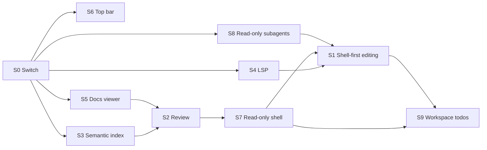

# Streamlining Roadmap

This page sketches a smaller Robi: one
general-purpose tool instead of a suite of specialised ones, fewer surfaces, and
a shell that spends its width on the conversation. **Four workstreams have
shipped as UI changes** — S2, S3 (its UI half), S5, and S6 — and the rest are
still proposals.

The premise is that a **minimalist harness** can outperform a complex one. A
small tool set with good prompts gives the model fewer ways to choose wrong, and
a shell is the one interface that already knows how to read, search, edit, and
verify a repository. The counter-premise is just as important: every tool we
remove is a guarantee we stop enforcing in code and start enforcing in prompt
copy. This roadmap exists to test the first claim without losing the second.

Read [roadmap.md](roadmap.md) first for the shipped milestones. This page
describes M11, which subtracts from them.

## What shipped

The four shipped workstreams removed a **surface**, not the code. Nothing in the
backend changed: the review, docs, and index routes are still served, and the
dependency graph is untouched.

| # | What the app lost |
|---|---|
| S2 | The review screen, its route, and the `N files edited` strip. `git diff` is the review path |
| S3 (UI) | The index status pill and the client's handling of `robi.index.v1.progress`. The index still runs; the tool is untouched |
| S5 | The `#/docs` route, the docs screen, the editor, the chat tray, and the chat/documentation toggle |
| S6 | The permanent left sidebar. Navigation is one bar across the top; the transcript gets the full width |

`src/app/surfaces.ts` is the switch: `docsViewer`, `reviewScreen`, and
`indexStatus` are off, `topBarShell` is on. Flipping a value restores that
surface, and the modules behind it never left the tree. `topBarShell` is a layout
flag only — it never gates a backend call (D5).

S3's **backend** half — disabling `semantic_search`, `IndexHub`, and the index
routes — is still open. So are S1, S4, S7, S8, and S9.

## Thesis

| Complex harness | Minimal harness |
|---|---|
| A tool per operation (`read_file`, `edit_file`, `write_file`, …) | One `shell` tool, plus a small set of read-only search tools |
| Tool schemas encode safety | The sandbox and approval policy encode safety |
| In-app review, docs, and index panes | The IDE, git, and a file browser do those jobs |
| A permanent navigation column | A top bar that yields width to the transcript |

The bet is that a strong model with `grep`, `cat`, `git diff`, and a shell writes
better code than a weaker model constrained by bespoke tools. If the bet is
wrong, the model burns turns on shell syntax and the harness gets slower, not
simpler. The measurement plan below is how we tell the difference.

## What changes

| # | Workstream | Outcome | State |
|---|---|---|---|
| S1 | Shell-first editing | `read_file`, `edit_file`, and `write_file` are disabled. The agent reads and edits through `shell`, with prompt hints and `git diff` verification | Proposed |
| S2 | No in-app code review | Review routes, screens, and baselines leave the app. Review happens in an IDE or `git diff` | **Shipped (UI)**. Routes still served; baselines still written |
| S3 | No semantic index | Indexing, embeddings, the `semantic_search` tool, and index UI are disabled | **UI shipped**. Backend open |
| S4 | No LSP diagnostics | The `diagnostics` tool is disabled, and the LSP surface is reduced or gated | Proposed |
| S5 | No docs viewer | The `/docs` route, docs screen, and docs editor are temporarily removed | **Shipped (UI)**. Backend open |
| S6 | Top-bar shell | The permanent left sidebar is removed; navigation moves into the top bar | **Shipped** |
| S7 | Read-only shell in Ask and Plan | Ask and Plan get a shell that cannot write, whatever the sandbox allows | Proposed |
| S8 | Read-only subagents | No child can write, and none can run unsandboxed | Proposed |
| S9 | No built-in todos | `todos` and `write_plan` go; the agent keeps its checklist in a `TODO.md` or `plan.md` in the workspace | Proposed |

## S1 — Shell-first editing

Disable the three file-mutation tools and let `shell` do the work. `find`,
`grep`, and `list_dir` stay: they are read-only, cheap, and map cleanly to what
the model already knows. `read_code` stays for the same reason, or is disabled
too if it goes unused; decide from the tool-call data, not from taste.

### What the model is told

The prompt is the whole interface now, so the hints are product copy and need
the same review as a tool schema. The first cut:

| Job | Hint |
|---|---|
| Read a file | `sed -n '1,120p' path`, `cat path`, `head`/`tail`; no pager, no `less`, no `vim` |
| Read a slice by line | `sed -n '40,80p'` or `awk 'NR>=40 && NR<=80'` |
| Full overwrite | `cat > path <<'EOF' … EOF` — quoted delimiter, so `$` and backticks survive |
| Small exact replacement | A short Python script that reads, replaces one occurrence, asserts the count, and writes |
| Delete | `rm path`, after confirming the path with `ls` |
| Verify | `git diff -- path`, `git status --short`; read the diff before claiming success |
| Avoid | `sed -i` for multi-line or regex-heavy edits, interactive editors, commands that wait on stdin |
| Search | `grep`/`rg`; prefer the tools when they are registered |

Two hints carry most of the risk:

- **`sed -i` is the wrong default.** It is portable enough to seem safe and
  subtly different between GNU and BSD, and an unanchored pattern edits more
  than intended. A Python replace that asserts exactly one match fails closed.
- **`cat <<'EOF'` is the only reliable full overwrite.** An unquoted delimiter
  expands `$VAR` and backticks inside the file being written, which corrupts
  shell scripts and templates. The prompt must show the quoted form.

The existing `shell` tool already returns `exit_code`, `stdout`, `stderr`,
`truncated`, and `sandboxed`, plus a blocked-path hint. That is the feedback
loop the agent needs. Shell output compression (M9) becomes more important here,
because a shell-first agent produces more output, not less.

### What this costs

- **Checkpoints can no longer be recorded automatically.** The edit journal in
  [checkpoints.md](design/tools/checkpoints.md) relies on `write_file` and
  `edit_file` to capture a baseline before their first write. A `shell` command
  is opaque, so the harness cannot know which paths it touched. S1 therefore
  depends on S2: either review and undo move to git, or a shell-first session
  has no per-session undo. Pretending to keep checkpoints without intercepting
  writes would be worse than removing them.
- **Ask and Plan must be pinned read-only first.** Once the shell is the editing
  interface, a mode that has a shell has an editor. S7 lands before S1 for that
  reason; without it, the mode policy silently widens.
- **Approval granularity changes.** A denied path currently becomes a prompt for
  that call. Under a shell, approval is for the command, and the command can
  touch many paths. The sandbox and the session path rules must stay the
  enforcement point; the prompt hints are convenience, not a boundary.
- **The prompt gets longer.** Deleting three schemas buys some tokens back, but
  the shell hints spend them. Measure the net change rather than assuming it is
  a saving.

### Exit criteria

A representative edit task — read a file, change one function, run the tests,
and inspect `git diff` — completes in the same number of turns as today, with no
higher rate of failed commands. If it does not, keep the edit tools.

## S2 — No in-app code review

**Shipped as a UI change.** The route and the screen are gone from the app, and
the strip with them; the API routes and `features/review/` stay. Baselines are
still written because the edit tools still write them — S2 coupled the baselines
to S1, and S1 has not shipped, so there is nothing to remove yet. The inline file
peek from a tool call card is not a review surface and stays.

Remove the review screen and the routes behind it:

- `GET /api/v1/chat_sessions/{id}/review`
- `GET /api/v1/chat_sessions/{id}/review/file`
- `POST /api/v1/chat_sessions/{id}/review`
- the `/sessions/:id/review` route and `src/features/review/`

The user reviews in an IDE or with `git diff`, which is where review already
happens for most people. The assistant can be asked to explain a diff, but it
does not own a review surface.

This is coupled to S1 and to [checkpoints.md](design/tools/checkpoints.md):

- The review screen reads `session_file_baselines`, and so does checkpoint
  undo. Removing review does not automatically remove the table, but a
  shell-first agent cannot fill it.
- Recommendation: **remove the baselines with the review screen.** Git becomes
  the undo mechanism. A session that wants an independent snapshot can ask for
  `git stash` or a branch, under the same approval as any other command.
- Keep `crates/robi/src/agent/review/` behind the disabled switch until the
  shell-first path has shipped for a release. If checkpoints return, they will
  return as a git-backed feature, not a second journal.

Also update [guides/code-review.md](guides/code-review.md): either delete the
page or turn it into "reviewing changes with git and your editor". A guide for a
removed screen is a broken link with extra steps.

### Exit criteria

No route, component, guide, or prompt mentions in-app review. `git diff` is the
documented verification path, and the S1 prompt hints say so.

## S3 — No semantic index

**The UI half shipped.** The index status pill and the client's
`robi.index.v1.progress` handling are off, so a cold start issues no index
request. The backend half — the tool, `IndexHub`, and the routes — is still open,
so the index still runs and `semantic_search` is still registered.

Agents do not call `semantic_search` enough to justify an embedding runtime,
a vector store, and a background index task. Disable:

- the `semantic_search` tool (`crates/robi/src/agent/tools/semantic_search.rs`);
- `IndexHub` and its leases (`crates/robi/src/agent/index.rs`);
- `GET`/`PUT /api/v1/workspaces/{id}/index` (`web_api/code_index.rs`);
- `IndexStatusLine` in the chat header;
- the semantic engine in docs search, assuming docs search survives S5 at all.

`crates/robi-index` stays in the tree, unbuilt or feature-gated. It is the
largest optional dependency in the workspace, which is exactly why it should be
behind a feature rather than deleted: restoring it later is a manifest change.

`grep` and `find` become the only retrieval path. That is a real downgrade for
"where is this concept handled?" questions, and the prompt should say so
honestly: search by identifier and filename first, then read the hits.

### Exit criteria

A cold workspace start does no indexing work, opens no embedding model, and the
index status UI is gone. `grep`/`find` cover the retrieval in the S1 task set
without a measurable drop in success.

## S4 — No LSP diagnostics

Disable the `diagnostics` tool, the settings toggle, and the registration path
in `register_read_tools`. The two smaller decisions:

1. **Diagnostics only, or the whole LSP surface?** `definition`, `references`,
   `hover`, and `workspace_symbol` share the same hub. If the agents do not use
   diagnostics, they are unlikely to use symbol navigation either. Prefer
   disabling the whole set and keeping `crates/robi/src/agent/lsp/` behind the
   switch. If tool-call data says `grep` is not a substitute for `references`,
   restore the four non-diagnostics tools and leave diagnostics off.
2. **What replaces verification?** The shell. `cargo check`, `tsc`, `eslint`,
   and the project's own test command are already available through `shell` and
   are more honest than a diagnostics snapshot. Add them to the prompt hints.

`docs/src/reference/tools.md` should lose the language-server section, and
[design/intelligence/lsp.md](design/intelligence/lsp.md) gets the disabled
banner from S0.

### Exit criteria

`lsp = on` no longer registers a tool, the settings toggle is gone, and the S1
task set verifies with `cargo check` rather than `diagnostics`.

## S5 — No docs viewer

**Shipped as a UI change.** The route is out of `chatRoutePaths`, `DocsScreen` and
`ChatTray` are out of `ChatChrome`, and the toggle is out of the bar. The docs
modules and the API routes stay, so a return is a flag flip plus a back link. A
`#/docs` hash kept from an older build is rewritten to the chat on startup.

Temporarily remove the viewer and editor:

- the `/docs` route and `ViewToggle`;
- `src/features/docs/` (screen, tree, toolbar, find bar, editor, autosave);
- `src/api/docs.ts` and the docs store.

The backend question is separate. The agent can read and write markdown with the
shell, so `web_api/docs.rs` is not needed by the model. Recommendation: disable
the docs routes with the UI, and keep `agent/docs/` (change reconciliation and
merge) behind the switch. When the viewer returns, it returns with its merge
path intact rather than half-remembered.

Docs search goes with the viewer, and its guide went with it. If search should
survive as a standalone surface, it needs its own entry point, which is a
different feature.

**Temporarily** means the removal is reversible and recorded: the design pages
[design/shell/docs-viewer.md](design/shell/docs-viewer.md) and
[design/shell/docs-mode.md](design/shell/docs-mode.md) stay, with the banner and
a note on what a return would need.

### Exit criteria

No `/docs` route, no docs components, and the S1 prompt tells the agent to use
the shell for markdown. The user browses docs in an external editor.

## S6 — Top-bar shell

**Shipped.** `TopBar` renders one row over the window frame's strip: the workspace
dropdown, back and forward, the session title (which is also the Recents menu),
then New chat, Settings, and an overflow holding MCP marks and the API health
row. `Sidebar` and `ChatHeader` remain in the tree as the legacy branch behind
`showSurface('topBarShell')`; delete them a release after this shipped.

Remove the permanent left sidebar and give the transcript the full window width.
Everything the sidebar held moves into the top bar:

| Today (sidebar) | Tomorrow (top bar) |
|---|---|
| Workspace switcher | Workspace dropdown at the leading edge |
| Recents session list | Recents dropdown, with the current session title as the trigger |
| New chat | Icon button |
| Workspaces | Item in the workspace dropdown, not a separate page link |
| Settings | Icon button at the trailing edge |
| Chat/Docs toggle | Gone with S5 |
| History back/forward | Icon pair beside the title |
| Index status | Gone with S3 |
| API status, MCP tray | Stay in the top bar; MCP moves into an overflow icon |

The shell already has two vertical layers to work with: `WindowFrame` (the
draggable, route-tinted window chrome) and `ChatHeader` (the session header).
S6 should produce one bar, not two stacked bars. On macOS the leading edge
must leave room for the traffic lights; the existing `WindowFrame` padding rules
are the place to handle that.

Design constraints:

- **One row at the default width.** The title truncates before any control does.
  The primary actions (workspace, recents/new chat, settings) stay visible; the
  rest collapses into one overflow menu.
- **Dropdowns are menus, not panels.** Kobalte primitives styled with the tokens
  in [visual-style.md](design/shell/visual-style.md). No new hex values.
- **Keyboard and focus still work.** Every icon-only button needs an accessible
  name and a shortcut where the sidebar had one. A hover-only menu is not a
  replacement for a visible list.
- **Recents needs search.** A dropdown is worse than a list once a user has more
  than a screenful of sessions. Ship it with a filter field or cap it and link
  to the workspaces page.
- **State lives where it did.** `ChatChrome` keeps owning route and session
  state; only the presentation moves. Do not create a second source of truth for
  the selected workspace.

### Exit criteria

At 1280 px and 900 px wide, the transcript gets the full width, every sidebar
function is reachable in two clicks or fewer, and no control is clipped. The
`Sidebar.tsx` and `Sidebar.module.css` files are gone from the render path,
along with `AppLayout`'s fixed left column.

## S7 — Read-only shell in Ask and Plan

Today the mode's tool set decides who may write, and it does so by withholding
tools: Ask gets no `shell`, Plan gets a `shell` that can write anywhere the
sandbox allows, and Agent gets the edit tools too. Under S1 the shell becomes
the editing interface, so "Plan has a shell" quietly becomes "Plan can edit".
That must not happen.

Make read-only a property of the `shell` tool instance, not a consequence of
which tools were registered:

| Mode | Today | After S7 |
|---|---|---|
| Ask | No `shell` | `shell`, read-only |
| Plan | `shell`, full write inside the sandbox | `shell`, read-only |
| Agent | `shell`, full write inside the sandbox | unchanged |

Implementation shape:

- **A flag, not a second tool.** `Shell::new(ctx)` gains a `ShellAccess::ReadOnly`
  or `ReadWrite`. One tool, one schema, two policies; a separate `read_shell`
  tool would split the prompt and the tests for no benefit.
- **Enforce in the sandbox profile, not in the arguments.** A read-only call
  puts the workspace in `Profile::deny_writes` and refuses `write_paths`
  outright. Checking the command string for `>`, `rm`, or `tee` is not
  enforcement: `python -c`, `cp`, and `git checkout` all write without a
  redirect. The OS profile is the boundary.
- **Drop the write knobs from the schema.** In read-only mode, omit `write_paths`
  and `unsandboxed` from `parameters()`, and say so in `description()`. A
  property the model can set and the tool then refuses is a wasted turn.
- **Refuse, then explain.** A blocked write returns the sandbox's blocked-path
  hint plus "this mode is read-only", so the model asks the user to switch to
  Agent rather than retrying the same command.
- **`git` is read-only or it is not.** `git status`, `diff`, `log`, `show`, and
  `grep` are fine. `git checkout`, `restore`, `stash`, `commit`, and anything
  that writes `.git` are writes. The simplest rule that holds: the read-only
  profile denies `.git` writes along with the working tree, which makes the
  whole family fail closed without a command allowlist.

**Build caches are the sharp edge.** `cargo check` writes to `target/`, `tsc`
and `eslint` write caches, and a test run writes artifacts. A blanket
deny-writes profile therefore refuses exactly the verification commands S1
tells the agent to use. Two honest options:

1. **Scope the exception.** Let a read-only call write to the known build and
   cache directories (`target/`, `node_modules/.cache/`, `.git` excluded), and
   nothing else. This needs a per-project list, so it is a setting, not a
   constant.
2. **Verify in Agent only.** Ask and Plan read and reason; they do not run the
   build. The prompt says so, and a refused `cargo check` is expected.

Prefer the first if the mode prompts promise verification, and the second if
they do not. Do not silently allow the whole workspace and call it read-only.

Ask gains a shell it did not have. That is deliberate: with S1 and S3 in place,
`grep`, `ls`, and `git diff` are how the agent answers questions, and Ask needs
them. If Ask should stay tool-free of the shell, drop that row; do not keep the
shell and leave it unconstrained.

### Exit criteria

In Ask and Plan, a command that writes fails inside the sandbox with a
read-only refusal and no file changes. `git diff` still works. The tool schema
in those modes has no `write_paths` or `unsandboxed`.

## S8 — Read-only subagents

A subagent cannot ask for approval, and the current code already fails closed:
`FailClosed` turns any `NeedsApproval` call into an `access_denied` result. That
is the right shape, but it is not the same as read-only. A sandboxed write
inside the workspace needs no approval, so a `general` child can still edit
files, run `git checkout`, and leave the workspace changed after the summary is
returned.

Make the child's access read-only in the profile, not in the wrapper:

- **Every child gets `ShellAccess::ReadOnly`.** `general` keeps its shell,
  because command output is what it is for; it loses the ability to write.
  `explore` has no shell and is unaffected.
- **No child can run unsandboxed.** This is already true through `FailClosed`,
  but state it as an invariant and test it directly rather than relying on the
  wrapper. The child registry must not see `unsandboxed`, `write_paths`, or
  `network: unrestricted` in its schema at all. Removing the key is stronger
  than rejecting the value.
- **Keep `FailClosed`.** It is still what stops a child from reading outside the
  session's allowed paths. Read-only narrows writes; fail-closed still bounds
  reads.
- **The summary is the only channel out.** A child that wants a change makes
  it the parent's job: the summary says what to change, and the parent edits
  with its own approval path. That is the same argument as
  [subagents.md](design/core/subagents.md) makes for not giving `explore` a
  shell.

Two consequences to write down:

- `general` subagents become slower for tasks that assume they can fix what they
  find, because every fix becomes a parent turn. That is the price of not having
  an approval channel, and it is better than a silent edit.
- A subagent's transcript is in memory and the parent sees only the summary, so
  a write made by a child is the hardest kind of change to audit. Removing that
  path also removes a class of "where did this edit come from?" bugs.

### Exit criteria

No child tool schema contains `unsandboxed`, `write_paths`, or an unrestricted
network option. A `general` child asked to write a file returns a refusal and
the file is unchanged. A test asserts the read-only profile for both child
modes, and a second test asserts the schema has no escalation keys.

## S9 — No built-in todos

Remove the `todos` and `write_plan` tools. The agent keeps its open tasks in a
markdown file in the workspace — `TODO.md` for a running list, or `plan.md` when
the work is a plan — and updates it with the same shell writes it uses for
everything else (S1).

### What exists today

Worth seeing in full, because most of it is machinery that only exists to
support the tool:

| Piece | File | What it does |
|---|---|---|
| `todos` tool | `tools/todos.rs` | Patches `clear`/`remove`/`update`/`add` on frontmatter, validates unique ids and one `in_progress` |
| `write_plan` tool | `tools/write_plan.rs` | Creates or overwrites a plan, inventing `<plan_name>-<uuid>.md` |
| Frontmatter parser | `tools/plan_file.rs` | `split_plan`, `format_plan`, `normalize_todos`, the 500-char limit |
| Prompt injection | `tools/plan_file.rs` `todos_prompt` | Reads the plan at prompt build and emits a `<todos path="…">` block |
| Session column | `chat_sessions.plan_path` | Points at one plan file per session |
| Cleanup | `adapters/session_plans.rs` | Deletes `~/.robi/plans/<session_id>` with the session |
| UI | `PlanPage.tsx`, `todoProgress.ts`, `toolCallView.ts` | Derives a checklist from the tool-call arguments, not from the file |

The plan file lives under `~/.robi/plans/<session_id>`, outside the workspace.
That single fact is the argument for S9: the plan is the one artifact the user
most wants to read and edit, and it is in a hidden app directory they will
never open, in a bespoke frontmatter format, deleted when the session is.

### What replaces it

A file in the workspace, in a format the model already knows:

```markdown
# Ship the mode registry

- [ ] Add `ShellAccess` to the shell tool
- [x] Register the read tools per mode
- [ ] Update the mode table in the design doc
```

Rules, and no more than these:

- **Checkboxes, not frontmatter.** `- [ ]` and `- [x]`. Every model writes
  these without being taught, and the user's editor renders them.
- **One file, one convention.** `TODO.md` at the workspace root for a running
  list. `plan.md` when the user asked for a plan. Say which in the prompt; do
  not let the agent invent `tasks/TODO-2.md`.
- **The file is the source of truth.** No session column, no prompt injection
  from a hidden path. The agent reads it with `cat TODO.md` when it needs to
  reorient, which is one shell call it already knows how to make.
- **Plan mode writes exactly this one path.** See the conflict below.

### The Plan-mode conflict

This is the part that does not resolve itself. S7 makes Plan's shell read-only,
and `write_plan` is the only write Plan has today. Remove `write_plan` without a
replacement and **Plan mode cannot produce a plan file at all**.

Three ways out, in order of preference:

1. **A one-path write exception in Plan.** The read-only profile denies writes
   except to `plan.md` (or whatever path the session agreed on). Narrow,
   auditable, and it keeps the "Plan produces a plan" contract. This needs
   explicit support in `Profile`: a deny-all plus a single allowed file, not a
   directory-wide write root.
2. **Plan proposes, Agent writes.** Plan returns the plan in chat; switching to
   Agent writes the file. Simple, but the plan file appears after the mode
   switch, which is a worse story for the user.
3. **Keep `write_plan` and remove only `todos`.** Half the change, and it leaves
   the tool that writes to a hidden directory.

Prefer 1. It is also the only option that keeps plan authoring inside Plan mode,
which is where the mode prompt says it belongs.

### What this costs

- **No validation.** `normalize_todos` rejects duplicate ids, two `in_progress`
  items, and a 500-character step. A freeform checklist has none of that. That
  is acceptable: those checks mostly caught the model fighting its own tool
  schema. If a task is too long for a checkbox, the plan body is the place for it.
- **No guaranteed structure.** The UI can no longer parse a checklist, so
  `PlanPage` and `todoProgress` go with the tools. Under S5 there is no docs
  viewer either, so the user reads `plan.md` in their editor. That is consistent,
  but it means the plan has no in-app rendering at all — decide whether that is
  acceptable before shipping S9 with S5.
- **The file can conflict.** The user may edit `TODO.md` while the agent is
  working. There is no merge path here, unlike the docs editor's three-way
  merge. The prompt should say: re-read before rewriting, and never overwrite a
  file you have not read this turn.
- **It shows up in git.** A `TODO.md` at the root appears in `git status` and in
  every `git diff`. That is either the point (a durable, reviewable plan) or
  noise. Recommend documenting a `.gitignore` entry for a scratch list, and
  committing `plan.md` only when the plan is meant to be shared. Do not have the
  agent add the ignore rule silently.

### What gets deleted, not disabled

`todos` and `write_plan` are pure harness scaffolding with no user-facing
surface once the file moves into the workspace. Unlike S1–S5 there is nothing
worth keeping behind a switch:

- `tools/todos.rs` and `tools/write_plan.rs`;
- `tools/plan_file.rs` and its frontmatter parser (keep `session_plan_directory`
  only if something else still needs it — check first);
- the `todos_prompt` block in prompt assembly;
- `adapters/session_plans.rs` and the `chat_sessions.plan_path` column;
- `PlanPage.tsx`, `todoProgress.ts`, and the `todos` case in `toolCallView.ts`.

Deleting the column is a migration; do it in the same change as the code that
stops reading it, not before.

### Exit criteria

No `todos` or `write_plan` tool is registered in any mode. A plan-mode session
produces a `plan.md` in the workspace, and an agent-mode session updates a
`TODO.md` across turns by reading it first. The prompt contains the checklist
convention and the re-read rule.

## Sequencing

The order is chosen so the app is usable at every step and each step can be
reverted alone.

1. **S0 — the switch and the banners.** Add the single `streamlined` switch, the
   disabled banners, and a prompt-hint test that asserts the shell hints are
   present. No behavior changes.
2. **S6 — the top bar.** Pure UI. Do it before removing features so the layout
   is proven while the surfaces still exist. The sidebar can be hidden first,
   then deleted.
3. **S5 — the docs viewer.** Smallest backend surface, and its removal frees the
   top bar of the Chat/Docs toggle.
4. **S3, S4, and S8 — the intelligence layer and child confinement.** All three
   are backend registrations plus a policy flag. None changes the editing path,
   and S8 is a small, self-contained narrowing.
5. **S2 — review and baselines.** Remove after the intelligence layer, because
   it is the only workstream that deletes a safety net.
6. **S7 — the read-only shell.** Land it before S1, so the mode policy exists
   before the shell becomes the editing interface. S7 on its own is a small
   behavior fix; it is required only because of S1.
7. **S1 — shell-first editing.** Last, because it is the change that can
   actually make the product worse. It ships behind the switch and is measured
   against the current harness.
8. **S9 — workspace todo files.** After S1, because the replacement writes
   through the shell, and after S7, because Plan's write exception is defined
   against the read-only profile.

S1 depends on S2's decision about baselines and on S7 being in place. If S1
ships without S7, Plan and Ask become editing modes by accident. S3, S4, and S8
must ship before S1's measurement run, so the "before" and "after" harnesses
differ only in the editing path. If S1 fails its exit criteria, S2–S8 still
stand on their own. S9 is the one workstream that can ship early against the
current `write_file` instead of the shell; do that if the hidden plan directory
is the more urgent problem.



## How we will know

The research claim is empirical, so the change is too. Run the same task set
against the current harness and the streamlined one, with the same model and
the same prompt:

| Metric | Why |
|---|---|
| Task success | The only metric that matters if it moves the wrong way |
| Model turns to done | A shell-first agent that needs ten extra turns is not simpler |
| Tool-call errors | Shell syntax mistakes, bad paths, failed replacements |
| Tokens in and out | The prompt gets longer and the schemas get shorter; measure the net |
| Time to first useful diff | Perceived speed, not wall-clock |
| Approval prompts per task | Fewer prompts is the point; more means the sandbox is doing too much |

Keep the task set in the repository so the comparison is repeatable. A
qualitative review of the traces is worth more than a single number: read the
turns where the streamlined harness lost, and decide whether the loss is a
prompt hint or a missing tool. That distinction is this roadmap's main open
question.

## Risks

| Risk | Mitigation |
|---|---|
| Shell-first editing is less safe, not just simpler | The sandbox and approval policy are unchanged. `shell` stays mandatory-sandboxed; path rules stay the floor. Prompt hints are never described as a boundary. |
| The model writes a broken heredoc and corrupts a file | Quoted delimiter in every example; verify with `git diff` before claiming success; keep `write_file` one switch away. |
| No per-session undo | Git is the undo. Say so in the guide and the prompt. |
| Removing review makes the agent's changes invisible | The chat already streams tool calls; the prompt requires a `git diff` after edits. |
| The top bar cannot hold the navigation at small widths | Overflow menu for secondary actions, keep the primary three visible, test at 900 px. |
| "Disabled" code rots | One switch, one banner convention, and a checklist in this page. Restore is a tested path, not a hope. |
| We remove a tool the model actually used | Keep a month of tool-call counts before deleting the registration. If a tool is in the top five, it does not qualify. |
| A read-only shell blocks `cargo check` and test runs | Scope writes to build and cache directories, or move verification to Agent mode and say so in the prompt. |
| A read-only shell is enforced by scanning the command string | Do not scan. Use the OS profile's deny list. A regex on `>` is defeated by `python -c` on the first try. |
| Plan mode becomes useless without a writable shell | Plan's one allowed write is its plan file (S9). Anything else is an Agent task. |
| Subagents lose the ability to fix what they find | Expected. The summary names the fix; the parent applies it with its own approval. Measure the extra parent turns in the S1 run. |
| S8 is "already true" and silently regresses | Assert the invariant with tests on the profile and the schema, not on the wrapper's behavior. |
| Plan mode cannot write a plan once `write_plan` is gone | Give Plan exactly one allowed write path, or move plan authoring to Agent. Do not ship S9 and S7 together without deciding. |
| The workspace `TODO.md` is stale, duplicated, or fights the user's edits | One fixed path per workspace, re-read before rewrite, and never invent alternate names. |
| A root-level `TODO.md` pollutes every diff | Document the `.gitignore` choice; do not let the agent edit ignore rules on its own. |

## Open decisions

- **D1 — Is `read_file` really redundant?** `cat` and `sed` are fine, but
  `read_file` reports truncation with an exact continuation offset, and that is
  hard to reproduce in a one-liner. Keep it if the traces show repeated
  `sed`/`wc` calls.
- **D2 — Do checkpoints return as git-backed?** S1 needs an answer before it
  ships. The likely shape: no automatic journal, a prompt hint to use a branch
  or `git stash`, and no in-app undo.
- **D3 — Diagnostics only, or all LSP tools?** See S4.
- **D4 — Do docs routes leave with the UI, or stay for a future client?** **Settled
  for the UI:** the docs routes stay on the API and the app no longer calls them.
  `web_api/docs.rs` and `agent/docs/` stay in the tree, so a future client or a
  restored viewer finds them working.
- **D5 — One switch or two?** **Settled: one module, four flags.**
  `src/app/surfaces.ts` holds `docsViewer`, `reviewScreen`, `indexStatus`, and
  `topBarShell`. `topBarShell` is a layout flag that gates no backend behavior,
  which is what S6 shipping on its own required.
- **D6 — What happens to `read_code`?** It is a read tool, not an edit tool, and
  it depends on the same tree-sitter work as the index. Decide from usage.
- **D7 — Does Ask get a shell?** S7 gives it a read-only one. Ask currently has
  none. Either is defensible; an unconstrained shell in Ask is not.
- **D8 — Build caches under a read-only profile?** Scope the write exception to
  `target/` and friends, or move verification to Agent. See S7. This decides
  whether Ask and Plan can run their own checks.
- **D9 — Do `general` subagents keep a shell at all?** S8 keeps it read-only.
  If the read-only shell turns out to be useless for them, remove the shell from
  both child modes and make delegation purely read-and-summarize.
- **D10 — Where does the checklist live?** `TODO.md` at the workspace root, or
  inside the session's working directory? A root file is shared by every
  session in that workspace, which is either the point or a conflict.
- **D11 — Does Plan mode get a one-path write exception?** See S9. Required
  before S7 and S9 ship together.
- **D12 — Is the plan file git-tracked?** A committed plan is a durable artifact
  and a reviewable diff; an ignored one is scratch. Pick one and document it.
- **D13 — Does anything still render a plan in-app?** With S5 and S9 both
  shipped, nothing does. Either accept that, or keep one read-only plan view.

## What must be updated when this ships

Done for S2, S3 (UI), S5, and S6: the roadmap, the two shell design pages, the
code-review guide, and the docs-search guide (deleted). A page a shipped
workstream touches now says what the app does, not what it used to do.

- [roadmap.md](roadmap.md): M6, M7, and M10 gain a "Disabled" note, and M11
  points here. **Done.**
- [reference/tools.md](reference/tools.md): the tool set after S1, S3, and S4.
  Waiting on the S3 backend half.
- [guides/editor.md](guides/editor.md): the shell-first workflow. **Partly done:**
  the review and docs references are gone; the shell-first half waits on S1.
- [guides/code-review.md](guides/code-review.md): review with git and an IDE.
  **Done.**
- The docs-search guide: removed with S5. **Done.**
- [design/shell/frontend-layout.md](design/shell/frontend-layout.md) and
  [design/shell/visual-style.md](design/shell/visual-style.md): the top-bar
  layout and the removal of the left column. **Done.**
- [design/core/agent-modes.md](design/core/agent-modes.md): the mode table, with
  a read-only shell in Ask and Plan.
- [design/core/subagents.md](design/core/subagents.md): `general` children are
  read-only, and no child can escalate.
- [design/tools/shell-tool.md](design/tools/shell-tool.md): the `ShellAccess`
  flag and the read-only profile.
- [design/core/agent-modes.md](design/core/agent-modes.md) and
  [reference/tools.md](reference/tools.md): `todos` and `write_plan` removed,
  and the workspace checklist convention in their place.
- The design pages for review, LSP, semantic search, and docs: the disabled
  banner from S0.
- `AGENTS.md`: the layout table and the "read/edit tools" language, once the
  change is no longer a proposal.
